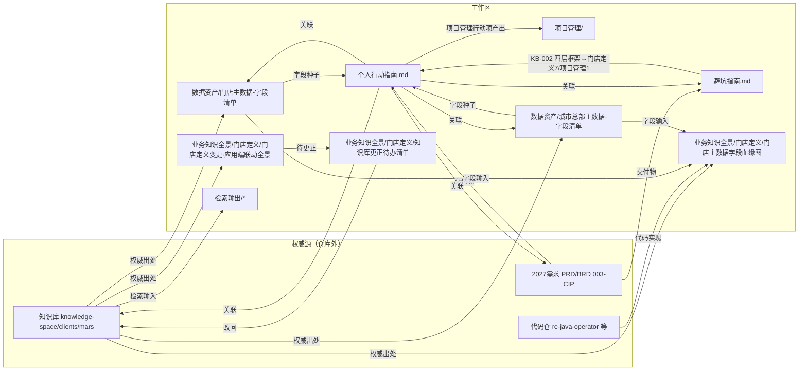

# CLAUDE.md

This file provides guidance to Claude Code (claude.ai/code) when working with code in this repository.

## 这个目录是什么

`D:\CMJWORK\业务知识库` 是一个**工作区外壳 + 个人工作流仓库**（git 远端 `git@github.com:fairycmj000/store_defination_workflow.git`，分支 main）。里面包含：

- **`knowledge-space/`**（独立仓库 `inkstone-lab/knowledge-space`，分支 main）—— **Markdown-first** 组织知识库，同时服务人和 AI（RAG / Agent / Context Engineering），是权威源。
- **其余目录/文件** —— 门店定义个人工作流的在途/产出材料（个人产出物 · 数据资产 · 过程输出），收录在 `store_defination_workflow` 仓。

> **工作区文件关系与入库映射见下方「## 检索地图」节**（任何文件变更须同步维护）；仓库目录与资产性质总表见 `README.md`。

进入 `knowledge-space/` 之前，权威指南按优先级读这几份（都是仓库内文件，**不要**在外壳层再抄一遍）：

1. `knowledge-space/README.md` — 人读入口：三层目录、怎么查、怎么加/改知识。
2. `knowledge-space/CLAUDE.md` — 写作、frontmatter、目录、引用规范。
3. `knowledge-space/AGENTS.md` — 协作约定 + 提交前门禁清单。
4. `knowledge-space/AGENT-ENTRY.md` — Agent 入口（按阶段取资产 + 可执行命令）。
5. `knowledge-space/kb-index.yaml` / `kb-metadata.yaml` — 结构化索引 / 版本元数据。

## 检索地图（工作区文件关系 · 入库映射）

> 用途：记录 `D:\CMJWORK\业务知识库\` 下所有目录/文件的**内容、性质、相互关系与知识库入库映射**，作为「个人产出物 → knowledge-space 公共知识库」的桥。
> 维护约定（**强制**）：任何文件**新增 / 修改 / 移动 / 删除**后，必须同步更新本节——① 目录总览、② 文件关系、③ 入库映射、④ 变更记录（append-only）。改完自查一遍「关系是否还成立」。
> 性质：本节也是**个人产出物 · 暂时非公共资产**，变更随本仓库 git 历史记录。

### 一、目录 / 文件总览（性质 + 用途）

> 「性质」三档：**个人产出物·非公共**（对外共享前评审）/ **数据资产** / **过程输出**。`knowledge-space/`、`代码仓/` 为独立仓库，不在本工作流仓内，仅在此登记其角色。

| 路径 | 性质 | 用途 / 说明 |
|---|---|---|
| `README.md` | 仓库说明 | 本仓库入口：目录 + 资产性质总表 |
| `CLAUDE.md` | 工作区指引 | 含本节检索地图，指向 knowledge-space 权威指南与关键命令 |
| `个人行动指南.md` | 个人产出物·非公共 | 行动清单/路线图（门店定义 9 项 + 项目管理 4 项 + 完美门店） |
| `门店定义知识库探究-避坑指南.md` | 个人产出物·非公共 | 探究踩坑记录 KB-001/002（append-only） |
| `项目管理/` | 个人产出物·非公共 | 项目管理节行动项产出（跟进经验 / 系统升级框架 / 材料目录 / 交接清单，入口 README） |
| `knowledge-space/` | 独立仓库 | 公共知识库权威源（`inkstone-lab/knowledge-space`） |
| `代码仓/` | 独立仓库 ×39 | 后端代码仓（各自独立 .git，取证源） |
| `数据资产/` | 数据资产 | 字段清单 + 原始抽取 |
| `检索输出/` | 过程输出 | 检索/能力测试报告 |
| `业务知识全景/` | 个人产出物·非公共 | 门店定义全局纲领 + `门店定义/` 子目录（字段血缘 / 应用端联动验证输出 + 更正待办桥） |
| `业务中台架构/` | 个人产出物·非公共 | 业务中台资产层次梳理 |
| `自动化工具/` | 个人产出物·非公共 | 门店定义第 8/9 项输出地：`designated-customer-type-join` skill（指定客户类型关联 + 店型清洗去重） |

#### 1.1 数据资产/

| 文件 | 口径基线 | 权威来源（knowledge-space 相对路径） |
|---|---|---|
| `门店主数据-字段清单.md` | 2026 P3 | `data/store_center_data_dictionary.md`、`systems/business-middle-platform/store-center/ontology/object-types/store.md`、`business/rules/store_definition_rules.md` |
| `城市总部主数据-字段清单.md` | 2026 P3 | `.../store-center/ontology/object-types/customer-hq.md`、`.../customer-center/ontology/customer-center-ontology.md`、`business/rules/store_definition_rules.md`、`features/customer-master-data.md`、`features/store-definition-city-hq.md` |
| `store_query1_全量字段.xlsx` + `_xlsx_dump_utf8.txt` | — | `store_query1` 原始抽取（字段清单的原料） |

#### 1.2 检索输出/

| 文件 | 用途 |
|---|---|
| `门店店型定义变更影响评估报告.md` | 门店定义变更影响评估（检索产出） |
| `NKA-RKA-LKA关键客户定义.md` | 关键客户定义（检索产出） |
| `ACT-SPC新渠道需求评估报告.md` | ACT/SPC 新渠道需求评估 |
| `审批流-代审批话题讨论记录.html` | 审批流讨论记录（过程证据） |
| `_xlsx_sheet1.txt` / `_xlsx_sheets.txt` | Excel 抽取 |

#### 1.3 业务知识全景/

| 文件 | 用途 | 权威来源 |
|---|---|---|
| `门店定义·全局纲领.md` | 门店定义**全局纲领/骨架**（按行动项 1–9 搭章，驱动新一代文档重构） | knowledge-space 全量 + `003-CIP\2027需求\`（BRD Excel + 同步会纪要） |
| `门店定义\门店主数据字段血缘图.md`（+`-3D.html`） | 字段血缘**验证输出**（非正式图谱） | `business/rules/store_definition_rules.md`、`.../config-objects/`、`customer-hq.md`、代码 `re-java-operator/mdx/store-channel-calc` |
| `门店定义\门店定义变更·应用端联动改动全景.md` | 2026 变更 → 应用端联动**验证输出** | `proj-cot-2026-application-refresh.md` + 4 端侧 + `openstore-page-registry.md` |
| `门店定义\知识库更正待办清单.md` | **桥**：逐条把分析结论改回 knowledge-space | 多份 knowledge-space 文件（见其表格） |

#### 1.4 业务中台架构/

| 文件 | 用途 |
|---|---|
| `业务中台—asset-hierarchy.md`（+`.html`） | 业务中台资产层次梳理 |
| `系统分层与业务中台统一梳理_summary.md`（+`_transcript.pdf`） | 系统分层与业务中台统一梳理 summary / transcript |

### 二、文件关系（引用 / 关联 / 血缘）

> 箭头 = 「引用 / 依赖」。`知识库 = knowledge-space`，`PRD = D:\CMJWORK\003-CIP\2027需求\PRD\`（+ `BRD\` 渠道/店型定义）。



#### 关键关系清单

1. `个人行动指南.md` → `门店定义知识库探究-避坑指南.md`（避坑经验反哺门店定义第 7 项 / 项目管理第 1 项）
2. `个人行动指南.md` → `数据资产\门店主数据-字段清单.md`、`城市总部主数据-字段清单.md`（门店定义第 2/3 项字段种子）
3. `个人行动指南.md` → `003-CIP\2027需求\PRD\`、`knowledge-space/clients/mars/`（权威源）
4. `数据资产\*.md` ← `knowledge-space`（字段字典/对象/规则语料为权威出处）
5. `业务知识全景\门店定义\门店主数据字段血缘图.md` ← `数据资产\*.md`（字段）+ `knowledge-space` + 代码 `re-java-operator`
6. `业务知识全景\门店定义\门店定义变更·应用端联动改动全景.md` → `业务知识全景\门店定义\知识库更正待办清单.md`（边界结论 → 待办）
7. `业务知识全景\门店定义\知识库更正待办清单.md` → `knowledge-space`（逐条改回，改完 ☐→☑）
8. `检索输出\*.md` ← `knowledge-space`（检索产出；`门店店型定义变更影响评估报告.md` 与门店定义变更主题相关）
9. `业务中台架构\*` ← 业务中台资产梳理（与门店定义主数据/系统分层主题相关，独立成区）
10. `个人行动指南.md` → `项目管理\`（项目管理节行动项 1–4 的产出目录，入口 `README.md`）
11. `个人行动指南.md` → `业务知识全景\门店定义·全局纲领.md`（门店定义行动项 1–9 的纲领骨架，驱动新一代文档重构）

### 三、入库映射（工作区 → knowledge-space）

> 目标路径为**候选**，最终按 knowledge-space 放置规则 / 主题权威定；状态：`不入库`（过程记录）/ `待提炼`（评审后提炼）/ `桥`（更正待办）。

| 工作区资产 | 候选 knowledge-space 目标 | 状态 |
|---|---|---|
| `个人行动指南.md` | 不入库（个人过程记录）；行动项成果另落对应路径 | 不入库 |
| `项目管理\` | 不入库（个人过程记录）；项目管理节行动项 1–4 的产出 | 不入库 |
| `门店定义知识库探究-避坑指南.md` | 待提炼：`capabilities/` 或 `knowledge-governance/`（摄取/影响评估规范） | 待提炼 |
| `数据资产\门店主数据-字段清单.md` | `clients/mars/data/`（字段字典）或 `systems/.../store-center/ontology/` | 待提炼 |
| `数据资产\城市总部主数据-字段清单.md` | `clients/mars/systems/.../customer-center/` 或 `business/entities/actor-model.md` 增补 | 待提炼 |
| `业务知识全景\门店定义·全局纲领.md` | 待提炼：`clients/mars/` 门店定义主题权威 / 总纲（或 `features/` / `projects/`） | 待提炼 |
| `业务知识全景\门店定义\门店主数据字段血缘图.md` | 不入库（验证输出）；结论可补入 `data/` 字段字典「血缘」 | 不入库 |
| `业务知识全景\门店定义\门店定义变更·应用端联动改动全景.md` | 不入库（验证输出）；结论可补入 `features/` | 不入库 |
| `业务知识全景\门店定义\知识库更正待办清单.md` | 桥：改完即失效，逐条落地到具体文件 | 桥 |
| `检索输出\*.md` | 不入库（过程报告）；关键口径可提炼进 `industries/` 或 `clients/mars/business/` | 待提炼 |
| `业务中台架构\*` | 待提炼：`clients/mars/architecture/` 或 `capabilities/` | 待提炼 |
| `自动化工具\designated-customer-type-join` | 工具本身不入库；店型清洗去重口径可提炼进 `clients/mars/data/` 字段字典或 `business/rules/` | 待提炼 |

### 四、变更记录（append-only）

| 日期 | 变更 | 影响的关系 / 说明 |
|---|---|---|
| 2026-10-16 | 初始化本仓库：新增 `README.md`、`.gitignore`；git init + 首次提交推送 origin/main | 确认 5 项个人产出物（`自动化工具\`、`业务知识全景\`、`业务中台架构\`、`个人行动指南.md`、`避坑指南.md`）；排除 `knowledge-space/`、`代码仓/`、`.claude/` |
| 2026-10-16 | 检索地图由独立 `检索地图.md` 移入本 `CLAUDE.md`「检索地图」节 | 关系/入库映射就地维护 |
| 2026-10-16 | `fairycmj000-github-repo-access-2026-10-16.md` 移出仓库（加 `.gitignore`，本地保留） | 该文件为个人生成快照，不入库 |
| 2026-10-20 | `个人行动指南.md` 结构调整：行动清单汇总独立成节、两表新增「行动目的」列、门店定义由 10 项增至 14 项 | 同步本节目录总览（门店定义 10 → 14 项） |
| 2026-10-20 | `个人行动指南.md` 删除行动项 11（review 2027 门店定义 Excel），「项目管理」独立成节（行动项 8/12/13/14 移入） | 同步本节目录总览（门店定义 14 → 9 项 + 项目管理 4 项） |
| 2026-10-20 | `个人行动指南.md` 行动项编号改为「各节独立」：项目管理 1–4、门店定义 1–9，汇总表加节前缀区分 | 同步本节文件关系（行动项编号引用改为节前缀：7/8 → 门店定义7/项目管理1、2/3 → 门店定义2/3、9/10 → 门店定义8/9） |
| 2026-10-20 | 新建 `项目管理\` 目录（README 索引项目管理节行动项 1–4），关联 `个人行动指南.md` 输出路径 | 同步本节目录总览 / 文件关系 / 入库映射 |
| 2026-10-20 | 新建 `项目管理\项目管理经验.md`（2026 系统升级项目管理经验思维导图 + 细节描述） | 参考 `003-CIP\2026年需求\2026系统升级\` 全量资料 |
| 2026-10-20 | `项目管理\项目管理经验.md` 改用 HTML 交付（`项目管理经验.html`：内嵌可点击文件链接的 SVG 思维导图 + 结合 2026 真实文件数据的细节描述），删除独立 `项目管理经验.svg` | 描述细化到具体文件产出（Work Stream A–E / PRD CheckList / 甘特图 / WBS / 报价 v3 / 部署窗口 / UAT 支持清单等真实数据），思维导图节点挂 file:// 文件链接 |
| 2026-10-20 | `项目管理\项目管理经验.html` 重构为「项目管理参考手册」（供新人接手下一年的复用）：描述抽象到「管理工件作用 + 构件方式」（去除个别人名/个事）；Work Stream 表与项目甘特图完整呈现；文件链接改为右侧内嵌预览（不下载，`data-file` 触发）；附录按思维框架（管理流程 / 管理对象含工具）罗列；报价仅显示人天 + 总价；思维导图「管理工具」融合进「管理对象」、「kick off 启动会」展开会议内容 | 同前；`项目管理经验.md` 仍为指向 HTML 的入口说明 |
| 2026-10-20 | `项目管理\项目管理经验.html` 再版：管理工件/工具在思维导图中橙色标出（8 项：进度表/甘特图/WBS/CheckList/变更风险管理表/周报/报价表/工时登记）；文件链接由预览改为**内嵌直接下载**（12 工件 base64 内嵌，不依赖本地路径，分享后仍可下载；xlsx 剔除截图保留全部 Sheet/数据/结构，pptx/docx 原样）；新增「项目甘特图 Excel 原格式还原」（合并单元格/背景色/文字颜色，空行不渲染，182×25）；目录升级三级（管理任务项细化到 h4）；对外/对内任务拆分思维导图分支（SIT 对外/内部、周报/例会、对外/对内交接）；PRD BUG 登记归入质量管理分支；上下架报表清单归入上线申请阶段（SV 报表平台部署申请）；附录合并为一张大宽表（12 文件不重复、流程阶段×对象×作用×构件多维）；移除右侧预览区、内容自适应铺满屏幕 | 同前；`项目管理\README.md`「另见」行同步 |
| 2026-10-20 | `项目管理\项目管理经验.html` 思维导图「管理对象」分支改为「先内容后工件」：每个对象先展开「管理内容」（具体管什么：业务需求/运维需求/需求变更、BA/开发/UAT 安排、开发/测试任务、对外/对内进度、预算/工时、PRD/测试评审），再落到「管理工件 / 工具」（橙色标出，增至 11 项：+组织结构 / PRD BUG 登记 / 测试用例 CheckList） | 同前；lead 段同步 |
| 2026-10-21 | `项目管理\项目管理经验.html` 思维导图「任务项」分支对齐大纲细化：拆为「整体 / 需求分析 / 开发 / 测试 / 上线部署 / Hypercare 运维」六类任务项，每类落到对应工件（项目甘特图 / PRD CheckList+PRD review 会议 / WBS / SIT CheckList+UAT+联调 / 部署计划 / 保障计划）；新增「文档」第 7 个管理对象（创建目录 + 三类归档）；需求范围补「需求基线」工件、成本补「变更项报价」、进度对内补「在线文档」 | 同前；lead 段同步（管理对象 6 → 7）；工件橙色节点增至 15 项 |
| 2026-10-21 | `项目管理\项目管理经验.html` 新增两张原文档完整展示：`PRD CheckList`（42 行 × 19 列）与 `SIT CheckList（对外）`（34 行 × 15 列）按原 Excel 合并单元格/背景色/文字颜色逐格还原，挂入「管理范围 / 管理任务项」节，目录补两个三级入口；`render_sheet()` 通用化（甘特图保持 182×25 不变，PRD/SIT 裁剪尾部空列，进度 xlsx 以 `data_only=True` 读取使 `=ROW()-1` 编号列显示为数字） | 同前；`项目管理\README.md`「另见」行同步 |
| 2026-10-21 | `项目管理\项目管理经验.html` 更正「验收」阶段测试口径：思维导图「验收」节点去掉「SIT（对外）」，改为「SIT（对内）/ UAT（对外）/ 联调」；测试任务项正文与「SIT CheckList（对外）」原文档标题改为「UAT CheckList（对外）」（对外验收测试用例清单，源 Sheet 名「SIT CheckList（对外）」不变）；SIT 只对内 | 同前；节点数 90 → 89 |
| 2026-10-21 | `项目管理\项目管理经验.html`「项目甘特图 · Excel 原格式还原」由独立「④」上移为「① 项目甘特图」下的 h5 子节（紧接①阶段×周全景表之后），任务项目录随之「① → ↳甘特图还原 → ② → ③」 | 同前 |
| 2026-10-21 | `项目管理\项目管理经验.html` 修复 xlsx 内嵌下载：`strip_xlsx_bytes` 增强为同时剔除 `<picture>`（背景/浮图）与 `<drawing>`（图表/形状）两种图片内嵌方式，并兼容自闭合/非自闭合的 `<Relationship>`/`<Override>` 写法，消除剔除截图后残留的悬空 media/drawings 引用（此前 `项目周报` 等 xlsx 下载后 Excel 无法打开） | 同前；`项目周报` 等 xlsx 下载后为可正常打开的有效文件 |
| 2026-10-21 | `项目管理\项目管理经验.html` 附录「关键文件清单」宽表新增「文件内 Sheet（全部）」列，逐文件列出全部 Sheet 名（xlsx；pptx/docx 显示「—」），由 `_sheet_names()`（openpyxl read_only）动态读取 | 同前 |
| 2026-10-21 | `项目管理\项目管理经验.html`「项目甘特图 · Excel 原格式还原」冻结前 5 行表头：`render_sheet()` 增 `freeze_rows` 参数（把前 N 行包进 `<thead>`），甘特图以 `freeze_rows=5` 渲染 + CSS `position:sticky` 让表头随 680px 容器纵向滚动固定（前 5 行表头为无跨行 5/6 边界的干净块，182 行滚动时表头钉顶） | 同前；PRD/SIT 表不受影响（`freeze_rows` 默认 0） |
| 2026-10-21 | `项目管理\项目管理经验.html` 思维导图「管理工件」由「管理内容」的并列兄弟改为**管理内容之下的子分支**（工件节点深一层，橙色工件落到内容之后）；「文档」管理对象「文件归档（三类）」细拆为「业务归档 / 技术归档 / 管理归档」三个子节点；布局常量扩展到 depth 5（`X`/`FONT`/`NODE_H` 加第 5 档） | 同前；节点数 89 → 92；lead 段「再落到管理工件」改为「作为管理内容之下的子分支」 |
| 2026-10-21 | `项目管理\项目管理经验.html`「管理任务项」目录与思维导图对齐：正文由 3 节扩为 6 节（① 整体任务项·项目甘特图 / ② 需求分析任务项·PRD CheckList / ③ 开发任务项·WBS / ④ 测试任务项·SIT/UAT/联调 / ⑤ 上线部署任务项·部署计划 / ⑥ Hypercare 运维任务项·保障计划），导航栏同步 6 个入口；新增②⑤⑥节简述（需求分析任务项、部署计划、保障计划，交叉引用「管理范围」「项目收尾」原文档） | 同前；`任务项` 分支与目录/正文逐类对应 |
| 2026-10-21 | `项目管理\项目管理经验.html` 思维导图「管理工件」定位再修正：不再作为「管理内容」下的独立「管理工件」子分支，而是**逐条接到对应管理内容项之后**（作为其子节点）：PRD 评审→PRD BUG 登记、测试用例评审→测试用例 CheckList、预算基线→报价表、工时→工时登记、对外进度→周报、对内进度→项目进度表、业务需求→需求基线、需求变更→变更风险管理表、团队分工→组织结构、文件归档（三类）→归档目录；「人」补「团队分工」内容项 | 同前；节点数 92 → 87（移除 6 个「管理工件」包裹节点 + 新增「团队分工」）；lead 段改为「每条管理内容之后接其管理工件」 |
| 2026-10-21 | `项目管理\项目管理经验.html` 思维导图删除「归档目录（业务/技术/管理）」节点（「文档」对象现仅保留「创建项目目录」「文件归档（三类）→业务/技术/管理归档」） | 同前；节点数 87 → 86 |
| 2026-10-21 | `项目管理\项目管理经验.html`「① 整体任务项 · 项目甘特图」下方**非原文格式**全景表浓缩：由「阶段 × 周」逐周 23 行（4 列：阶段/周/起止日期/里程碑）改为「阶段」粒度 8 行（3 列：阶段/起止日期/周期，去掉「周」与「关键任务 / 里程碑」两列）；「周期」按 5 天一周由工作日折算为周数（P11 2 周 / P12 4 周 / P13 4 周 / SIT 4 周 / UAT 3 周 / 春节 1.2 周 / Hypercare 3.8 周 / 收尾 1 周） | 同前；`Excel 原格式还原` 表（182×25 全量周级明细）保持不变 |
| 2026-10-21 | `项目管理\项目管理经验.html` 思维导图整合：删除顶层「管理对象」分支，把 7 类管理对象融合进「管理流程」各阶段（启动→人/成本/文档；分析→需求范围/人/任务项；构建→任务项/人/质量；验收→任务项/人/质量；上线→任务项/需求范围/文档），对象下是管理内容、最后落到管理工件（橙色）；跨阶段工件（项目甘特图/周报/项目进度表/变更风险管理表/工时登记）统一收进新增「贯穿全程」节点（与 5 阶段并列）；原流程节点（kick off 启动会/IR 模型训练/上下架报表清单/对外·对内交接/待业务提供清单）保留为阶段子节点；lead 段同步 + 新增「声明 · 全文范围」（侧重全盘了解，不含各任务项规范与行为准则，待后续细化） | 同前；节点数 86 → 92（对象名按阶段重复展开）；`项目管理\README.md`「另见」行同步 |
| 2026-10-21 | `项目管理\项目管理经验.html` 思维导图根节点标题由「2026 COT 系统升级项目管理经验」改为「项目管理」，并删除硬编码的副标题行「项目管理经验」（原根节点第二行），根节点收敛为单行标题 | 同前；文本节点 92（不再因根标题换行多出 1 行） |
| 2026-10-21 | `项目管理\项目管理经验.html` 思维导图「成本」对象整体移入「贯穿全程」：删除「启动」下的成本对象节点（预算基线/报价表），并入「贯穿全程」的成本节点（现为 预算基线→报价表 + 工时→工时登记），体现成本管理贯穿全程 | 同前；节点数 92 → 91；「启动」保留「确认成本」流程节点（非对象） |
| 2026-10-21 | `项目管理\项目管理经验.html` 思维导图删除「项目阶段」中间节点（此前由「管理流程」改名而来）：6 个阶段节点（启动 / 分析 / 构建 / 验收 / 上线 / 贯穿全程）直接接入「项目管理」根节点，各标 `branch="流程"` 保持蓝色；根节点之下不再有「项目阶段 / 管理流程」包裹层 | 同前；节点数 91 → 90；lead 段「以项目阶段为主线」语义不变；`项目管理\README.md`「另见」行同步 |
| 2026-10-21 | `项目管理\项目管理经验.html` 思维导图「启动」节点新增「任务项」对象节点（作为启动首个子节点），其下 3 个子节点：确认PM / 确认项目范围 / 动员成员 | 同前；节点数 90 → 94（+任务项 +3 子节点）；「启动」原有流程节点「确立 PM / 动员成员」及 kick off 内「确认项目范围」暂保留（与任务项子节点存在同名/近义重复，待确认是否合并） |
| 2026-10-21 | `项目管理\项目管理经验.html` 思维导图「启动」重复节点合并：删除原流程节点「确立 PM」「动员成员」与 kick off 启动会内「确认项目范围」（三者已并入「任务项」子节点：确认PM / 确认项目范围 / 动员成员）；kick off 启动会子节点收敛为「明确团队分工 / 上线时间与 SOP」 | 同前；节点数 94 → 91（-确立 PM -动员成员 -确认项目范围）；「确认PM」「动员成员」「确认项目范围」在启动下各仅出现一次 |
| 2026-10-21 | `项目管理\项目管理经验.html` 思维导图「启动」节点删除「确认成本」流程节点（成本管理已统一收在「贯穿全程」的「成本」对象下） | 同前；节点数 91 → 90；「启动」现为 任务项 / kick off 启动会 / 人 / 文档 |
| 2026-10-21 | `项目管理\项目管理经验.html` 思维导图「启动」调整顺序：kick off 启动会保持在「任务项」之后；「动员成员」从「任务项」子节点上移为「启动」的直接子节点（与 kick off 启动会同级、置于其下方） | 同前；节点数不变 90；「任务项」现仅 确认PM / 确认项目范围；「启动」为 任务项 → kick off 启动会 → 动员成员 → 人 → 文档 |
| 2026-10-21 | `项目管理\项目管理经验.html` 思维导图层级倒置重构：由「阶段 → 对象」改为「管理对象 → 项目阶段 → 管理内容 → 管理工件」，顶层 8 分支 = 「流程（阶段活动）」（单独保留流程维度，容纳 kick off / BRD / SIT / UAT / 联调 / 上线申请 / 交接 等阶段活动）+ 7 个管理对象（需求范围 / 人 / 任务项 / 进度 / 成本 / 质量 / 文档）；阶段节点在对象下按需重复展开（阶段标「流程」蓝、内容标「对象」绿） | 同前；节点数 90 → 97；正文（一/二/三 节）仍按阶段组织，不动；lead 段、声明、图例同步改为「对象 × 阶段 × 内容 × 工件」 |
| 2026-10-21 | `项目管理\项目管理经验.html` 新增「项目收尾」阶段（挂「流程（阶段活动）」分支，位于「上线」之后），其下「项目总结&复盘」活动节点 | 同前；节点数 97 → 99；「流程（阶段活动）」现为 启动 / 分析 / 构建 / 验收 / 上线 / 项目收尾 6 阶段 |
| 2026-10-21 | `项目管理\项目管理经验.html` lead 段（参考手册说明）与「声明 · 全文范围」上移到「思维导图」标题之上（新增 `__INTRO__` 占位，`D` 拆为 `INTRO`(D[:2]) + `DESC`(D[2:])） | 同前；页面顺序变为 header → 说明/声明 → 思维导图 → 图例 → 细节描述 |
| 2026-10-21 | `项目管理\项目管理经验.html`「Hypercare 运维任务项」+ 工件「保障计划（值守/监控/汇报）」由 任务项→上线 移入 质量 对象下新增「质保」阶段（质量现为 构建/验收/质保 三阶段） | 同前；节点数 99 → 100；lead 段阶段序列补「→ 质保」 |
| 2026-10-21 | `项目管理\项目管理经验.html`「运维需求」由 需求范围→上线 上移到 需求范围→分析（置于「业务需求」之后）；需求范围「上线」阶段因无子节点删除 | 同前；节点数 100 → 99 |
| 2026-10-21 | `项目管理\项目管理经验.html` 需求范围→分析 删除中间节点「业务需求（5大 Work Stream）」，工件「需求基线（BRD→Work Stream→PRD CheckList）」直接挂到「分析」阶段节点之后 | 同前；节点数 99 → 98 |
| 2026-10-21 | `项目管理\项目管理经验.html` 新增第 4 类颜色「活动」（紫 `#7030A0`）：`BRANCH` 增「活动」项，全部「阶段活动」节点（kick off/BRD sign-off/SIT/UAT/联调/上线申请/交接/项目总结&复盘 等）由蓝改紫；图例由 3 项扩为 4 项（项目阶段 / 活动 / 管理对象·管理内容 / 管理工件），`:root` 增 `--purple` | 同前；节点数不变 98 |
| 2026-10-21 | `项目管理\项目管理经验.html`「流程（阶段活动）」分支整体并入「任务项」对象：其 6 阶段活动节点按阶段挂到 任务项 各任务项节点之后（紫色「活动」），新增「项目收尾」阶段（项目总结&复盘）挂入 任务项；顶层由 8 分支收敛为 7 个管理对象；lead 段「单独归入流程（阶段活动）分支」改为「整合进任务项对应阶段（紫色标出）」，阶段序列补「→ 项目收尾」 | 同前；节点数 98 → 92；`项目管理\README.md`「另见」行同步 |
| 2026-10-21 | `项目管理\项目管理经验.html` 任务项各阶段「活动 / 工件」再分类 + 去重：活动（无工件输出，紫色、去链接）与工件（有既有工件链接，橙色）作为任务项节点的同级子节点并行；任务项→分析 收敛为 需求分析任务项 → [PRD CheckList（工件）/ 待业务确认清单（工件）/ PRD review 会议（活动）]，删除重复「PRD CheckList」及「BRD sign-off」「Work Stream 拆分」；上线 删除重复「部署计划」，「上下架报表清单」由活动改工件；kick off 启动会子项（明确团队分工/上线时间与 SOP）、SIT/UAT/联调、上线申请、Hypercare 保障、交接、项目总结&复盘 等全部去链接改为纯「活动」节点 | 同前；节点数 92 → 88；`项目管理\README.md`「另见」行同步 |
| 2026-10-21 | `项目管理\项目管理经验.html`「活动」定义收敛为「会议组织 / 评审会议」并全图统一：任务项→启动「kick off 启动会」改「kick off 会议组织」、分析「PRD review 会议」扩「PRD review 会议组织（内部/外部）」、验收新增「测试用例 review 会议组织（内部/外部）」，其余原「活动」（动员成员/明确团队分工/上线时间与 SOP/PRD 编写与评审/WBS 开发/IR 模型训练/SIT（对内）/UAT（对外）/联调/上线申请/Hypercare 保障/对外·对内交接 等）全部降为任务项（对象）；进度→对外进度 新增「例会」（活动，与「周报」工件同级）；项目收尾「项目总结&复盘」恢复为活动并挂两工件「运维问题清单」「贡献度评定文档」（新增内嵌第 13 号文件 贡献度评定与奖金发放参考标准报告.docx）；质量对象新增「开发」阶段挂「技术方案评审」（活动），「PRD 评审」「测试用例评审」由对象改活动，「测试用例评审」工件由「测试用例 CheckList」改「测试报告」（无链接）；活动叶子节点样式与容器节点统一（tint 底 + 深紫字）；人→启动「团队分工」改「识别干系人」、人→验收「UAT 支持人员」改「UAT 支持人员安排」 | 同前；节点数 88 → 98；内嵌文件 12 → 13；lead 段（阶段增「开发」、活动定义重写）与 `项目管理\README.md`「另见」行同步 |
| 2026-10-21 | `项目管理\项目管理经验.html` 任务项→验收→测试任务项 拆分多一级为 SIT / UAT / 联调 三个对象节点：SIT → [SIT 测试用例 & issue log（工件）/ 内部测试用例 review 会议组织（活动）]、UAT → [UAT 测试用例 & issue log（工件）/ 外部测试用例 review 会议组织（活动）]、联调 → [接口文档（工件）/ 联调沟通会议（活动）]；删除原「SIT CheckList / UAT 任务项 / 联调任务项 / SIT（对内）/ UAT（对外）/ 联调 / 测试用例 review 会议组织（内部/外部）」节点；新增内嵌第 14 号文件「产品中心接口整理.docx」（联调接口文档） | 同前；节点数 98 → 98（不变）；内嵌文件 13 → 14；lead 段活动定义（测试用例 review 会议组织拆分内/外 + 新增联调沟通会议）、正文④测试任务项、附录增「产品中心接口整理」行、`项目管理\README.md`「另见」行同步 |
| 2026-10-21 | `项目管理\项目管理经验.html` 需求范围→分析「运维需求」取消链接（运维问题清单工件仅挂在 任务项→项目收尾→项目总结&复盘 之下，不再重复挂到「运维需求」节点） | 同前；节点数 98 不变；内嵌文件 14 不变 |
| 2026-10-21 | `项目管理\项目管理经验.html` 任务项→验收→测试任务项→SIT 下新增工件「测试用例 check list」（link tccl，挂在「SIT 测试用例 & issue log」之后） | 同前；节点数 98 → 99；内嵌文件 14 不变 |
| 2026-10-21 | `项目管理\项目管理经验.html` 移除 任务项→构建→开发任务项 下的「PRD 编写与评审」节点（PRD 编写/评审已由 分析→需求分析任务项 与 质量→构建→PRD 评审 覆盖，不重复挂到开发任务项） | 同前；节点数 99 → 98；内嵌文件 14 不变 |
| 2026-10-21 | `项目管理\项目管理经验.html`「PRD review 会议组织」（含内部/外部）由 任务项→分析→需求分析任务项 移动到 质量 对象下新增「分析」阶段（置于「构建」之前） | 同前；节点数 98 → 99（质量新增「分析」阶段节点）；内嵌文件 14 不变 |
| 2026-10-21 | `项目管理\项目管理经验.html`「内部测试用例 review 会议组织」「外部测试用例 review 会议组织」由 任务项→验收→测试任务项→SIT/UAT 移动到 质量→验收（置于「测试用例评审」之后） | 同前；节点数 99 → 99（不变）；内嵌文件 14 不变 |
| 2026-10-21 | `项目管理\项目管理经验.html`「对外交接」「对内交接」由 任务项→上线 移动到 任务项→项目收尾 新增「运维交接」活动节点之下（置于「项目总结&复盘」之前） | 同前；节点数 99 → 100（新增「运维交接」节点）；内嵌文件 14 不变；lead 段活动定义补「运维交接」、`项目管理\README.md`「另见」行同步 |
| 2026-10-21 | `项目管理\项目管理经验.html` 上线部署任务项 子节点顺序调整：「上下架报表清单」移到「上线申请」之后（部署计划 → 上线申请 → 上下架报表清单） | 同前；节点数 100 不变；内嵌文件 14 不变 |
| 2026-10-21 | `项目管理\项目管理经验.html` 八项调整：①删除 验收→测试任务项→联调 下【接口文档】；②③人→验收 新增【SIT人员安排】【hypercare人员安排】；④删除 开发任务项 下【WBS 开发】【IR 模型训练】；⑤新增图例类别「项目交付物」（金色 #BF8F00），将 接口文档（技术归档）、PRD文档/测试用例/测试报告/issue log（业务归档）标记为交付物并落位到 文档→上线→文件归档（三类）子节点下（接口文档/测试报告为迁移、其余新增）；⑥人→启动→识别干系人 工件【组织结构】替换为【kick off 整体计划】（Mars kick off pptx，复用既有 kickoff 内嵌件）；⑦需求范围→分析 新增【业务需求】子节点（与【运维需求】同级），BRD 工件【需求基线】迁至其下；⑧任务项→贯穿全程 移至 任务项 子节点最上方 | 同前；节点数 100 → 104（净 +4：新增 业务需求/SIT人员安排/hypercare人员安排/PRD文档/测试用例/issue log 6 节点，删除 WBS 开发/IR 模型训练 2 节点，迁移 接口文档/测试报告/需求基线 3 节点）；内嵌文件 14 不变；`项目管理\README.md`「另见」行同步 |
| 2026-10-21 | `项目管理\项目管理经验.html` 任务项→构建→开发任务项→WBS 连线调直：WBS（按 Work Stream）为「开发任务项」唯一子节点，将其下移与父节点垂直居中对齐（rect y 690→724，中心 703→737），连接线由斜向 S 曲线改为水平直线 | 同前；节点数 104 不变；内嵌文件 14 不变 |
| 2026-10-21 | `项目管理\项目管理经验.html` 任务项→项目收尾：原「运维交接」活动节点改名「运维交接任务项」（对象，绿色），其后新增「运维交接会议」活动节点（紫色），「对内交接」「对外交接」两个叶子移到「运维交接会议」之后；「项目总结&复盘」活动之后新增工件「项目总结&复盘文档」（橙色、无链接，源目录暂无该文件）；SVG 高度 1950→1984（底部节点整体下移 34），lead 段活动定义「运维交接」改「运维交接会议」 | 同前；节点数 104 → 106（+运维交接会议 +项目总结&复盘文档）；内嵌文件 14 不变 |
| 2026-10-21 | `项目管理\项目管理经验.html` 任务项→验收→测试任务项→联调「联调沟通会议」连接线调直（与父节点「联调」垂直居中对齐为水平直线） | 同前；节点数 106 不变；内嵌文件 14 不变 |
| 2026-10-21 | `项目管理\项目管理经验.html` 人→构建「开发人员安排」改名「开发人员时间安排」并链接进度 xlsx Sheet【开发人员时间安排】；人→分析「BA时间安排」改名「BA人员时间安排」并链接 Sheet【BA人员时间安排】；人→验收「SIT人员安排」改名「SIT人员时间安排」并链接 Sheet【BA人员时间安排】（与 BA 共用同一 Sheet 统筹管理）；新增内嵌第 15/16 号文件（进度 xlsx 抽取的 BA/开发人员时间安排单 Sheet） | 同前；节点数 106 不变；内嵌文件 14 → 16 |
| 2026-10-21 | `项目管理\项目管理经验.html` 任务项→验收→测试任务项→SIT/UAT：「SIT 测试用例 & issue log」改名「SIT issue log」、「UAT 测试用例 & issue log」改名「UAT issue log」（节点 + 正文④测试任务项） | 同前；节点数 106 不变；内嵌文件 16 不变 |
| 2026-10-21 | `项目管理\项目管理经验.html` 需求范围→分析「业务需求」「运维需求」两节点样式由叶子样式改为容器样式（与「需求变更」一致：绿底 #E2EFDA、绿边 #538135、深绿字 #375623、font 12） | 同前；节点数 106 不变；内嵌文件 16 不变 |
| 2026-10-21 | `项目管理\项目管理经验.html` 人→启动「识别干系人」节点样式改为叶子样式（与「BA人员时间安排」一致：白底、绿边、绿字 #538135、font 11） | 同前；节点数 106 不变；内嵌文件 16 不变 |
| 2026-10-21 | `项目管理\项目管理经验.html` 文档→上线→文件归档（三类）→业务归档 下的「issue log」交付物节点改名「UAT issue log」（width 76→98，text 居中 x 1568→1579，与 SIT/UAT issue log 同宽） | 同前；节点数 106 不变；内嵌文件 16 不变 |
| 2026-10-21 | `项目管理\项目管理经验.html` 文档→上线→文件归档（三类）→业务归档 下的「测试报告」交付物节点改名「SIT 测试报告」（width 76→98，text 居中 x 1568→1579，与 SIT/UAT issue log 同宽） | 同前；节点数 106 不变；内嵌文件 16 不变 |
| 2026-10-21 | `项目管理\项目管理经验.html` 文档→上线→文件归档（三类）→业务归档 下的「测试用例」交付物节点改名「SIT测试用例」（width 76→98，text 居中 x 1568→1579，与 SIT/UAT issue log 同宽） | 同前；节点数 106 不变；内嵌文件 16 不变 |
| 2026-10-21 | `项目管理\项目管理经验.html` 任务项→上线部署任务项 下「上下架报表清单」改名「SV平台上下架报表清单」（width 109→145，text 居中 x 1284.5→1302.5；节点本就在「上线申请」之后，位置不动）；导航栏与 h4 标题同步 | 同前；节点数 106 不变；内嵌文件 16 不变 |
| 2026-10-21 | `项目管理\项目管理经验.html` 任务项→项目收尾→运维交接任务项 下「对外交接」「对内交接」两叶子改名「对外交接会议」「对内交接会议」并改紫色活动样式（fill #E9DEF5 / 边 #7030A0 / 字 #4A2170、font 12、width 76→98、text x 1268→1279）；两条连接线由绿 #538135 改紫 #7030A0；lead 段活动列表补「对外交接会议 / 对内交接会议」 | 同前；节点数 106 不变；内嵌文件 16 不变 |
| 2026-10-21 | `项目管理\项目管理经验.html` 任务项→上线部署任务项 下「上线申请」叶子节点改名「服务部署清单」（width 76→98，text 居中 x 1268→1279，样式保持叶子） | 同前；节点数 106 不变；内嵌文件 16 不变 |
| 2026-10-21 | `项目管理\项目管理经验.html` 任务项→项目收尾→运维交接任务项 删除「运维交接会议」节点；「对外交接会议」「对内交接会议」两节点重新垂直居中于父节点（±17：中心 1110/1144 → 1093/1127），对应连接线同步调整；lead 段活动列表移除「运维交接会议」 | 同前；节点数 106 → 105；内嵌文件 16 不变 |
| 2026-10-21 | `项目管理\项目管理经验.html` 任务项→项目收尾 修正遮挡：「对外交接会议」重居中至 1093 后与「保障计划」（质量→质保，中心 1077）同处 x=1230 且仅距 16px 遮挡，故「对外交接会议」「对内交接会议」回落至中心 1110/1144（对外对齐父节点、对内下移 34），连接线同步回落 | 同前；节点数 105 不变；内嵌文件 16 不变 |
| 2026-10-21 | `项目管理\项目管理经验.html` 任务项→项目收尾「项目总结&复盘」节点由紫色活动改为绿色容器样式（fill #E2EFDA / 边 #538135 / 字 #375623，与「运维交接任务项」一致），连接线由紫改绿；lead 段活动列表移除「项目总结&复盘」 | 同前；节点数 105 不变；内嵌文件 16 不变 |
| 2026-10-21 | `项目管理\项目管理经验.html` 任务项→验收→测试任务项→SIT 下「测试用例 check list」工件上移到「SIT issue log」上方（中心 839→805、SIT issue log 805→839），文本去空格改「测试用例check list」（width 146.2→144、text x 1603.1→1602）；两条连接线均橙色位置不变 | 同前；节点数 105 不变；内嵌文件 16 不变 |
| 2026-10-21 | `项目管理\项目管理经验.html` 任务项→上线部署任务项「服务部署清单」由叶子改为橙色工件样式（fill #FCE4D6 / 边 #C55A11 / 字 #833C0B、font 12 bold），连接线由绿改橙 | 同前；节点数 105 不变；内嵌文件 16 不变 |
| 2026-10-21 | `项目管理\项目管理经验.html` 全局换色：原「白底绿边」叶子节点（识别干系人 / BA·开发·SIT·UAT·hypercare 人员安排 / 确认PM / 确认项目范围 / 明确团队分工 / 上线时间与SOP / 动员成员 / 创建项目目录 / 业务·技术·管理归档，共 15 个）统一改青色（fill #D6EEEA / 边 #2C7A7B / 字 #285E61），对应 15 条连接线由绿 #538135 改青 #2C7A7B；图例新增「个人行动项」（青 #2C7A7B） | 同前；节点数 105 不变；内嵌文件 16 不变 |
| 2026-10-21 | `项目管理\项目管理经验.html` 文档→上线→文件归档（三类）→技术归档 新增两个工件节点「服务架构图」「网络拓扑图」（橙色、无链接，置于「接口文档」之后）；SVG 高度 1984→2020（底部下延 36） | 同前；节点数 105 → 107；内嵌文件 16 不变 |
| 2026-10-21 | `项目管理\项目管理经验.html` 文档 对象「启动」节点与「创建项目目录」子节点下移 52（中心 1698→1750），「启动」与「上线」间距 190→138；两条连接线（文档→启动、启动→创建项目目录）端点同步下移 | 同前；节点数 107 不变；内嵌文件 16 不变 |
| 2026-10-21 | `项目管理\项目管理经验.html` 图例按最新框架重写并移到思维导图标题之下（居中）：顺序 管理对象/管理内容（绿）→ 项目阶段（蓝）→ 工件（橙）→ 活动组织（紫）→ 个人行动项（青）→ 项目交付物（金）；「活动」→「活动组织」、「管理工件」→「工件」；lead 段与「声明·全文范围」同步为「管理方式 = 工件（橙）/ 活动组织（紫）/ 个人行动项（青）」，移除 lead 段活动逐条枚举 | 同前；节点数 107 不变；内嵌文件 16 不变 |
| 2026-10-21 | `项目管理\项目管理经验.html` 「个人行动项」颜色由青改玫红（fill #D6EEEA→#FCE4EC、边/连接线 #2C7A7B→#C2185B、字 #285E61→#880E4F，覆盖 15 节点 + 15 连接线 + 图例圆点）；lead 段「个人行动项（青）」改「（玫红）」 | 同前；节点数 107 不变；内嵌文件 16 不变 |
| 2026-10-21 | `项目管理\项目管理经验.html` 文档→上线→文件归档→技术归档 新增工件「服务架构图」「网络拓扑图」由橙色改为金色交付物（fill #FCE4D6→#FFF2CC、边 #C55A11→#BF8F00、字 #833C0B→#7F6000、连接线 #C55A11→#BF8F00，与「接口文档」一致） | 同前；节点数 107 不变；内嵌文件 16 不变 |
| 2026-10-21 | `项目管理\项目管理经验.html` 二章「项目管理」按最新思维导图重构为 7 个管理对象节（1 需求范围 / 2 人 / 3 任务项 / 4 进度 / 5 成本 / 6 质量 / 7 文档），原「3. 全阶段管理」拆分为人/成本/进度/质量/文档 5 节并顺位编号；导航目录同步重排；正文内容同步：人节补「SIT 人员时间安排（与 BA 共用 Sheet）」「hypercare 人员安排」、质量节补「PRD review 会议组织」「技术方案评审」及内/外测试用例 review 会议组织迭代 | 同前；节点数 107 不变；内嵌文件 16 不变 |
| 2026-10-21 | `项目管理\项目管理经验.html` 思维导图新增节点折叠/展开：JS 由 path 起止点重建父子树，容器节点右侧加 −/＋ 徽标点击折叠/展开其子分支（连带隐藏子节点与其入边，嵌套折叠状态保留）；无下载链接的容器节点点击节点本身亦可折叠（带 data-file 的节点点击仍下载）；图例下方新增「全部展开 / 全部折叠」按钮；标题与图例提示语同步说明 | 同前；节点数 107 不变；内嵌文件 16 不变 |
| 2026-10-21 | `项目管理\项目管理经验.html` 修复折叠 bug + 移除按钮：折叠状态集合由普通对象改用 `Set`（原以节点对象作键会被字符串化为同一 `[object Object]`，导致点击任一节点即折叠全部）；移除「全部展开 / 全部折叠」按钮及对应 expandAll/collapseAll JS，折叠仅靠节点右侧 −/＋ 徽标与点击节点本身 | 同前；节点数 107 不变；内嵌文件 16 不变 |
| 2026-10-21 | `项目管理\项目管理经验.html` 二章「经验要点」逐节点补全：在 7 个管理对象（需求范围 / 人 / 任务项 / 进度 / 成本 / 质量 / 文档）关键工件后新增 `<div class="tip">经验要点：…</div>`，结合思维导图节点与链接文档内容提炼（BRD 影响面一次性点全、欠项显性化、人员时间占用防过载、任务编号即进度单元、超前 UAT 挡板、对外/对内双通道、报价逐版收敛、质量四道门禁、三分类归档交付物索引）；三章「上线部署」补 1 条部署窗口经验 | 同前；节点数 107 不变；内嵌文件 16 不变 |
| 2026-10-21 | `项目管理\项目管理经验.html` 思维导图删除 质量→验收 下「测试用例评审」活动节点及其入边（保留「内部/外部测试用例 review 会议组织」两活动节点） | 同前；节点数 107 → 106；内嵌文件 16 不变 |
| 2026-10-21 | `项目管理\项目管理经验.html` 思维导图折叠/展开布局自适应：JS 新增 tidy-tree 纵向重排——每次折叠/展开后按「可见子树高度」重算各节点 y（横向列 x 固定不动）、重画入边（水平 S 曲线，控制点取父子 x 中点），并同步收缩/扩张 SVG height 与 viewBox；节点对象补记 w/h，子节点按原始 y 排序保证重排后自上而下顺序稳定 | 同前；节点数 106 不变；内嵌文件 16 不变 |
| 2026-10-21 | 新建 `项目管理\项目管理经验-2026-10-21.html`（`项目管理经验.html` 的日期后缀副本，内容同当前版：思维导图 + 经验要点 + 16 内嵌文件） | 同前；副本与原件并行，后续改版继续在 `项目管理经验.html` 上进行 |
| 2026-10-22 | 新建 `项目管理\项目管理经验-讲解步骤.md`（内部同步会讲解提词卡：45–60 分钟、以 7 个管理对象为主线，含讲前准备 / 流程总表 / 分步详解 ①–⑪ / Q&A，13 条经验要点逐条标注行号） | 不入库（个人过程输出）；与 `项目管理经验.html` 配合使用 |
| 2026-10-22 | `项目管理\项目管理经验-讲解步骤.md` 补「讲解目的」节（一句话目的 + 三个目标：对齐认知 / 可复用交接 / 避坑沉淀），并在 ① 开场首句引用 | 同前 |
| 2026-10-22 | `项目管理\项目管理经验-讲解步骤.md` 讲解目的收敛为高层框架口径：删「避坑沉淀」目标（改两个目标：对齐认知 / 可复用交接），一句话目的去「少踩坑」；① 开场补「基调」条（13 条经验要点只作一句话收口、点到为止，不展开踩坑细节） | 同前 |
| 2026-10-22 | `项目管理\项目管理经验-讲解步骤.md` 演示点去 2026 具体数字、转高层口径：③ BRD「18 份附录/7 系统」→「影响面如何点全」、PRD CheckList 去「42×19」留列结构；⑤ 甘特图去「182×25」、部署计划「21 Sheet」→「分区结构」；⑦ 报价去「5 Sheet」与人天分项数值；⑧ 测试用例去「3 Sheet」；⑩ 三章去「两个 2026 窗口 / 下架 2023 上架 2026」、收尾 tip 去「21 张 Sheet」、附录括号简化为「均已内嵌可直接下载」 | 同前 |
| 2026-10-22 | `项目管理\项目管理经验.html` 思维导图「构建」统一改「开发」：lead 段阶段序列、人/任务项/质量对象下「构建」阶段节点改名「开发」；质量对象原「构建」（挂 PRD 评审）与原「开发」（挂技术方案评审）两阶段合并为单一「开发」阶段（含 PRD 评审 + 技术方案评审两子节点），删除重复「开发」节点及其入边、重接两条子边 | 同前；节点数 104 → 103；内嵌文件 16 不变 |
| 2026-10-22 | `项目管理\项目管理经验.html` 思维导图「Hypercare 保障」由「上线」阶段下的管理内容节点提升为独立「Hypercare」项目阶段（置于「上线」之后、「项目收尾」之前）：新增蓝色阶段节点「Hypercare」（x=630），原「Hypercare 保障」改名「保障」作其内容子节点、「保障计划」工件不变；重接 任务项→Hypercare（蓝）/ Hypercare→保障（绿）两条边、改 保障→保障计划 起点；`项目管理经验-讲解步骤.md` ② 阶段序列同步（去「构建」、补 Hypercare） | 同前；节点数 103 → 104；内嵌文件 16 不变 |
| 2026-10-22 | `项目管理\项目管理经验.html` 左侧导航栏新增折叠/展开：JS 给带子项的 `<li>` 加 `has-sub` + caret 角标（▾），点击 caret 切换 `.collapsed` 折叠/展开子项（旋转 -90° 变 ▸、`.collapsed > ul` 隐藏）；CSS 增 caret 样式与命中区、移动端 media query 隐藏 caret | 同前；节点数 104 不变；内嵌文件 16 不变 |
| 2026-10-22 | `项目管理\项目管理经验.html` 左侧目录区域支持整块折叠：`.side-title` 改为 `.side-head`（flex：标题 + «/» 折叠按钮 `#sideToggle`）；点击按钮切换 `body.side-collapsed`，侧栏由 292px 收起为 40px 竖条（标题与 `ul` 隐藏、按钮居中显示「»」），`nav.side` 增 `transition:width .2s` 平滑过渡；移动端隐藏折叠按钮 | 同前；节点数 104 不变；内嵌文件 16 不变 |
| 2026-10-22 | 新建 `项目管理\项目管理经验同步-演讲PPT.pptx`（内部同步会演讲 PPT，python-pptx 生成，配色对齐 HTML 图例 6 色） | 不入库（个人过程输出）；配合 `项目管理经验.html` 与 `项目管理经验-讲解步骤.md` 使用 |
| 2026-10-22 | `项目管理\项目管理经验同步-演讲PPT.pptx` 由 15 页精简为 5 页：① 封面 & 讲解目的（对齐认知 / 可复用交接 / 基调）② 全景框架（7 对象 + 四维度 + 阶段链含 Hypercare + 六类图例 + 贯穿全程）③ 对象 1–4 ④ 对象 5–7 + 项目收尾 ⑤ 收口 & Q&A（回答口径 / 带走什么）；每对象一「骨架 + 一句经验」收口 | 同前 |
| 2026-10-22 | `项目管理\项目管理经验同步-演讲PPT.pptx` 文本精炼美化：封面/骨架/经验/收口全部收敛为短句（如「影响面一次点全 · 变更走流程」「编号即进度 · 先挡超前测试」），对象块由「左窄徽标 + 右双行」改「左色条 + 白底卡片」卡片式，封面与收口加大留白、副标题去「一句话」长句（仍 5 页） | 同前 |
| 2026-10-22 | `项目管理\项目管理经验.html` header meta 收敛：删除「参考源：`D:\CMJWORK\003-CIP\…`（下文路径均相对该目录）· 关联：`个人行动指南.md`「项目管理」节（行动项 1–4）」两行，仅保留「用途」一行 | 同前；对外共享版本不再暴露源目录路径与个人行动指南关联 |
| 2026-10-22 | `项目管理\项目管理经验.html` 清除报价文件链接（敏感报价不外发）：思维导图「预算基线（报价）」「报价表（high level/终版/变更项）」两节点去掉 `data-file="quote"` 下载包裹与 `<title>`（改为普通节点）；正文启动表「确认项目成本」与「5. 成本·工时」处 `报价 v3` 链接改纯文本；附录「关键文件清单」删除报价 v3 行；JS `FILES_DATA` 删除 `quote` 条目（内嵌 base64 一并移除） | 同前；节点数 104 不变；内嵌文件 16 → 15 |
| 2026-10-22 | `项目管理\项目管理经验.html` 思维导图「报价表（high level/终版/变更项）」改名「报价表（参考飞书在线成本评估文档）」并改为飞书外链（`<a href>` 指向飞书在线成本评估文档、`target="_blank"` 新标签打开，完整 URL 写入 `<title>` 悬停提示），替代已删除的报价 xlsx 下载 | 同前；节点数 104 不变；内嵌文件 15 不变 |
| 2026-10-22 | `项目管理\项目管理经验.html` 清除贡献度评定文档链接：思维导图「贡献度评定文档」节点去掉 `data-file="eval"` 下载包裹与 `<title>`（改为普通节点）；附录「关键文件清单」删除该行；JS `FILES_DATA` 删除 `eval` 条目（内嵌 base64 一并移除） | 同前；节点数 104 不变；内嵌文件 15 → 14 |
| 2026-10-22 | `项目管理\项目管理经验.html` 成本节移除具体金额：删除「2026 实例」价格表（人天/合计税前 分项数值），正文仅保留「作用（锁定预算基线）+ 构件方式（按分项登记人天与总价，报价三层收敛：high level → 终版 → 变更项）」口径描述 | 同前；敏感金额不外发 |
| 2026-10-22 | `项目管理\项目管理经验.html` 附录「文件内 Sheet（全部）」不再列空 Sheet：UAT 行剔除空的「Issue Summary」，测试用例 check list 行由「Sheet1/Sheet2/Sheet3」收敛为「Sheet1」（Sheet2/Sheet3 为空） | 同前 |
| 2026-10-22 | `项目管理\项目管理经验.html` 移除思维导图图例后的「点击节点 / 文件名下载文件 · 节点右侧 −/＋ 可折叠 / 展开分支」提示行（标题已含同样内容，避免重复） | 同前 |
| 2026-10-22 | `项目管理\项目管理经验.html` header 删除「用途：作为管理经验参考手册，供新人接手下一年同类项目时复用」meta 行（此前保留的最后一 header meta） | 同前；header 现仅剩 `<h1>` 标题 |
| 2026-10-22 | `项目管理\项目管理经验.html` 标题居中：`header.top h1` 增 `text-align:center`（header 仅剩标题，居中更醒目） | 同前 |
| 2026-10-22 | `项目管理\项目管理经验.html` 思维导图标题「（点击节点下载工件 · 点击节点右侧 −/＋ 折叠 / 展开）」括号内容 highlight（加粗 + 黄底 `#FFF3CD` 圆角） | 同前 |
| 2026-10-23 | 新建 `业务知识全景\门店定义·全局纲领.md`（门店定义全局纲领/结构骨架，按行动项 1–9 搭章，驱动 2027 文档重构） | 同步本节目录总览（业务知识全景）、文件关系、入库映射 |
| 2026-10-24 | `自动化工具\designated-customer-type-join` skill 落地（`SKILL.md` + `scripts\join_designated_customer.py` 关联 + `scripts\clean_store_type.py` 清洗去重），依据飞书「3.1.1.4 渠道类型计算逻辑更新」店型脑图；输出 `生产门店数据_By条件汇总_1024_清洗去重.xlsx`（保留 17 列：渠道结果 + 判断条件，删除全局无关 9 列，24996 → 545 行） | 同步本节「自动化工具/」目录总览与入库映射（由「暂空」改「待提炼」）；skill 同时镜像到 `C:\Users\14263\.claude\skills\designated-customer-type-join\` |
| 2026-10-24 | `clean_store_type.py` 清洗口径收敛：①字段清空由「按一级渠道」改为「按三级店型」逐店型保留（`STORE_TYPE_KEEP`，散装联营/小镇青年无判断条件列但渠道结果列仍保留）；②新增「脏数据剔除」步骤（`MANDATORY` + `_chain` + `_is_valid`）：店型必备条件不满足整行剔除（折扣店/自营式前置仓 指定客户类型空、生鲜店 生鲜主导非是、大众便利店 营业时间未超16h、区域连锁零食客户/校园内TT店/传统渠道 连锁非否等），连锁=空 等同 连锁=否；③新增「指定客户类型值级清空」（`CUSTOMER_TYPE_STORE`）：每个指定客户类型值只对其目标店型有效（如 高端便利店客户 只对 高端便利店），出现在其它店型则清空；④新增「OR 条件互斥」（`OR_CONDITIONS`）：店型由多条「任一满足即可」的独立条件判定时，各行只保留命中的那一条（如 仓储式卖场 = 指定客户类型=仓储式卖场客户 或 是否大宗售卖=1）；输出 24996 → 113 行 | 同前；`SKILL.md`「店型清洗去重口径」节同步（新增脏数据剔除 + 指定客户类型值级清空 + 连锁空≡否） |
| 2026-10-24 | `clean_store_type.py` 清洗口径再收敛（校园店分层 + 连锁归一化）：⑤新增「连锁值级归一化」（`_chain_num`）：连锁=空 等同 连锁=否（0），统一输出 0/1，去重合并「空」与「0」（平台式前置仓-散仓/非连锁餐饮 空行并入 0 行）；⑥「连锁*」现代渠道超市/生鲜/卖场 + 高端/大众便利店 新增必备条件 连锁=是（连锁小型超市/大众便利店 连锁空 脏数据剔除）；⑦校园店按面积分层：面积 1200-6000/＞6000→校园内标准超市、70-500/500-1200→校园内小型超市（连锁无关、清空）、40-70/＜40 才看连锁（连锁=0→校园内TT店、连锁=1→校园内小型超市），新增「条件字段清空」（`CONDITIONAL_CLEAR`）；输出 113 → 105 行 | 同前；`SKILL.md`「店型清洗去重口径」节同步（连锁归一化 + 连锁*=是 + 校园店分层 + 条件字段清空） |
| 2026-10-24 | `clean_store_type.py` 更正「小镇青年」判断条件：由「无判断条件列」改为「门店特征=小镇青年」（`STORE_TYPE_KEEP` 补 门店特征 + `MANDATORY` 必备 门店特征=小镇青年）；散装联营仍为「无判断条件列」 | 同前；输出仍 105 行（小镇青年仅 1 行，门店特征由清空改为保留） |
| 2026-10-24 | `clean_store_type.py` 新增「已知数据缺口占位行」（`SYNTHETIC_ROWS`）：源数据缺「校园-中小学校园内 + 面积＞6000㎡」的校园内标准超市组合（决策树本应存在），去重后手工补一条占位（渠道 Special/特殊渠道/校园店 + 商圈 校园-中小学校园内 + 面积 大于6000平方米，其余条件列空），源数据补抽后可删除 | 同前；输出 105 → 106 行；`SKILL.md`「店型清洗去重口径」节同步 |
| 2026-10-27 | `业务知识全景\` 下新建 `门店定义\` 子目录，移入 `门店定义变更·应用端联动改动全景.md`、`门店主数据字段血缘图.md`（+`-3D.html`）、`知识库更正待办清单.md` 三份 | 同步本节目录总览（1.3 三行路径加 `门店定义\` 前缀）+ 文件关系（mermaid XP/XA/XT + 关系清单 5–7）+ 入库映射（三行路径）；`门店定义·全局纲领.md` 仍在 `业务知识全景\` 根目录 |
| 2026-10-27 | 更正过期 PRD 路径：`个人行动指南.md`、`门店定义知识库探究-避坑指南.md`、`CLAUDE.md` 检索地图（文件关系 note / mermaid PRD / 关系清单 3）、`门店定义·全局纲领.md` §8.1 中的 `2027需求\2027门店定义PRD.md` 统一更正为 `2027需求\PRD\`（+ `BRD\` 渠道/店型定义）；§8.1 `BRD\门店定义\` 修正为 `BRD\` | 2027 需求已由单一 PRD.md 拆为 `BRD\`（渠道/店型/RTM 定义）+ `PRD\`（店型判断规则/穷举场景）+ `项目启动\`（同步会纪要） |
| 2026-10-27 | `门店定义·全局纲领.md` 结构完善：① 全年份去强调（header/0.1/0.2/0.3/0.4/1.3/2/4.1/7.1/8 的「2026→2027」框架改为「历史演进（2022 至今）+ 最新 delta → 新一代文档」，0.4 改「重构路径（全盘演进 → 文档生成）」）；② 章节重排（原「2 业务团队划分」移至「变更与演进规律」之后、重编为第 5 章并定调「业务团队与门店主数据的关系」，主数据/依赖/变更演进顺次前移为 2/3/4 章，6/7/8 不变） | 同步本节目录总览（纲领行 + 关系清单 11「驱动 2027」→「驱动新一代」）；全盘总结内容待用户后续填充 |
| 2026-10-27 | `个人行动指南.md`「门店定义」节关联收敛：顶部「关联」区块与 9 个行动项的「关联专题文档」行改为指向纲领文档 `业务知识全景\门店定义·全局纲领.md` 对应章节，删除失效的 PRD §3/§4/§5/§4.4/附录C 章节号引用与细粒度知识库/字段清单/代码路径关联 | 细粒度口径/来源以纲领文档各章「权威来源」为准，`个人行动指南.md` 不再重复维护 |

## 大图架构（跨多份文件才能拼出来）

知识库按「知识属于谁」分三层，引用方向**单向**：

```
industries/   行业通用知识（FMCG 概念/指标/框架）  ← 被引用，不引用客户
clients/      客户专有知识（mars 主体、carlsberg、hh）
capabilities/ 公司交付方式（executive-specs 模板、playbooks、audits）
```

- 允许：`clients/` → `industries/`、`capabilities/` → `industries/`（作案例）。反向禁止。
- `clients/mars/` 内部按「知识是什么」分七区：`systems/`（系统知识主体）、`business/`（对象/规则/指标）、`data/`（数据集 `*.dataset.md` + `*.fields.md` 成对）、`architecture/`、`features/`、`projects/`、`knowledge-governance/`（四张治理登记表 + scorecard）。
- `systems/` 根目录只允许 `README.md` 与子目录；跨系统的登记类文件统一在 `clients/mars/systems/_global/`。

治理机器有四张登记表（`clients/mars/knowledge-governance/`）：**事实登记**（权威值+口径+禁止值）、**主题权威**（一题一权威）、**放置规则**（知识类型 → 唯一目录）、**术语**（权威写法+易混概念对+枚举取值域）。新增/修改知识前先查这几张表。

## 关键命令

均在 `knowledge-space/` 目录内执行。没有 build/test runner，所有「门禁」都是 Python 校验脚本。

- **提交前一条命令跑全部门禁**：`bash tools/quality/run_all_gates.sh --with-drill`
  （硬门禁 / 软门禁 / 独立复核分开列结果；软违规退出码 2 不是红灯，但要在 PR 说明。）
- **装一次提交前钩子**（生成链自检，约 2.8 秒）：`python3 tools/setup/install_git_hooks.py`
  （`KB_HOOK_FULL=1` 加严、`KB_HOOK_OFF=1` 跳过；自检 `--check`、卸载 `--uninstall`。）
- **逐条等价命令**（生成链自检）：`build_kb_index.py --check`、`build_kb_metadata.py --check`、`build_center_doc_indexes.py --check`、`build_service_catalog.py --check`、`build_object_index.py --check`、`check_kb_selfconsistency.py`，都在 `tools/kb/`；校验在 `tools/quality/`（`check_kb_domains.py`、`check_kb_entrypoints.py`、`check_kb_landing.py`、`check_rule_corpus.py` 等）。
- **生成顺序有依赖**（乱序会「刚生成就报过期」）：

```text
build_center_doc_indexes → build_service_catalog → build_object_index
→ audit_kb_cognition → build_kb_index → build_kb_metadata
```

## 最容易踩的坑（非显而易见、必须记住）

- **生成物禁手改**：`AGENT-ENTRY.md`、`kb-index.yaml`、`kb-metadata.yaml`、各中心 `document-index.md`、`service-catalog.md`、`object-index.md`、`scorecard.md` 都是机器产物（文件头有 `generated by` 标记）。改了会变「第二真相源」并被门禁拦；要改就改源数据或改生成器（`tools/kb/`）。
- **一处权威 / 只追加**：同一事实只写一遍；旧文档要保留就标 `status: deprecated` + `superseded_by: <权威文档>`；事件台账不覆盖、只追加。
- **提交风格与暂存**：提交信息简洁限范围（`docs(mars): …`、`feat(kb): …`）；多人共用一个工作区时**不要 `git add -A`**，显式按路径暂存本次涉及的文件；移动/改名后必须跑 `--links-all`。
- **应用源码不在这台机器 / 这个仓库**：知识库只存「口径与规范」。要回答实现、字段值、API、配置问题时，先查 `knowledge-space/` 文档，再去代码目录取证——且**代码目录未必在本机**，引用前先确认存在，别凭记忆给出不存在/过期的代码路径。
- **git 推送**：远端是 HTTPS（`https://github.com/inkstone-lab/knowledge-space.git`）；HTTPS 推送在本机可能被拦，改用 SSH（或 Trae）推送。
