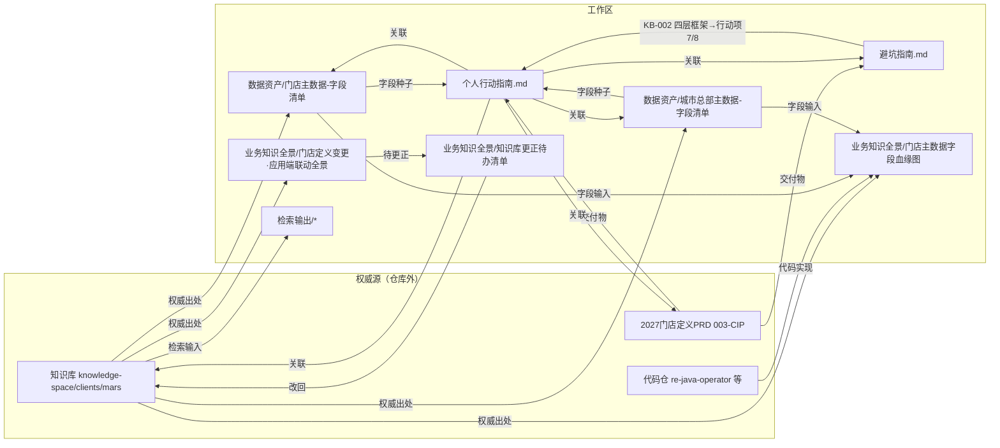

# CLAUDE.md

This file provides guidance to Claude Code (claude.ai/code) when working with code in this repository.

## 这个目录是什么

`D:\CMJWORK\业务知识库` 是一个**工作区外壳 + 个人工作流仓库**（git 远端 `git@github.com:fairycmj000/store_defination_workflow.git`，分支 main）。里面包含：

- **`knowledge-space/`**（独立仓库 `inkstone-lab/knowledge-space`，分支 main）—— **Markdown-first** 组织知识库，同时服务人和 AI（RAG / Agent / Context Engineering），是权威源。
- **其余目录/文件** —— 门店定义个人工作流的在途/产出材料（个人产出物 · 数据资产 · 过程输出），收录在 `store_defination_workflow` 仓。

> **工作区文件关系与入库映射见下方「## 检索地图」节**（任何文件变更须同步维护）；仓库目录与资产性质总表见 `README.md`。

进入 `knowledge-space/` 之前，权威指南按优先级读这几份（都是仓库内文件，**不要**在外壳层再抄一遍）：

1. `knowledge-space/README.md` — 人读入口：三层目录、怎么查、怎么加/改知识。
2. `knowledge-space/CLAUDE.md` — 写作、frontmatter、目录、引用规范。
3. `knowledge-space/AGENTS.md` — 协作约定 + 提交前门禁清单。
4. `knowledge-space/AGENT-ENTRY.md` — Agent 入口（按阶段取资产 + 可执行命令）。
5. `knowledge-space/kb-index.yaml` / `kb-metadata.yaml` — 结构化索引 / 版本元数据。

## 检索地图（工作区文件关系 · 入库映射）

> 用途：记录 `D:\CMJWORK\业务知识库\` 下所有目录/文件的**内容、性质、相互关系与知识库入库映射**，作为「个人产出物 → knowledge-space 公共知识库」的桥。
> 维护约定（**强制**）：任何文件**新增 / 修改 / 移动 / 删除**后，必须同步更新本节——① 目录总览、② 文件关系、③ 入库映射、④ 变更记录（append-only）。改完自查一遍「关系是否还成立」。
> 性质：本节也是**个人产出物 · 暂时非公共资产**，变更随本仓库 git 历史记录。

### 一、目录 / 文件总览（性质 + 用途）

> 「性质」三档：**个人产出物·非公共**（对外共享前评审）/ **数据资产** / **过程输出**。`knowledge-space/`、`代码仓/` 为独立仓库，不在本工作流仓内，仅在此登记其角色。

| 路径 | 性质 | 用途 / 说明 |
|---|---|---|
| `README.md` | 仓库说明 | 本仓库入口：目录 + 资产性质总表 |
| `CLAUDE.md` | 工作区指引 | 含本节检索地图，指向 knowledge-space 权威指南与关键命令 |
| `个人行动指南.md` | 个人产出物·非公共 | 行动清单/路线图（门店定义 10 项 + 完美门店） |
| `门店定义知识库探究-避坑指南.md` | 个人产出物·非公共 | 探究踩坑记录 KB-001/002（append-only） |
| `knowledge-space/` | 独立仓库 | 公共知识库权威源（`inkstone-lab/knowledge-space`） |
| `代码仓/` | 独立仓库 ×39 | 后端代码仓（各自独立 .git，取证源） |
| `数据资产/` | 数据资产 | 字段清单 + 原始抽取 |
| `检索输出/` | 过程输出 | 检索/能力测试报告 |
| `业务知识全景/` | 个人产出物·非公共 | 字段血缘 / 应用端联动验证输出 + 更正待办桥 |
| `业务中台架构/` | 个人产出物·非公共 | 业务中台资产层次梳理 |
| `自动化工具/` | 个人产出物·非公共 | 行动项 9/10 输出地（暂空） |

#### 1.1 数据资产/

| 文件 | 口径基线 | 权威来源（knowledge-space 相对路径） |
|---|---|---|
| `门店主数据-字段清单.md` | 2026 P3 | `data/store_center_data_dictionary.md`、`systems/business-middle-platform/store-center/ontology/object-types/store.md`、`business/rules/store_definition_rules.md` |
| `城市总部主数据-字段清单.md` | 2026 P3 | `.../store-center/ontology/object-types/customer-hq.md`、`.../customer-center/ontology/customer-center-ontology.md`、`business/rules/store_definition_rules.md`、`features/customer-master-data.md`、`features/store-definition-city-hq.md` |
| `store_query1_全量字段.xlsx` + `_xlsx_dump_utf8.txt` | — | `store_query1` 原始抽取（字段清单的原料） |

#### 1.2 检索输出/

| 文件 | 用途 |
|---|---|
| `门店店型定义变更影响评估报告.md` | 门店定义变更影响评估（检索产出） |
| `NKA-RKA-LKA关键客户定义.md` | 关键客户定义（检索产出） |
| `ACT-SPC新渠道需求评估报告.md` | ACT/SPC 新渠道需求评估 |
| `审批流-代审批话题讨论记录.html` | 审批流讨论记录（过程证据） |
| `_xlsx_sheet1.txt` / `_xlsx_sheets.txt` | Excel 抽取 |

#### 1.3 业务知识全景/

| 文件 | 用途 | 权威来源 |
|---|---|---|
| `门店主数据字段血缘图.md`（+`-3D.html`） | 字段血缘**验证输出**（非正式图谱） | `business/rules/store_definition_rules.md`、`.../config-objects/`、`customer-hq.md`、代码 `re-java-operator/mdx/store-channel-calc` |
| `门店定义变更·应用端联动改动全景.md` | 2026 变更 → 应用端联动**验证输出** | `proj-cot-2026-application-refresh.md` + 4 端侧 + `openstore-page-registry.md` |
| `知识库更正待办清单.md` | **桥**：逐条把分析结论改回 knowledge-space | 多份 knowledge-space 文件（见其表格） |

#### 1.4 业务中台架构/

| 文件 | 用途 |
|---|---|
| `业务中台—asset-hierarchy.md`（+`.html`） | 业务中台资产层次梳理 |
| `系统分层与业务中台统一梳理_summary.md`（+`_transcript.pdf`） | 系统分层与业务中台统一梳理 summary / transcript |

### 二、文件关系（引用 / 关联 / 血缘）

> 箭头 = 「引用 / 依赖」。`知识库 = knowledge-space`，`PRD = D:\CMJWORK\003-CIP\2027需求\2027门店定义PRD.md`。



#### 关键关系清单

1. `个人行动指南.md` → `门店定义知识库探究-避坑指南.md`（避坑经验反哺行动项 7/8）
2. `个人行动指南.md` → `数据资产\门店主数据-字段清单.md`、`城市总部主数据-字段清单.md`（行动项 2/3 的字段种子）
3. `个人行动指南.md` → `003-CIP\2027需求\2027门店定义PRD.md`、`knowledge-space/clients/mars/`（权威源）
4. `数据资产\*.md` ← `knowledge-space`（字段字典/对象/规则语料为权威出处）
5. `业务知识全景\门店主数据字段血缘图.md` ← `数据资产\*.md`（字段）+ `knowledge-space` + 代码 `re-java-operator`
6. `业务知识全景\门店定义变更·应用端联动改动全景.md` → `业务知识全景\知识库更正待办清单.md`（边界结论 → 待办）
7. `业务知识全景\知识库更正待办清单.md` → `knowledge-space`（逐条改回，改完 ☐→☑）
8. `检索输出\*.md` ← `knowledge-space`（检索产出；`门店店型定义变更影响评估报告.md` 与门店定义变更主题相关）
9. `业务中台架构\*` ← 业务中台资产梳理（与门店定义主数据/系统分层主题相关，独立成区）

### 三、入库映射（工作区 → knowledge-space）

> 目标路径为**候选**，最终按 knowledge-space 放置规则 / 主题权威定；状态：`不入库`（过程记录）/ `待提炼`（评审后提炼）/ `桥`（更正待办）。

| 工作区资产 | 候选 knowledge-space 目标 | 状态 |
|---|---|---|
| `个人行动指南.md` | 不入库（个人过程记录）；行动项成果另落对应路径 | 不入库 |
| `门店定义知识库探究-避坑指南.md` | 待提炼：`capabilities/` 或 `knowledge-governance/`（摄取/影响评估规范） | 待提炼 |
| `数据资产\门店主数据-字段清单.md` | `clients/mars/data/`（字段字典）或 `systems/.../store-center/ontology/` | 待提炼 |
| `数据资产\城市总部主数据-字段清单.md` | `clients/mars/systems/.../customer-center/` 或 `business/entities/actor-model.md` 增补 | 待提炼 |
| `业务知识全景\门店主数据字段血缘图.md` | 不入库（验证输出）；结论可补入 `data/` 字段字典「血缘」 | 不入库 |
| `业务知识全景\门店定义变更·应用端联动改动全景.md` | 不入库（验证输出）；结论可补入 `features/` | 不入库 |
| `业务知识全景\知识库更正待办清单.md` | 桥：改完即失效，逐条落地到具体文件 | 桥 |
| `检索输出\*.md` | 不入库（过程报告）；关键口径可提炼进 `industries/` 或 `clients/mars/business/` | 待提炼 |
| `业务中台架构\*` | 待提炼：`clients/mars/architecture/` 或 `capabilities/` | 待提炼 |
| `自动化工具\`（未来） | 工具本身不入库；工具产出的口径/约定可入库 | — |

### 四、变更记录（append-only）

| 日期 | 变更 | 影响的关系 / 说明 |
|---|---|---|
| 2026-10-16 | 初始化本仓库：新增 `README.md`、`.gitignore`；git init + 首次提交推送 origin/main | 确认 5 项个人产出物（`自动化工具\`、`业务知识全景\`、`业务中台架构\`、`个人行动指南.md`、`避坑指南.md`）；排除 `knowledge-space/`、`代码仓/`、`.claude/` |
| 2026-10-16 | 检索地图由独立 `检索地图.md` 移入本 `CLAUDE.md`「检索地图」节 | 关系/入库映射就地维护 |
| 2026-10-16 | `fairycmj000-github-repo-access-2026-10-16.md` 移出仓库（加 `.gitignore`，本地保留） | 该文件为个人生成快照，不入库 |

## 大图架构（跨多份文件才能拼出来）

知识库按「知识属于谁」分三层，引用方向**单向**：

```
industries/   行业通用知识（FMCG 概念/指标/框架）  ← 被引用，不引用客户
clients/      客户专有知识（mars 主体、carlsberg、hh）
capabilities/ 公司交付方式（executive-specs 模板、playbooks、audits）
```

- 允许：`clients/` → `industries/`、`capabilities/` → `industries/`（作案例）。反向禁止。
- `clients/mars/` 内部按「知识是什么」分七区：`systems/`（系统知识主体）、`business/`（对象/规则/指标）、`data/`（数据集 `*.dataset.md` + `*.fields.md` 成对）、`architecture/`、`features/`、`projects/`、`knowledge-governance/`（四张治理登记表 + scorecard）。
- `systems/` 根目录只允许 `README.md` 与子目录；跨系统的登记类文件统一在 `clients/mars/systems/_global/`。

治理机器有四张登记表（`clients/mars/knowledge-governance/`）：**事实登记**（权威值+口径+禁止值）、**主题权威**（一题一权威）、**放置规则**（知识类型 → 唯一目录）、**术语**（权威写法+易混概念对+枚举取值域）。新增/修改知识前先查这几张表。

## 关键命令

均在 `knowledge-space/` 目录内执行。没有 build/test runner，所有「门禁」都是 Python 校验脚本。

- **提交前一条命令跑全部门禁**：`bash tools/quality/run_all_gates.sh --with-drill`
  （硬门禁 / 软门禁 / 独立复核分开列结果；软违规退出码 2 不是红灯，但要在 PR 说明。）
- **装一次提交前钩子**（生成链自检，约 2.8 秒）：`python3 tools/setup/install_git_hooks.py`
  （`KB_HOOK_FULL=1` 加严、`KB_HOOK_OFF=1` 跳过；自检 `--check`、卸载 `--uninstall`。）
- **逐条等价命令**（生成链自检）：`build_kb_index.py --check`、`build_kb_metadata.py --check`、`build_center_doc_indexes.py --check`、`build_service_catalog.py --check`、`build_object_index.py --check`、`check_kb_selfconsistency.py`，都在 `tools/kb/`；校验在 `tools/quality/`（`check_kb_domains.py`、`check_kb_entrypoints.py`、`check_kb_landing.py`、`check_rule_corpus.py` 等）。
- **生成顺序有依赖**（乱序会「刚生成就报过期」）：

```text
build_center_doc_indexes → build_service_catalog → build_object_index
→ audit_kb_cognition → build_kb_index → build_kb_metadata
```

## 最容易踩的坑（非显而易见、必须记住）

- **生成物禁手改**：`AGENT-ENTRY.md`、`kb-index.yaml`、`kb-metadata.yaml`、各中心 `document-index.md`、`service-catalog.md`、`object-index.md`、`scorecard.md` 都是机器产物（文件头有 `generated by` 标记）。改了会变「第二真相源」并被门禁拦；要改就改源数据或改生成器（`tools/kb/`）。
- **一处权威 / 只追加**：同一事实只写一遍；旧文档要保留就标 `status: deprecated` + `superseded_by: <权威文档>`；事件台账不覆盖、只追加。
- **提交风格与暂存**：提交信息简洁限范围（`docs(mars): …`、`feat(kb): …`）；多人共用一个工作区时**不要 `git add -A`**，显式按路径暂存本次涉及的文件；移动/改名后必须跑 `--links-all`。
- **应用源码不在这台机器 / 这个仓库**：知识库只存「口径与规范」。要回答实现、字段值、API、配置问题时，先查 `knowledge-space/` 文档，再去代码目录取证——且**代码目录未必在本机**，引用前先确认存在，别凭记忆给出不存在/过期的代码路径。
- **git 推送**：远端是 HTTPS（`https://github.com/inkstone-lab/knowledge-space.git`）；HTTPS 推送在本机可能被拦，改用 SSH（或 Trae）推送。
