# COT 与业务中台系统资产梳理

> 本文档按 **Application Asset Hierarchy Model（应用资产分层模型）** 对 COT System 与业务中台 System 进行资产梳理，统一采用 System → Subsystem → Service → Microservice → Module → Component 的层次结构。

## 一、架构层次

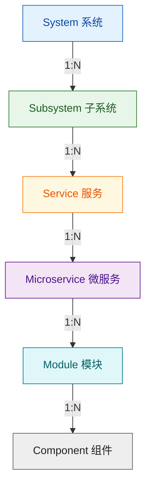

> **图 1：应用资产分层模型。** System 到 Component 自上而下逐层分解，每一层对其下层为 1 对多关系。颜色：System 蓝 / Subsystem 绿 / Service 琥珀 / Microservice 紫 / Module 青 / Component 灰。

### 层级定义

| 层级 | 定义 | 关注对象 | 示例 |
|------|------|----------|------|
| System | 一个完整交付的软件系统 | 产品/应用整体 | 业务中台 |
| Subsystem | System 内具有独立业务或技术边界的子域 | 领域边界 | 用户中心 |
| Service | 面向业务能力或平台能力提供服务的逻辑单元 | 能力资产 | 用户管理服务 |
| Microservice | Service 的具体软件实现单元，可独立开发、部署、扩缩容 | 软件运行单元 | user-api-service |
| Module | Microservice 内部的软件功能模块 | 代码组织 | 用户注册模块 |
| Component | Module 使用的软件组件、库、运行依赖 | 技术实现 | Spring Security、Redis Client |

### Scenarios / Procedures / 算子依赖模式

本文多处提到的 "Scenarios/Procedures/算子" 遵循同一依赖模式：业务 Subsystem 在平台能力中心 Subsystem 中为其专用的 Kepler Service（#1 号～#4 号，见下文 11. 平台能力中心 Subsystem）上部署 Scenarios / Procedures，经平台能力中心 leibniz Service（工作流引擎）执行，最底层的算子统一运行在平台能力中心 Subsystem 的 #1 号 newton Service 上。

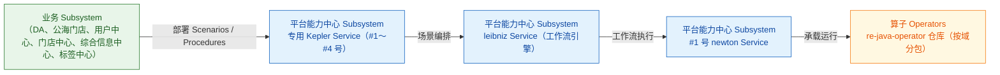

> **图 2：Scenarios / Procedures / 算子依赖模式。** 各业务 Subsystem 的具体算子仓库路径见对应引用块。颜色：业务 Subsystem 绿 / 平台能力中心服务（Kepler / Leibniz / Newton）蓝 / 算子 琥珀。

## 二、COT System

> 先看全景：COT System 共 6 个 Subsystem（业务域 5 个 + 平台能力域 1 个），仓库地址与状态详见下方表格。

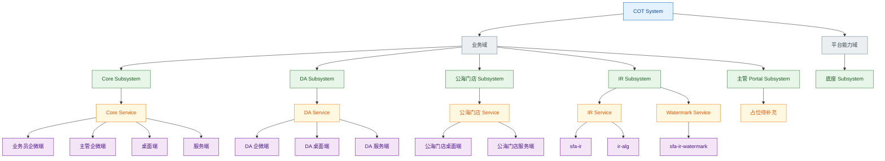

> **图 3：COT System 资产全景。** Kepler / Hertz 实例已归入平台能力中心 Subsystem（#1 号，COT System 专用），见下文 11. 平台能力中心 Subsystem；Gateway Service 为 Zuul / Kong 类开源网关（非自研），归入基础设施中心，见下文 12. 基础设施中心 Subsystem。颜色：System 蓝 / 域分组 灰 / Subsystem 绿 / Service 琥珀 / Microservice 紫。

### （一）业务域 Subsystems（5 个）

#### 1. Core Subsystem

| Service | Microservice | 仓库（GitHub / 本地） | 状态 |
|---------|--------------|----------------------|------|
| Core Service | 业务员企微端 | git@github.com:inkstone-re/re-sfa-wxwps-2024.git 本地：`a2_deliveries/mw-cot/re-sfa-wxwps-2024` | — |
| Core Service | 主管企微端 | git@github.com:inkstone-re/re-sfa-wxsavwps.git | 仓库未初始化 |
| Core Service | 桌面端 | git@github.com:inkstone-re/re-sfa-mgtwps.git 本地：`a2_deliveries/mw-cot/re-sfa-mgtwps` | — |
| Core Service | 服务端 | git@github.com:inkstone-re/re-yyx-cot-master.git 本地：`a2_deliveries/mw-cot/re-yyx-cot-master` | — |

#### 2. DA Subsystem

| Service | Microservice | 仓库（GitHub / 本地） | 状态 |
|---------|--------------|----------------------|------|
| DA Service | DA 企微端 | git@github.com:inkstone-re/re-da-sfa-wxwps.git | 仓库未初始化 |
| DA Service | DA 桌面端 | da-wfe（GitHub 地址未知） | — |
| DA Service | DA 服务端 | git@github.com:inkstone-re/re-yyx-da-master.git 本地：`a2_deliveries/mw-cot/re-yyx-da-master` | — |

> **DA Scenarios/Procedures/算子**：DA Subsystem 利用底座 Subsystem 的能力，在平台能力中心 #1 号 Kepler Service（COT System 专用）上部署了一系列 Scenarios / Procedures；最底层是一系列部署在业务中台 System 平台能力中心 Subsystem #1 号 newton Service 上的算子。这些算子在本地 git 仓库目录：`a2_deliveries/mw-bmp/store-center/re-java-operator/da-sfa`。

#### 3. 公海门店 Subsystem

| Service | Microservice | 仓库（GitHub / 本地） | 状态 |
|---------|--------------|----------------------|------|
| 公海门店 Service | 公海门店桌面端 | git@github.com:inkstone-re/re-yyx-openstore-page.git 本地：`a2_deliveries/mw-cot/re-yyx-openstore-page` | — |
| 公海门店 Service | 公海门店服务端 | git@github.com:inkstone-re/re-yyx-openstore-master.git 本地：`a2_deliveries/mw-cot/re-yyx-openstore-master` | — |

> **公海门店 Scenarios/Procedures/算子**：公海门店 Subsystem 利用底座 Subsystem 的能力，在平台能力中心 #1 号 Kepler Service（COT System 专用）上部署了一系列 Scenarios / Procedures；最底层是一系列部署在业务中台 System 平台能力中心 Subsystem #1 号 newton Service 上的算子。这些算子在本地 git 仓库目录：`a2_deliveries/mw-bmp/store-center/re-java-operator/openstore`。

#### 4. IR Subsystem

| Service | Microservice | 本地仓库 | 状态 |
|---------|--------------|----------|------|
| IR Service | sfa-ir | `a2_deliveries/mw-cot/re-sfa-ir` | — |
| IR Service | ir-alg | `a2_deliveries/mw-cot/re-ir-alg` | — |
| Watermark Service | sfa-ir-watermark | `a2_deliveries/mw-cot/re-sfa-ir-watermark` | — |

#### 5. 主管 Portal Subsystem

> **占位**：主管 Portal Subsystem 细节待补充；Service/Microservice 与仓库映射待确认。占位目录见 `clients/mars/systems/cot/supervisor-portal/`。

### （二）平台能力域 Subsystem（1 个）

#### 6. 底座 Subsystem

> 底座 Subsystem 的原平台服务均已另行归位：Kepler / Hertz → 业务中台平台能力中心 Subsystem（见下文 11.），Gateway → 基础设施中心 Subsystem；Page Service 暂不纳入，当前无独立资产明细。

## 三、业务中台 System

> 先看全景：业务中台 System 共 12 个 Subsystem（业务域 7 个 + 平台能力域 5 个），状态与职责详见下方表格。

```mermaid
flowchart TD
    n1["业务中台 System"]:::lvlSys
    n2["业务域"]:::lvlDom
    n3["平台能力域"]:::lvlDom
    n1 --> n2
    n1 --> n3
    n4["用户中心 Subsystem"]:::lvlSub
    n2 --> n4
    n5["产品中心 Subsystem"]:::lvlSub
    n2 --> n5
    n6["门店中心 Subsystem"]:::lvlSub
    n2 --> n6
    n7["供销中心 Subsystem"]:::lvlSub
    n2 --> n7
    n8["营销中心 Subsystem"]:::lvlSub
    n2 --> n8
    n9["经销商中心 Subsystem"]:::lvlSub
    n2 --> n9
    n10["分销订单中心 Subsystem"]:::lvlSub
    n2 --> n10
    n11["综合信息中心 Subsystem"]:::lvlSub
    n3 --> n11
    n12["标签中心 Subsystem"]:::lvlSub
    n3 --> n12
    n13["通用服务中心 Subsystem"]:::lvlSub
    n3 --> n13
    n14["平台能力中心 Subsystem"]:::lvlSub
    n3 --> n14
    n15["基础设施中心 Subsystem"]:::lvlSub
    n3 --> n15

    classDef lvlSys fill:#e3f2fd,stroke:#1565c0,color:#0d47a1;
    classDef lvlDom fill:#eceff1,stroke:#607d8b,color:#37474f;
    classDef lvlSub fill:#e8f5e9,stroke:#2e7d32,color:#1b5e20;
```

> **图 4：业务中台 System 资产全景（概览）。** 业务域 7 个 + 平台能力域 5 个 Subsystem；各 Subsystem 明细图见对应小节（图 4-1～图 4-12，经销商中心 / 分销订单中心仅占位）。Kepler / Hertz 实例已归入平台能力中心 Subsystem（#1～#4 号），详见 11. 平台能力中心 Subsystem。颜色：System 蓝 / 域分组 灰 / Subsystem 绿。

### （一）业务域 Subsystems（7 个）

#### 1. 用户中心 Subsystem

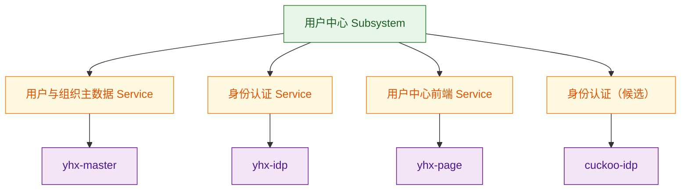

> **图 4-1：用户中心 Subsystem 资产明细。** 层级颜色同图 4（Subsystem 绿 / Service 琥珀 / Microservice 紫）。

| Service | Microservice | 状态 |
|---------|--------------|------|
| 用户与组织主数据 Service | yhx-master | Active |
| 身份认证 Service | yhx-idp | Active |
| 用户中心前端 Service | yhx-page | 前端 |
| 身份认证（候选） | cuckoo-idp | 仓库待补充 |

> **用户中心 Scenarios/Procedures/算子**：用户中心 Subsystem 利用门店中心 Subsystem 的能力，在平台能力中心 #2 号 Kepler Service（门店中心专用）上部署了一系列 Scenarios / Procedures；最底层是一系列部署在业务中台 System 平台能力中心 Subsystem #1 号 newton Service 上的算子。这些算子在本地 git 仓库目录：`a2_deliveries/mw-bmp/store-center/re-java-operator/yhx`。

#### 2. 产品中心 Subsystem

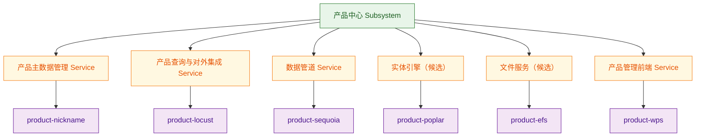

> **图 4-2：产品中心 Subsystem 资产明细。** 层级颜色同图 4（Subsystem 绿 / Service 琥珀 / Microservice 紫）。

| Service | Microservice | 状态 |
|---------|--------------|------|
| 产品主数据管理 Service | product-nickname | Active |
| 产品查询与对外集成 Service | product-locust | Active |
| 数据管道 Service | product-sequoia | Active |
| xx服务（候选） | product-poplar | 仓库未初始化 |
| xx服务（候选） | product-efs | 仓库未初始化 |
| 产品管理前端 Service | product-wps | 仓库未初始化 |

#### 3. 门店中心 Subsystem

```mermaid
flowchart TD
    n1["门店中心 Subsystem"]:::lvlSub
    n2["门店定义 Service"]:::lvlSvc
    n3["门店规则 Service"]:::lvlSvc
    n4["完美门店 Service"]:::lvlSvc
    n5["门店拜访 Service"]:::lvlSvc
    n6["门店分销 Service"]:::lvlSvc
    n7["门店运营 Service"]:::lvlSvc
    n8["门店查询 Service"]:::lvlSvc
    n9["Utilities Service"]:::lvlSvc
    n10["Page Service"]:::lvlSvc
    n12["待建设"]:::lvlMs
    n13["store-validation"]:::lvlMs
    n14["store-level"]:::lvlMs
    n15["store-sequoia"]:::lvlMs
    n16["待建设"]:::lvlMs
    n17["store-visit-planning"]:::lvlMs
    n18["store-vss"]:::lvlMs
    n19["store-sdrs"]:::lvlMs
    n20["fdw-fns"]:::lvlMs
    n21["store-sops"]:::lvlMs
    n22["store-report-generator"]:::lvlMs
    n23["store-locust"]:::lvlMs
    n24["store-downstream"]:::lvlMs
    n25["data-repairer"]:::lvlMs
    n26["data-insight"]:::lvlMs
    n27["mdx-page"]:::lvlMs
    n1 --> n2
    n1 --> n3
    n1 --> n4
    n1 --> n5
    n1 --> n6
    n1 --> n7
    n1 --> n8
    n1 --> n9
    n1 --> n10
    n2 --> n12
    n3 --> n13
    n3 --> n14
    n3 --> n15
    n4 --> n16
    n5 --> n17
    n5 --> n18
    n6 --> n19
    n6 --> n20
    n7 --> n21
    n7 --> n22
    n8 --> n23
    n8 --> n24
    n9 --> n25
    n9 --> n26
    n10 --> n27

    classDef lvlSys fill:#e3f2fd,stroke:#1565c0,color:#0d47a1;
    classDef lvlDom fill:#eceff1,stroke:#607d8b,color:#37474f;
    classDef lvlSub fill:#e8f5e9,stroke:#2e7d32,color:#1b5e20;
    classDef lvlSvc fill:#fff8e1,stroke:#f57f17,color:#e65100;
    classDef lvlMs fill:#f3e5f5,stroke:#6a1b9a,color:#4a148c;
```

> **图 4-3：门店中心 Subsystem 资产明细。** 层级颜色同图 4（Subsystem 绿 / Service 琥珀 / Microservice 紫）。

| Service | Microservice | 职责说明 |
|---------|--------------|----------|
| Page Service | mdx-page | — |
| 门店定义 Service | — | **目前没有，迫切需要建设。** 负责定义门店业务模型，包括门店属性体系、属性取值规则、门店分类分级、生命周期场景及业务规则，为各业务系统提供统一的门店认知标准。 |
| 门店规则 Service | store-validation、store-level、store-sequoia | 负责根据门店定义的业务规则，在门店创建、修改、关闭等生命周期过程中执行属性校验、属性计算和属性生成，保障门店数据符合业务规范。 |
| 完美门店 Service | — | **目前没有，迫切需要建设。** 负责建立和管理完美门店标准体系，通过检查、评分和分析衡量门店执行质量，推动终端门店标准化运营。 |
| 门店拜访 Service | store-visit-planning（拜访计划）、store-vss（拜访执行） | 负责支持业务人员围绕门店开展计划制定、拜访执行和过程管理，提升销售执行效率和门店覆盖质量。 |
| 门店分销 Service | store-sdrs、fdw-fns | 负责管理门店商品分销规则、铺货执行和分销达成情况，提升产品在终端门店的覆盖和可见度。 |
| 门店运营 Service | store-sops、store-report-generator | 负责支撑门店日常运营管理，包括运营规则、SOP 管理、运营监控和综合运营分析，提升门店运营效率。 |
| 门店查询 Service | store-locust、store-downstream | 负责提供门店信息聚合查询和跨系统数据访问能力，支持业务人员快速获取门店相关信息。 |
| Utilities Service | data-repairer、data-insight | — |

> **门店分销 Scenarios/Procedures/算子**：门店分销 Service 在平台能力中心 #2 号 Kepler Service（门店中心专用）上部署了一系列 Scenarios / Procedures；最底层是一系列部署在业务中台 System 平台能力中心 Subsystem #1 号 newton Service 上的算子。这些算子在本地 git 仓库目录：`a2_deliveries/mw-bmp/store-center/re-java-operator/sdrs`。

> **门店中心 Scenarios/Procedures/算子**：门店中心 Subsystem 在平台能力中心 #2 号 Kepler Service（门店中心专用）上部署了一系列 Scenarios / Procedures；最底层是一系列部署在业务中台 System 平台能力中心 Subsystem #1 号 newton Service 上的算子。这些算子在本地 git 仓库目录：`a2_deliveries/mw-bmp/store-center/re-java-operator/mdx`。

#### 4. 供销中心 Subsystem

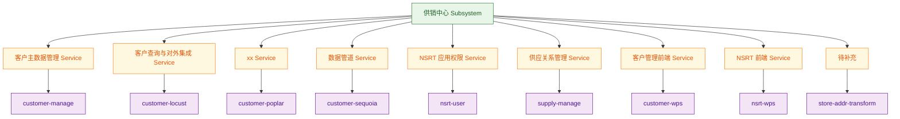

> **图 4-4：供销中心 Subsystem 资产明细。** 层级颜色同图 4（Subsystem 绿 / Service 琥珀 / Microservice 紫）。

| Service | Microservice | 状态 |
|---------|--------------|------|
| 客户主数据管理 Service | customer-manage | Active |
| 客户查询与对外集成 Service | customer-locust | Active |
| xx Service | customer-poplar | Active |
| 数据管道 Service | customer-sequoia | Active |
| NSRT 应用权限 Service | nsrt-user | Active |
| 供应关系管理 Service | supply-manage | Active |
| 客户管理前端 Service | customer-wps | 前端 |
| NSRT 前端 Service | nsrt-wps | 前端 |
| 待补充 | store-addr-transform | 仓库待补充 |

#### 5. 营销中心 Subsystem

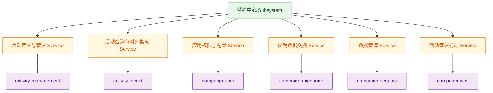

> **图 4-5：营销中心 Subsystem 资产明细。** 层级颜色同图 4（Subsystem 绿 / Service 琥珀 / Microservice 紫）。

| Service | Microservice | 状态 |
|---------|--------------|------|
| 活动定义与管理 Service | activity-management | Active |
| 活动查询与对外集成 Service | activity-locust | Active |
| 应用权限与配置 Service | campaign-user | Active |
| 促销数据交换 Service | campaign-exchange | Active |
| 数据管道 Service | campaign-sequoia | Active |
| 活动管理前端 Service | campaign-wps | 前端 |

#### 6. 经销商中心 Subsystem

经销商中心还有一系列其它 Services（待补充）。

#### 7. 分销订单中心 Subsystem

分销订单中心还有一系列其它 Services（待补充）。

### （二）平台能力域 Subsystems（5 个）

#### 8. 综合信息中心 Subsystem

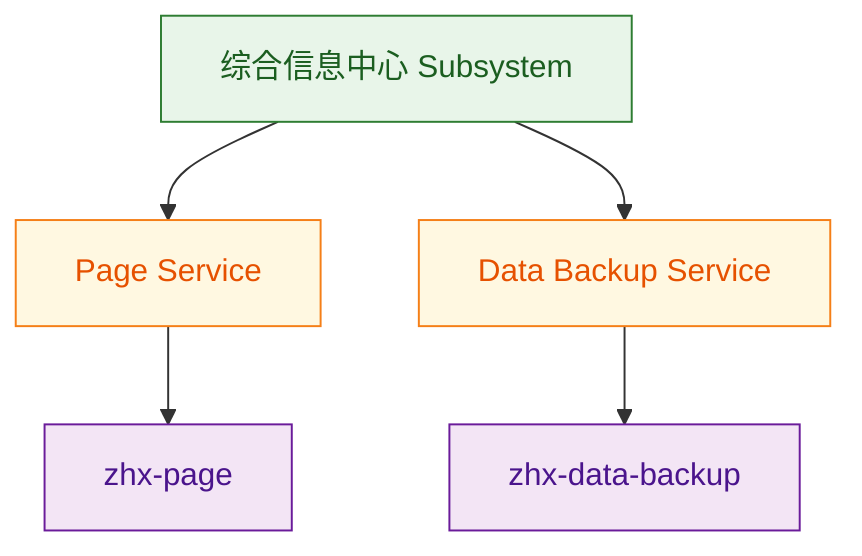

> **图 4-8：综合信息中心 Subsystem 资产明细。** 层级颜色同图 4（Subsystem 绿 / Service 琥珀 / Microservice 紫）。

| Service | Microservice | 状态 |
|---------|--------------|------|
| Page Service | zhx-page | 仓库待确认 |
| Data Backup Service | zhx-data-backup | Active |

> **综合信息中心 Scenarios/Procedures/算子**：综合信息中心 Subsystem 在平台能力中心 #3 号 Kepler Service（综合信息中心专用）上部署了一系列 Scenarios / Procedures；最底层是一系列部署在业务中台 System 平台能力中心 Subsystem #1 号 newton Service 上的算子。这些算子在本地 git 仓库目录：`a2_deliveries/mw-bmp/store-center/re-java-operator/zhx`。

#### 9. 标签中心 Subsystem

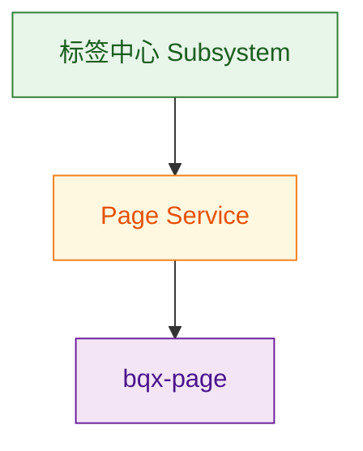

> **图 4-9：标签中心 Subsystem 资产明细。** 层级颜色同图 4（Subsystem 绿 / Service 琥珀 / Microservice 紫）。

> 原先是放在 gax-maxwell（即作为共享中心 gax 中的一个服务），现在重新定位，成立一个独立的标签中心 Subsystem。

| Service | Microservice | 状态 |
|---------|--------------|------|
| Page Service | bqx-page | 仓库待确认 |

> **标签中心 Scenarios/Procedures/算子**：标签中心 Subsystem 在平台能力中心 #4 号 Kepler Service（标签中心专用）上部署了一系列 Scenarios / Procedures；最底层是一系列部署在业务中台 System 平台能力中心 Subsystem #1 号 newton Service 上的算子。这些算子在本地 git 仓库目录：`a2_deliveries/mw-bmp/store-center/re-java-operator/gax`。

#### 10. 通用服务中心 Subsystem

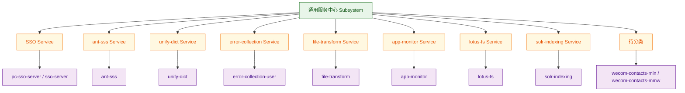

> **图 4-10：通用服务中心 Subsystem 资产明细。** 层级颜色同图 4（Subsystem 绿 / Service 琥珀 / Microservice 紫）。

| Service | Microservice |
|---------|--------------|
| SSO Service | pc-sso-server、sso-server |
| ant-sss Service | ant-sss |
| unify-dict Service | unify-dict |
| error-collection Service | error-collection-user |
| file-transform Service | file-transform |
| app-monitor Service | app-monitor |
| lotus-fs Service | lotus-fs |
| solr-indexing Service | solr-indexing |
| 待分类 | wecom-contacts-min、wecom-contacts-mmw |

#### 11. 平台能力中心 Subsystem

```mermaid
flowchart TD
    n1["平台能力中心 Subsystem"]:::lvlSub
    n2["#1 号 Kepler Service"]:::lvlSvc
    n3["#2 号 Kepler Service"]:::lvlSvc
    n4["#3 号 Kepler Service"]:::lvlSvc
    n5["#4 号 Kepler Service"]:::lvlSvc
    n6["#1 号 Hertz Service"]:::lvlSvc
    n7["#2 号 Hertz Service"]:::lvlSvc
    n8["#3 号 Hertz Service"]:::lvlSvc
    n9["#4 号 Hertz Service"]:::lvlSvc
    n10["表单工具（Galileo）Service"]:::lvlSvc
    n11["报表查看工具 Service"]:::lvlSvc
    n12["#1 号 newton Service"]:::lvlSvc
    n13["#2 号 newton Service"]:::lvlSvc
    n14["leibniz Service"]:::lvlSvc
    n15["dtr-edg Service"]:::lvlSvc
    n16["dtr-dcss Service"]:::lvlSvc
    n17["yyx-kepler-master / edge / worker / page"]:::lvlMs
    n18["COT System 专用"]:::lvlMs
    n19["mdx-kepler-master / edge / worker / page"]:::lvlMs
    n20["门店中心 Subsystem 专用"]:::lvlMs
    n21["zhx-kepler-master / edge / worker / page"]:::lvlMs
    n22["综合信息中心 Subsystem 专用"]:::lvlMs
    n23["bqx-kepler-master / edge / worker / page"]:::lvlMs
    n24["标签中心 Subsystem 专用"]:::lvlMs
    n25["yyx-hertz-master / page"]:::lvlMs
    n26["COT System 专用"]:::lvlMs
    n27["mdx-hertz-master / page"]:::lvlMs
    n28["门店中心 Subsystem 专用"]:::lvlMs
    n29["zhx-hertz-master / page"]:::lvlMs
    n30["综合信息中心 Subsystem 专用"]:::lvlMs
    n31["bqx-hertz-master / page"]:::lvlMs
    n32["标签中心 Subsystem 专用"]:::lvlMs
    n33["store-fts / store-fts-wps"]:::lvlMs
    n34["store-psrs / psrs-wfe"]:::lvlMs
    n35["业务中台 + COT 专用"]:::lvlMs
    n36["FoS DTR Integration 专用"]:::lvlMs
    n37["leibniz-master"]:::lvlMs
    n38["待补充"]:::lvlMs
    n39["nexus-edg-master"]:::lvlMs
    n1 --> n2
    n1 --> n3
    n1 --> n4
    n1 --> n5
    n1 --> n6
    n1 --> n7
    n1 --> n8
    n1 --> n9
    n1 --> n10
    n1 --> n11
    n1 --> n12
    n1 --> n13
    n1 --> n14
    n1 --> n15
    n1 --> n16
    n2 --> n17
    n2 --> n18
    n3 --> n19
    n3 --> n20
    n4 --> n21
    n4 --> n22
    n5 --> n23
    n5 --> n24
    n6 --> n25
    n6 --> n26
    n7 --> n27
    n7 --> n28
    n8 --> n29
    n8 --> n30
    n9 --> n31
    n9 --> n32
    n10 --> n33
    n11 --> n34
    n12 --> n35
    n13 --> n36
    n14 --> n37
    n15 --> n38
    n16 --> n39

    classDef lvlSys fill:#e3f2fd,stroke:#1565c0,color:#0d47a1;
    classDef lvlDom fill:#eceff1,stroke:#607d8b,color:#37474f;
    classDef lvlSub fill:#e8f5e9,stroke:#2e7d32,color:#1b5e20;
    classDef lvlSvc fill:#fff8e1,stroke:#f57f17,color:#e65100;
    classDef lvlMs fill:#f3e5f5,stroke:#6a1b9a,color:#4a148c;
```

> **图 4-11：平台能力中心 Subsystem 资产明细。** 层级颜色同图 4（Subsystem 绿 / Service 琥珀 / Microservice 紫）。

| Service | Microservice | 说明 |
|---------|--------------|------|
| 表单工具（Galileo）Service | store-fts、store-fts-wps | 规划作为门店中心专用 |
| 报表查看工具 Service | store-psrs、psrs-wfe | 规划作为门店中心专用 |
| #1 号 Kepler Service | yyx-kepler-master、yyx-kepler-edge、yyx-kepler-worker、yyx-kepler-page | COT System 专用（部署实例在 COT 底座；DA / 公海门店场景部署于此） |
| #2 号 Kepler Service | mdx-kepler-master、mdx-kepler-edge、mdx-kepler-worker、mdx-kepler-page | 门店中心 Subsystem 专用（用户中心 / 门店分销场景复用） |
| #3 号 Kepler Service | zhx-kepler-master、zhx-kepler-edge、zhx-kepler-worker、zhx-kepler-page | 综合信息中心 Subsystem 专用 |
| #4 号 Kepler Service | bqx-kepler-master、bqx-kepler-edge、bqx-kepler-worker、bqx-kepler-page | 标签中心 Subsystem 专用 |
| #1 号 Hertz Service | yyx-hertz-master、yyx-hertz-page | COT System 专用（部署实例在 COT 底座） |
| #2 号 Hertz Service | mdx-hertz-master、mdx-hertz-page | 门店中心 Subsystem 专用 |
| #3 号 Hertz Service | zhx-hertz-master、zhx-hertz-page | 综合信息中心 Subsystem 专用 |
| #4 号 Hertz Service | bqx-hertz-master、bqx-hertz-page | 标签中心 Subsystem 专用 |
| #1 号 newton Service | newton-master、newton-edge、newton-worker、newton-page、newton-hertz-master、newton-hertz-page、newton-gateway | 规划作为业务中台和 COT 两个 Systems 专用 |
| #2 号 newton Service | newton-master、newton-edge、newton-worker、newton-page、newton-hertz-master、newton-hertz-page、newton-gateway | 规划作为 FoS DTR Integration 项目专用 |
| leibniz Service | leibniz-master | 本地 git repo：`a2_deliveries/mw-foundation/leibniz` |
| dtr-edg Service | — | — |
| dtr-dcss Service | nexus-edg-master | — |

#### 12. 基础设施中心 Subsystem

```mermaid
flowchart TD
    n1["基础设施中心 Subsystem"]:::lvlSub
    n2["API Gateway"]:::lvlSvc
    n3["Web Gateway"]:::lvlSvc
    n4["ELK & Kafka"]:::lvlSvc
    n5["Prometheus & Grafana & Alertmanager"]:::lvlSvc
    n6["Redis"]:::lvlSvc
    n7["RabbitMQ"]:::lvlSvc
    n8["MySQL"]:::lvlSvc
    n9["MongoDB"]:::lvlSvc
    n10["Solr"]:::lvlSvc
    n11["PostgreSQL"]:::lvlSvc
    n12["XXL-JOB"]:::lvlSvc
    n13["Eureka"]:::lvlSvc
    n14["Zuul"]:::lvlSvc
    n15["Azure Blob"]:::lvlSvc
    n1 --> n2
    n1 --> n3
    n1 --> n4
    n1 --> n5
    n1 --> n6
    n1 --> n7
    n1 --> n8
    n1 --> n9
    n1 --> n10
    n1 --> n11
    n1 --> n12
    n1 --> n13
    n1 --> n14
    n1 --> n15

    classDef lvlSys fill:#e3f2fd,stroke:#1565c0,color:#0d47a1;
    classDef lvlDom fill:#eceff1,stroke:#607d8b,color:#37474f;
    classDef lvlSub fill:#e8f5e9,stroke:#2e7d32,color:#1b5e20;
    classDef lvlSvc fill:#fff8e1,stroke:#f57f17,color:#e65100;
    classDef lvlMs fill:#f3e5f5,stroke:#6a1b9a,color:#4a148c;
```

> **图 4-12：基础设施中心 Subsystem 资产明细。** 层级颜色同图 4（Subsystem 绿 / Service 琥珀 / Microservice 紫）。

以下均作为 Service 管理，不展开 Microservice：

API Gateway（Zuul / Kong 类开源网关，非自研；部署实例：yyx-gateway、mdx-gateway、zhx-gateway、bqx-gateway）、Web Gateway、ELK & Kafka、Prometheus & Grafana & Alertmanager、Redis、RabbitMQ、MySQL、MongoDB、Solr、PostgreSQL、XXL-JOB、Eureka、Azure Blob
