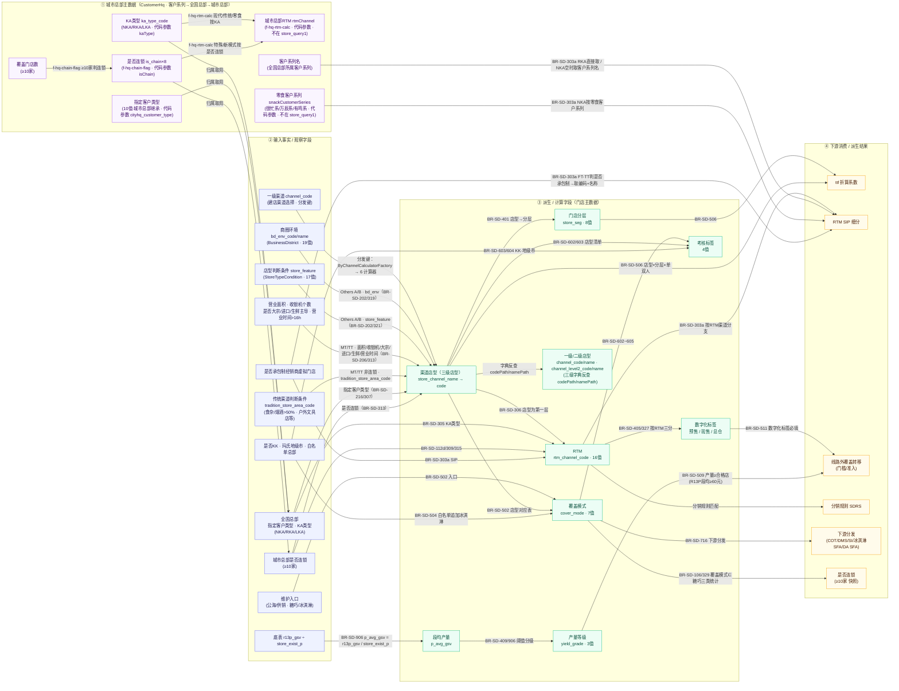

# 门店主数据字段血缘图（字段依赖关系 · 验证输出）

> 性质：局部小规模知识验证输出（**不是**正式知识图谱，仅用于验证知识库能否支撑字段血缘）
> 范围：门店定义相关的 8 个核心主数据字段 + 其输入事实字段（含城市总部主数据 CustomerHq）+ 下游消费
> 权威出处：`clients/mars/business/rules/store_definition_rules.md`（BR-SD-101~915）、`store-center/ontology/config-objects/`、城市总部主数据 `store-center/ontology/object-types/customer-hq.md`（表 `city_headquarters`）、代码实现 `re-java-operator/mdx/store-channel-calc`（店型计算 Newton 算子）
> 口径基线：**2026 P3**（未注明版本者以此为准；同一字段跨年取值会变）
> 生成日期：2026-10-15

## 血缘图（Mermaid）

> **潜在环说明**：`f5/o6`（是否连锁）构成环——是否连锁由覆盖模式统计得到（d3→o6），同时又是店型判定的输入（f5→d1）。实际通过「上线一次性初始化 + 不做自动重算」（BR-SD-804）打破该环，避免连锁改写。

> **城市总部主数据说明**：城市总部（CustomerHq）是门店归属的客户总部三级（客户系列 → 全国总部 → 城市总部）之一，由**一个对象类型 + 层级值 + 自链接**表达（非三个类型），backing 表 `city_headquarters`（库 `customer_manage`）。其「是否连锁」（覆盖门店数≥10家，f-hq-chain-flag）、「KA类型」「指定客户类型」是门店店型/RTM/覆盖模式判定的**归属侧输入**；「客户系列名」「零食客户系列」是 RTM SIP 细分（`rtm_segment`）的**直接输入**（BR-SD-303a）；「城市总部RTM」（f-hq-rtm-calc）是总部自身渠道，供总部级分销/供货，不进门店字段派生。城市总部渠道 `channel`（必填唯一）、供货关系等其余主数据字段不参与门店字段派生，故未上图。

## 店型计算 · 代码侧字段级血缘（2026-10-16 按代码补）

店型（三级门店类型）的权威实现是 **`re-java-operator/mdx/store-channel-calc/`**（Newton 算子，`StoreChannelCalcOperator`）。字段级判定链如下（`store_channel_name` 即三级门店类型，是计算结果；`store_channel_code` 由它反查字典得到）：

1. **分发键 = 一级渠道 `channel_code`**：`ByChannelCalculatorFactory` 按它路由到 6 个计算器——`MT&TT/MT/TT`→现代/传统、`WS`→批发、`Snacking`→零食、`Bulk`→散装联营、`Online`→线上、`Special/Seeding/NM/EOM/Others`→特殊·种子·新模式。
2. **现代/传统（`MtTtChannelCalculator`）**，自上而下命中即返回：
   - 全国总部「指定客户类型」`cityhq_customer_type`：仓储式卖场客户→仓储式卖场 · 个人护理店客户→个人护理店 · 折扣店客户→折扣店
   - `is_fresh_dominant`（是否生鲜主导，面积>70%）→ 连锁/单体生鲜店
   - `is_yh_ws`（是否大宗售卖）→ 仓储式卖场
   - `import_sku_over40_percent`（进口>40%）＋ 面积 1200–6000 → 连锁/独立高端超市
   - 连锁支：`biz_hours_over16h`→高端/大众便利店；面积>6000→连锁大卖场；1200–6000＋收银机(7–19/≥20→连锁大型 · 1–2/3–6→连锁标准)；500–1200/70–500/40–70/<40→连锁小型超市
   - 非连锁支：面积>6000→独立大卖场；1200–6000＋收银机→独立大型/标准；500–1200/70–500→独立小型；40–70/<40 按 `tradition_store_area_code`（食杂>50%→仓卖店/食杂店 · 烟酒>50%→烟酒店 · 户外文具店等→亭摊档和其他）定 TT 四类店型
3. **特殊·种子·新模式（`OthersChannelCalculator`）**：`bd_env`（商圈环境）＋ `store_feature`（门店特征/店型判断条件）→ `ChannelCalculateMethod` 查 A/B/C/D 方法（C/D 已停用）→ 小类 A2/B2/B3/C2/C3/D1/D2/D3（`StoreChannelSubCalculator`）。
4. **一二级店型 = 三级反查，非独立计算**：算出三级店型名后，`StoreChannelCalcOperator` 从字典域 `cotStoreChannel` 取 `codePath`/`namePath`，反查出一级 `channel_code`/`channel_name` 与二级 `channel_level2_code`/`channel_level2_name`。注意：作为**分发键的 `channel_code`（建店选择）** 与**反查得到的一级 `channel_code`（权威值）** 语义不同，别混。

> 口径对齐：`is_fresh_dominant`（生鲜主导）、`折扣店客户`、面积分档 40–70/＜40 均为 2026 口径，与本图基线 2026 P3 一致；BR-SD-216「2024 基线」、BR-SD-313「2025 判定表」是历史版本，现行以代码为准。

## 字段名多态（命名漂移 · 血缘的另一半）

| 概念 | 物理字段名（出现位置） |
|---|---|
| 门店分层 | `store_seg`（标签/综合信息）· `store_layering`（SDRS）· `Store_layer`（DSD_Report） |
| 门店分层 vs 门店 Level | `store_seg` ≠ `store_level`（两个不同标签，不可互换） |
| 覆盖模式（标签口径） | `cover_mode` 7 值 ≠ 数字化门店口径 `coverage_model`（PS/VS/ALL） |
| 段均产量 | `p_avg_gsv`（通用）· `p_avg_gsv_bm`（BM，仅 P1/P7 更新）· 底表 `r13p_gsv` |

## 已知缺口 / 注意

1. 「段均产量」作为检索词无独立文档，藏于 BR-SD-906 字段链（`r13p_gsv → p_avg_gsv → yield_grade`）。
2. 覆盖模式对应表 `coverage-mode-mapping` 标注「对应表待补」——仅 MW 列（G 列）已转录，其余渠道未落表（BR-SD-502）。
3. 口径 owner 未确认（BR-SD-904）；跨年取值会变（本图基线 2026 P3）。
