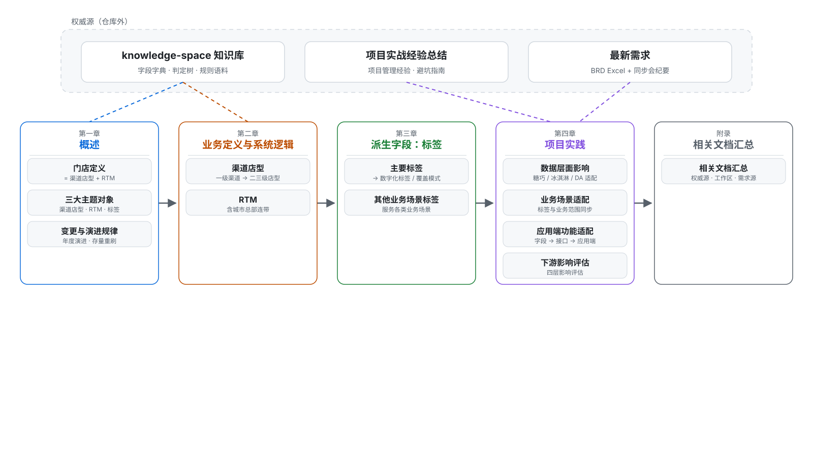
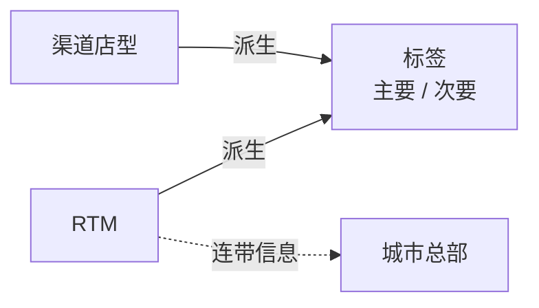
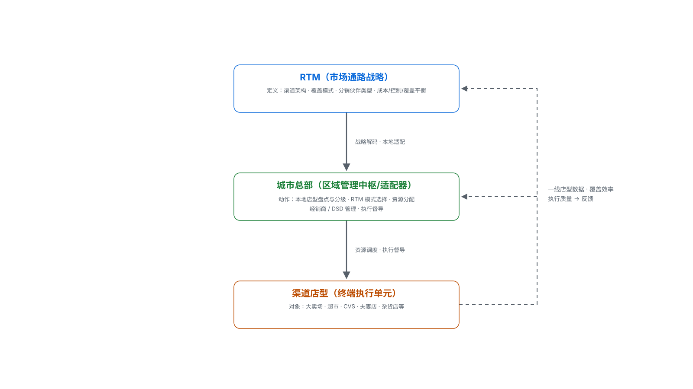
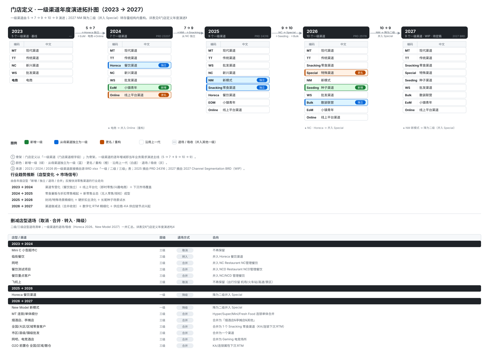
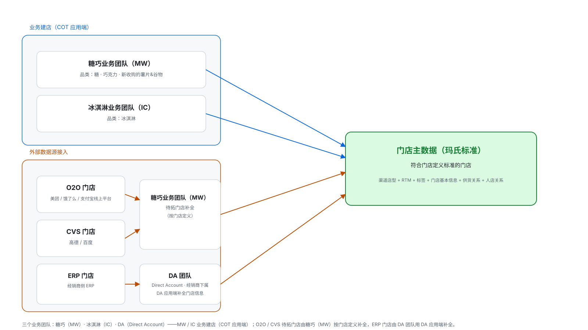
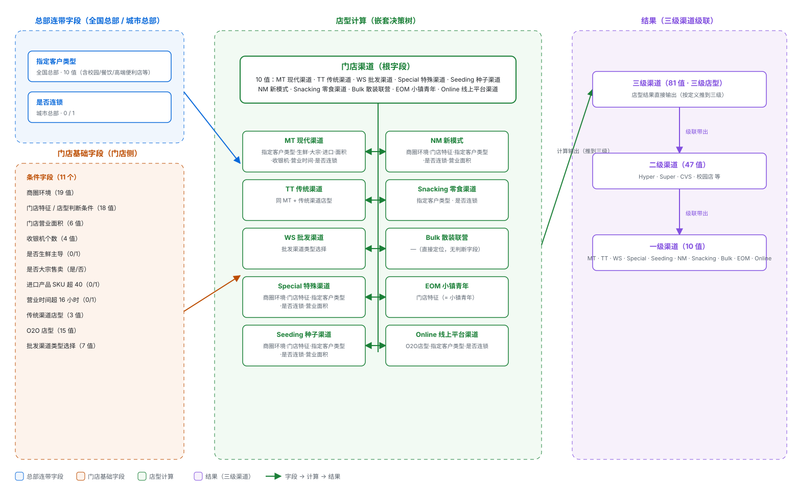
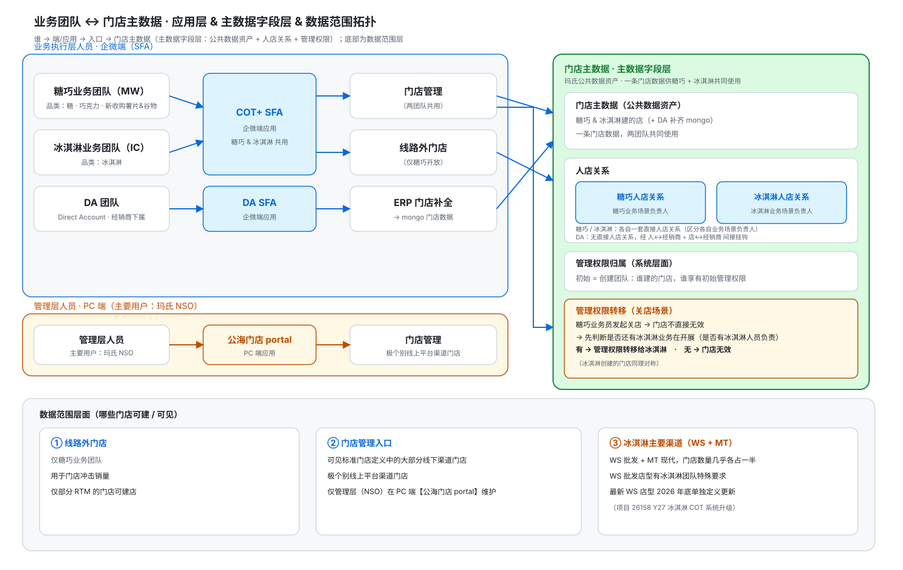
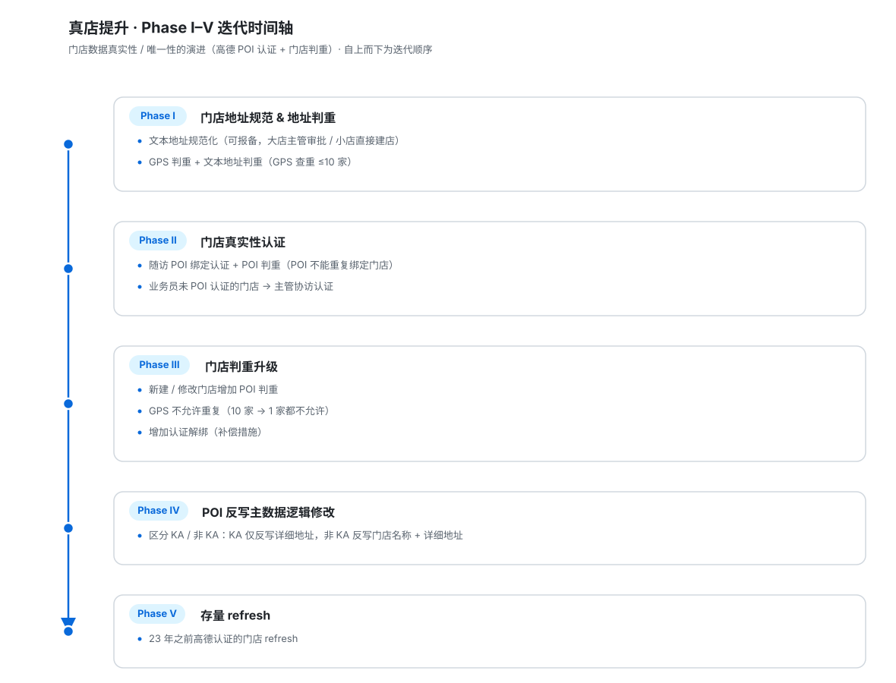
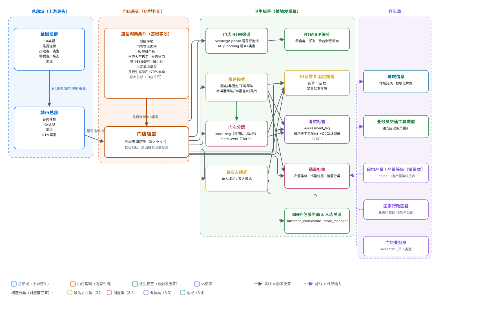

# 门店定义 · 全局纲领（结构性搭建）

> **定位**：门店定义知识的「全局纲领 / 单一骨架」——用一份结构化框架统摄门店定义的所有知识（对象、字段、依赖、变更、影响），作为「历史演进 + 最新需求 → 重构生成新一代门店定义文档」的总纲。
> **用途**：① 门店定义知识的收敛总入口与单一骨架；② 文档生成模板，每章同时标注 **历史基线** 与 **最新变更 delta**，据此落成新一代门店定义文档。
> **维护约定**：结构稳定、内容逐步补充（状态「待补充 → 进行中 → 已完成」）；口径单源化 + 只追加；改动后同步更新 `CLAUDE.md`「检索地图」节；行文要求：结构清晰、主旨明确、语言精炼、通俗易懂、内容不冗余。
> **性质**：个人产出物 · 暂时非公共资产（评审后按 `CLAUDE.md`「检索地图」入库映射进 knowledge-space）。

---

## 第一章 概述：门店定义是什么、核心概念

### 1.1 门店定义是什么

**一句话定义**：「门店定义」可大可小，收敛下来就是——**针对门店主数据中「渠道店型」与「RTM」的定义**。对应每年门店定义系统升级时业务提供的核心文件，也正是这两块信息。

围绕门店定义，主数据层面有三个**主题对象**：**渠道店型 / RTM / 标签**。

- **渠道店型**：门店如何分类（一级渠道 → 二三级店型）。
- **RTM**：门店的市场通路（覆盖 / 供货路径）。
- **标签**：基于渠道店型与 RTM **派生**的字段信息（服务不同业务场景管理），分化为**主要标签 / 次要标签**。

三者关系如下（标签为派生对象；城市总部为 RTM 的连带信息）：

> **全文声明（门店主数据范围）**：本文聚焦门店主数据（系统数据）的**核心三块**——**渠道店型 + RTM + 标签**（标签为派生）。但门店主数据**不只有这些**，还包括：**门店基本信息**（地址 / 经纬度 / 营业面积 / 营业时间 / 收银机等）、**门店与经销商供货关系**（供货路径 / 经销商挂靠）、**人店关系**（门店 ↔ 业务员 ↔ 拜访线路）。本文纲要以「渠道店型 + RTM + 标签」为主线，其余三块作为门店主数据边界，在 2.1「门店数据来源」与第六章项目实践里交代，不逐字段展开定义。

### 1.2 业务目的（为什么要做门店定义）

- **门店定义的根本目的**：针对不同类型门店制定差异化的产品分销、陈列与促销策略，更高效地管理玛氏庞大的零售网络。
- **门店定义的意义**：
  1. 顺应市场变化及竞争环境改变；
  2. 根据门店类型制定优先发展次序；
  3. 根据门店类型制定不同的门店策略；
  4. 不断挖掘新型门店（店型），实现企业可持续发展。
- **RTM 的意义**：市场进入策略的核心，深刻影响产品的市场覆盖、销售执行力与最终盈利能力。

### 1.3 渠道店型是什么

「渠道」与「店型」是两个**层级不同、常被混用**的概念。玛氏的「门店定义」同时覆盖两者：**渠道（一级）是策略性通路分类，店型（二级/三级）是渠道下的物理落点与细分形态**。

**渠道（Channel）**：在快消品（FMCG）行业中，渠道指具有相似运营逻辑与商业特征的一类**通路类型/客户群体**，用于对市场做战略性切分——流通渠道（二批商/批发市场，追求覆盖广度与成本效率）、KA 渠道（大卖场/连锁超市，专人精细化管理）、特通渠道（学校/交通枢纽/影院等特定场景）。此层面渠道是**资源分配与策略制定的管理单元**。

**店型（Store Type）——渠道的物理落点与细分形态**：一个「现代渠道（MT）」下包含「大卖场」「标超」等不同店型；**渠道分层，正是通过定义不同店型业态来实现的**。

> **声明（玛氏口径）**：①「渠道店型」通常指的就是「店型」——即「一级渠道 → 二级/三级店型」完整层级的门店分类整体，不把「渠道」「店型」当两个独立并列概念；②「KA（重点客户）」属 **RTM 维度**（覆盖方式 / 重点服务），**不是店型**——上文通用行业口径的「KA 渠道」仅作概念对照，勿与玛氏「门店渠道 / 店型」混用。

玛氏的「店型定义」是一套服务于内部销售运营与渠道管理的**实战性分类体系**，本质是**目标导向的内部运营工具**——划分依据不是学术严谨性，而是**业务管理便利性**（消费者行为特征、经营者共同特征、业务管理便利性）。典型判据：用「收银台数量」判断门店规模，用「营业时间」「连锁规模」筛选 CVS。

**划分依据（两个维度）**：

| 维度 | 取值 |
|---|---|
| 消费行为 | 杂货购物 / 其他购物及服务 / 婚礼 / 餐饮 / 娱乐·休闲 / 交通·运输·住宿 / 教育 / 工作场所 / 内部 / 网购 |
| 消费场所 | 大卖场、超市 / 便利店 / 杂货店、一般商店 / 婚庆 / 餐饮场所 / KTV·休闲场所·网吧 / 大学·中小学 / 交通·运输·住宿 / 工作场所自动贩卖机 / 企业福利 / 电子商务网站 |

**店型特点**（快消品行业渠道的特征）：结构最复杂、分布最广泛、售点数量最多。

### 1.4 RTM 是什么

RTM 是 **Route-to-Market** 的缩写，中文常译为「市场通路」或「分销通路」——企业为让产品从仓库/工厂抵达目标消费者，所选择的一套**渠道组合与中间商类型**。核心问题：**产品通过怎样的路径「走向市场」**。

> **与「渠道店型」的关系（两条线但相关）**：RTM 与「门店渠道 → 店型」是**两条线**——店型回答「这家店是什么类型」，RTM 回答「这家店用哪种覆盖方式（直供/经销商/DSD）」；「KA / 连锁」属 RTM 覆盖方式的分类，**不是店型**。但两条线**相关**：RTM 的计算逻辑**依赖店型**——先判定店型，再据店型决定覆盖方式（如现代渠道大卖场 → 直供、传统渠道夫妻店 → 经销商）。

**核心矛盾**（三个相互制约目标的权衡）：**覆盖范围**（触达多广市场、多少终端门店）、**控制力度**（对分销、价格、陈列、店内执行的掌控力）、**成本**（维持分销体系的代价）。传统模式下三者难以同时最优，RTM 的本质就是在三者间找最适合企业现状的平衡点。

**常见 RTM 模式**：

| 模式 | 核心特征 | 适用场景 |
|---|---|---|
| 经销商主导 (Distributor-led) | 借助经销商网络和运力广泛分销 | 高度分散的传统零售（夫妻店） |
| 直供零售 (Direct-to-Retail) | 企业直接服务大型连锁或重点客户 | 现代渠道（大卖场、连锁便利店） |
| 直接门店配送 (DSD) | 自有团队送货到店并负责陈列 | 高周转、对新鲜度/陈列要求高的品类 |
| 混合模式 (Hybrid) | 组合以上方式，中央补货 + 本地执行 | 复杂市场中平衡覆盖与成本 |

**数字化演进（eRTM）**：传统深度分销依赖大量人力、成本高且信息不透明，随人力成本上升可持续性承压，催生 eRTM——用互联网平台/工具升级传统 RTM，更高效解决覆盖、控制、成本问题，为品牌商创造「高效分销、精准营销、全域数据」价值（如阿里零售通）。

### 1.5 城市总部

在零售行业，「城市总部」并非指向宏观城市战略的「城市总部经济」，而是**连锁零售企业组织架构中的一个中间管理层级**——企业在特定城市或核心市场设立的**区域性管理中枢**，承接集团总部战略、直接指挥一线门店的日常运营。

**定位**：在「总部—区域—城市—门店」或「总部—城市公司」架构中的关键一环，主要解决集团总部「管不过来」的问题。当门店网络扩张到一定规模，完全依赖总部垂直管理会低效且脱离实际，故将部分管理职能前移，设立城市总部以**贴近市场、快速决策**（如天虹将「区域/城市公司总部」定位为：执行公司政策、制定本区域/城市发展规划与经营战略，负责区域内的资源调配、市场拓展和日常管理）。

**核心职能**（相对集团总部聚焦长期战略/品牌/全国供应链，城市总部更偏运营与落地）：

- **战略落地与经营规划**：将集团整体目标分解为符合本地市场的具体经营计划。
- **区域资源调配与市场拓展**：授权范围内统筹本地市场/人力/财力资源，负责新店选址与拓展。
- **日常运营管理**：对辖区内门店的运营、销售、服务直接指导、监督和考核。
- **部分中后台职能**：依集团授权承担本地采购、财务、人力资源、市场营销（如苏宁将上海/北京「管理总部」定位为从南京总部「平移」而来的内控职能，如财务、采购）。

**与「区域总部」的区别与趋势**：区域总部管辖范围通常跨多城市/省份（华东区/华南区），城市总部聚焦单一核心城市或紧密城市群。近年明显趋势是**组织架构扁平化**——撤销中间区域层级、由集团总部直接管理城市公司（如大悦城 2025 年撤销 4 个大区公司、新设 7 个城市公司，管理体系精简为「总部—城市公司」两级，缩短决策链条）。此模式下城市总部的运营自主权和战略重要性进一步提升，成为企业在一个核心市场的「方面军」。

**总结**：零售行业的「城市总部」核心是一个**赋权前线、贴近运营的管理节点**，根本目的是让「听得见炮火的人来指挥战斗」——在集团统一战略框架下，赋予核心城市管理团队足够资源与权限，实现更敏捷、更精细化的区域经营。

> **系统数据口径（玛氏）**：玛氏系统中「城市总部」主数据为**三级级联结构——客户系列 → 全国总部 → 城市总部**；由**专门的后台数据维护功能**供业务方维护城市总部主数据（该维护流程不在本文展开）。本文聚焦门店定义**如何利用城市总部信息**完成店型与 RTM 定义——城市总部以「是否连锁」、全国总部以「指定客户类型 / KA 类型」等字段连带进入店型判断（2.2）与 RTM 计算（2.3），详见相关小节。

### 1.6 渠道店型 · RTM · 城市总部 关系与协同

**渠道店型与 RTM 的关系**（战略框架 vs 执行单元）：

RTM 是「如何把产品送达市场」的宏观路径设计，店型是这条通路上承载销售的具体终端——**RTM 定义和筛选店型，店型承载和验证 RTM**。

- **店型是 RTM 渠道分类的基石**：构建 RTM 第一步即对终端做渠道定义与划分，把海量店型归入现代渠道（MT）/传统渠道（TT）等战略类别。
- **店型分级是 RTM 资源分配的依据**：按销量潜力分 A/B/C 级，决定拜访频率、服务深度与投资力度。
- **不同 RTM 模式差异化覆盖不同店型**：DSD 直供高周转现代渠道门店，经销商网络覆盖分散的传统夫妻店，混合模式组合覆盖。
- **店型是 RTM「成功图像」的执行载体**：为每类店型设定陈列、分销、促销标准，一线按店型执行。

一句话：**RTM 因店型而设计，店型因 RTM 而被激活**。

**城市总部与 RTM 的关系**（战略原则与本地执行的「翻译器 / 适配器」）：

- **战略解码**：RTM 在总部层面解决「通过什么路径触达市场」的全局问题，定义经销商/直供/DSD 等通路组合原则；城市总部把框架**解码为符合本地市场特质的渠道策略**，决定本地哪些渠道全力推动、哪些适当推动、哪些只需小团队播种。RTM 是「工具箱」，城市总部决定打开哪几个工具、以什么优先级使用。
- **模式落地**：RTM 模式若无法在城市层面执行就是一纸空文。典型传导链：总部制定 RTM 策略 → 城市经理/城市总部**按总部 RTM 模式**协助开发和管理本地经销商/配送商、上报增减变更。从「扫街普查」绘制终端地图、渠道成本穿透测算，到网点分级与覆盖优化，核心动作都在城市层面发生——城市总部是 RTM 从「策略」到「货架上的产品」的**最后一公里推手**。
- **组织枢纽**：向上把一线关于渠道效率/经销商质量/竞品动态的真实反馈回传总部 RTM 团队，供策略迭代；向下把总部 RTM 指引、新兴渠道拓展策略（闪电仓、零食连锁等）转化为一线可理解、可执行的动作。这种「分散执行、集中治理」的平衡，正通过城市总部的枢纽作用实现。

**渠道店型 · RTM · 城市总部 三者协同（业务运营视角）**：

RTM、渠道店型与城市总部三者，构成零售分销体系中「战略—组织—终端」的三角关系：**RTM 决定「怎么走向市场」**，**城市总部负责「在本地怎么翻译和调度」**，**渠道店型则是「最终在哪卖、怎么卖」的执行单元**。三者不是简单的上下级线性关系，而是一个「RTM 设计店型组合 → 城市总部适配与调度 → 店型执行并反馈 → RTM 迭代」的闭环。

- **城市总部是店型组合的管理者**：负责本地店型盘点与分级（识别本地有哪些店型、各自潜力、A/B/C 怎么分）、差异化覆盖设计（高潜力 A 类店高频直营拜访，分散的 C 类店借经销商覆盖）、店型层面的执行督导（陈列/分销/促销「成功图像」是否按店型标准落地）、资源匹配（销售人力/市场费用/配送资源在不同店型组合间分配）。

| 维度 | RTM | 城市总部 | 渠道店型 |
|---|---|---|---|
| 本质 | 市场通路战略框架 | 区域管理组织节点 | 终端零售形态/执行单元 |
| 回答的问题 | 怎么走向市场 | 谁在本地翻译、调度、督导 | 最终在哪卖、怎么卖 |
| 层级 | 顶层/区域顶层设计 | 中间管理层 | 一线执行末端 |
| 时间尺度 | 中长期通路架构 | 年度/季度本地经营 | 日常拜访与执行 |
| 核心动作 | 渠道架构、覆盖模式、成本/控制平衡 | 本地适配、资源分配、经销商管理、执行督导 | 陈列、分销、促销、销售 |

**总结**：三者关系可概括为——**RTM 是「作战计划」，城市总部是「前线指挥部」，渠道店型是「一个个阵地」**。RTM 决定兵力如何部署、主攻哪些通路；城市总部根据本地阵地类型和价值进行战术适配与资源调度；店型承载最终执行，并把执行结果反馈回去，推动 RTM 和城市策略持续迭代。

### 1.7 门店定义业务需求演进规律

**年度演进总表（一级渠道 5 → 7 → 9 → 10 → 9）**：

| 年度 | PRD | 一级渠道数 | 主线变化 |
|---|---|---|---|
| 2023 | — | 5 | MT · TT · NC · WS · 电商（基线） |
| 2024 | 23207 | 7 | 餐饮独立为 Horeca 一级；EoM 一级化；电商→线上平台渠道重构 |
| 2025 | 24316 | 9 | 新模式 NM、零食渠道 Snacking 从 NC 独立 |
| 2026 | 25178 | 10 | NC→特殊渠道 Special 重构（吸收 Horeca/药店）；种子渠道、散装联营新增一级 |
| 2027 | WIP | 9 | NM 新模式降为二级（并入 Special），内部边界重划 + 合并收敛（供应商-KA 节点新增） |

**拓扑图（一级渠道逐年演进，摘取源 BRD xlsx 表内容）**：

> 图：一级渠道 5 → 7 → 9 → 10 → 9 逐年演化。绿=新增一级、蓝=从母渠道独立、橙=更名/重构、白底=沿用、灰=退场/吸收（2027 New Model 降为二级、并入 Special）；每列「编码 · 中文」直接摘自源 BRD xlsx 的「一级/二级/三级」表。

**规律归纳**：

1. **一级渠道演化四模式**：独立（做大了拆分：Horeca/NM/Snacking/Seeding/Bulk）、吸收（做不动降级：Horeca→Special、New Model→Special）、更名重构（NC→Special）、新增（有独立 RTM/考核诉求：EoM/Bulk）。
2. **「细分 → 合并」周期律**：连锁/非连锁、高端/大众、多值客户分层往往先「细分」再「合并收敛」，**RTM 字段逐渐承担区分度、店型定义做减法**（2027 大规模合并）。
3. **店型变化三类型**：新增（解决新业态定位）/ 改名+更新定义 / 取消合并。
4. **驱动因素**：多为「解决某类门店定位/考核标准问题」（生鲜店、折扣店、充电站、散装联营混在 TT）或「渠道边界模糊」（封闭渠道、seeding 定位）。
5. **供应商（商）维度兴起**：2027 大量「-KA 供应商」三级节点，门店定义从「纯门店」扩展到「仓/店/商」三维供货对象。

- **详表**：`业务知识全景\门店定义\演进\门店定义年度演进.md`（逐年 delta + 完整枚举 + 缺口待办）。
- **权威来源**：`2023→2024 门店定义BRD.xlsx`、`2025→2026门店定义BRD.xlsx`、`2027 Channel Segmentation and RTM_260923_(WIP).xlsx` + 飞书 PRD（24/25/26年）；knowledge-space `projects/proj-store-definition.md`、`config-objects/store-type-combination.md` 三年度判定树。
- **状态**：已汇总 2023→2027（2027 待定稿）

---

## 第二章 门店数据来源与计算逻辑

> 本章聚焦**门店主数据「怎么来 + 怎么算」**：先看**门店数据来源**（2.1），再看渠道店型的**2026 店型计算逻辑**（2.2）与 RTM（2.3）落到系统里「怎么算」（字段级字典、逐值明细），以及**门店主数据 ↔ 城市总部主数据的关系**（2.4）；数据真实性与唯一性（高德 POI 认证 + 门店判重）独立为第四章。门店定义业务需求的历史演进见 1.7；行业通用概念见第一章。

### 2.1 门店数据来源

门店主数据（系统数据）由 6 块组成——核心三块「渠道店型 + RTM + 标签」+ 边界三块「门店基本信息 + 门店与经销商供货关系 + 人店关系」（见 1.1 全文声明）。门店总体经**两种方式**变成玛氏的门店主数据：

1. **业务建店（COT 应用端）**：玛氏按负责不同产品线的团队划分业务团队，在 COT 应用端新建门店——
   - **糖巧业务团队**（简称 **MW**，品类：糖 · 巧克力 · 新收购的薯片&谷物）；
   - **冰淇淋业务团队**（简称 **IC**，品类：冰淇淋）。
2. **外部数据源接入**：对接外部平台门店，转成玛氏标准门店主数据——
   - **O2O 门店**（美团 / 饿了么线上平台）与 **CVS 门店**（高德 / 百度）：以**待拓门店**的形式接入，由**糖巧业务团队（MW）**按门店定义对待拓门店进行信息补全，转变成标准门店主数据。补全流程：**业代通过移动端地图 / 列表发现附近门店 → 执行新增门店或无法建店反馈 → 建店信息录入 → 建店审批（复用现有 COT 审批流程）**。
   - **ERP 门店**：接入后由**经销商下属的 DA 团队**（简称 **DA**，全称 Direct Account）负责日常覆盖与服务门店执行，用 **DA 应用端**补全门店信息，转变成与糖巧 / 冰淇淋在 COT 应用端建店同等标准、符合门店定义标准的门店，成为玛氏标准的门店主数据。

- **要回答**：两类来源各自覆盖 6 块中的哪些字段、谁来维护、失效 / 更正如何回流到门店主数据。
- **权威来源**：`门店定义·全局纲领-门店数据来源拓扑图.svg`；knowledge-space `store-center/ontology/` 字段字典；拓店详细文档见 `2026年需求\拓店\`（O2O 拓店 PRD + 项目仓库，见附录 C）。
- **状态**：已定来源结构（业务建店 MW/IC 两团队 + 外部接入 O2O/CVS/ERP 三源；O2O/CVS 以待拓门店形式由糖巧团队按门店定义补全）；字段级映射待补
- **关联**：不同来源门店主数据如何确保**真实且唯一**（高德 POI 认证 + 门店判重）→ 见第四章「数据真实性 / 唯一性」。

### 2.2 渠道店型（2026店型计算逻辑）

#### 2.2.1 字段级字典 / 逐值明细

**店型计算的本质**：本节记录**2026 版店型计算逻辑**——一棵**嵌套决策树**，根字段「门店渠道」先分 10 大一级渠道分支，各分支再按不同字段递归判断，店型结果按定义**推到三级**，一级 / 二级再由**级联关系带出**；历史演进见 1.7。本节只 high-level 罗列计算所依赖的**条件字段**与**结果字段**及它们的关联关系，不展开具体计算逻辑（完整决策树见店型计算脑图，权威来源见下）。

**条件字段（14 个，按来源分三组）**：

| 来源 | 字段 | 取值域 | 备注 |
|---|---|---|---|
| 根字段 | 门店渠道（一级渠道名称） | 10 值 | 决定走哪条一级渠道分支（MT 现代 / TT 传统 / WS 批发 / Special 特殊 / Seeding 种子 / NM 新模式 / Snacking 零食 / Bulk 散装联营 / EOM 小镇青年 / Online 线上平台） |
| 总部连带 | 指定客户类型 | 全国总部 10 值 | 强关联「校园/餐饮/高端便利店」等值 |
| 总部连带 | 是否连锁 | 城市总部 0 / 1 | |
| 门店基础 | 商圈环境 | 19 值 | |
| 门店基础 | 门店特征（店型判断条件） | 18 值 | |
| 门店基础 | 门店营业面积 | 6 值 | |
| 门店基础 | 收银机个数 | 4 值 | |
| 门店基础 | 是否生鲜主导 | 0 / 1 | 脑图称「是否生鲜面积>70%售卖」 |
| 门店基础 | 是否大宗售卖 | 是 / 否 | |
| 门店基础 | 进口产品SKU超40 | 0 / 1 | 脑图称「进口产品」 |
| 门店基础 | 营业时间超16小时 | 0 / 1 | 脑图称「门店营业时间>16小时」 |
| 门店基础 | 传统渠道店型 | 3 值 | 脑图称「传统渠道判断条件」 |
| 门店基础 | O2O店型 | 15 值 | 脑图称「Online渠道类型判断条件」 |
| 门店基础 | 批发渠道类型选择 | 7 值 | |

**结果字段（三级级联）**：店型结果按定义**推到三级**（81 值），一级渠道（10 值）/ 二级渠道（47 值）由三级**通过级联关系带出**；少数分支未细分到三级（散装联营直接定位、批发渠道按批发渠道类型定位）。

**10 大一级渠道**（权威来源：渠道类型架构；各一级渠道内再按二级/三级渠道级联判断，完整决策树见店型计算脑图 §3.1.1.4）：

| 编码 | 一级渠道名称 | 主要判断字段（high-level） |
|---|---|---|
| MT | 现代渠道 | 指定客户类型 · 是否生鲜主导 · 是否大宗售卖 · 进口产品SKU超40 · 门店营业面积 · 收银机个数 · 营业时间超16小时 · 是否连锁 |
| TT | 传统渠道 | 同 MT + 传统渠道店型 |
| WS | 批发渠道 | 批发渠道类型选择 |
| Special | 特殊渠道 | 商圈环境 · 门店特征 · 指定客户类型 · 是否连锁 · 门店营业面积 |
| Seeding | 种子渠道 | 商圈环境 · 门店特征 · 指定客户类型 · 是否连锁 · 门店营业面积 |
| NM | 新模式 | 商圈环境 · 门店特征 · 指定客户类型 · 是否连锁 · 门店营业面积 |
| Snacking | 零食渠道 | 指定客户类型 · 是否连锁 |
| Bulk | 散装联营 | —（直接定位，无判断字段） |
| EOM | 小镇青年 | 门店特征（= 小镇青年） |
| Online | 线上平台渠道 | O2O店型 · 指定客户类型 · 是否连锁 |

- **权威来源**：飞书 docx `JfrtdbtnVoDdoIxv2iscu4eEnRf` §3.1.1.4「店型计算脑图（0108）」（脑图 token `FJdPwVaFVhJUtxbEQEvc6TW6ncb`）；`D:\CMJWORK\003-CIP\2027需求\数据处理\依赖文件\`（`字段枚举值_2026.xlsx`、`条件与结果映射关系.xlsx`、`渠道类型架构Excel-最新2026.xlsx`）；工具实现理解 `000-个人资料\工具安装包\MindVine\docs\store-type-calc-logic.md`。

### 2.3 RTM（系统逻辑，含城市总部连带）

RTM（Route to Market，市场通路）定义门店的**覆盖 / 供货路径**。与「渠道店型」是两条线但相关——**RTM 的计算逻辑依赖店型**：先判一级渠道门店类型（店型），再据店型 + KA 类型 / 是否连锁决定覆盖方式（见 1.4）。

#### 2.3.1 RTM 业务需求演进（跟随店型）

RTM 渠道的定义**每年跟随店型（一级渠道）同步演进**：店型做加法时 RTM 同步新增取值，店型做减法 / 合并时 RTM 同步合并。核心字段 `rtm_channel_code` / `rtm_channel_name`（RTM 渠道）2025→2026 取值变化：

| 变化 | 2025 取值 | 2026 取值 | 说明 |
|---|---|---|---|
| 合并 | FT-NM / KA-NM | New Model | 新模式不再区分 FT / KA |
| 取消 | FT-NC / KA-NC | → FT-Special / KA-Special | NC 新兴渠道并入 Special |
| 取消 | Horeca | → KA-Special | 餐饮渠道并入 Special |
| 新增 | — | KA-Seeding / FT-Seeding | 种子渠道新增一级 |
| 新增 | — | KA-Special / FT-Special | 特殊渠道新增一级 |
| 新增 | — | 散装联营 | Bulk 散装联营新增一级 |
| 不变 | NKA / RKA / LKA / FT-Non KA / FT-TT / WS / EOM / O2O前置仓 / ERTM / DCOM | 同左 | |

**计算逻辑演进（2025 → 2026 决策树对比）**：

| 一级渠道 | 2025（Before） | 2026（After） |
|---|---|---|
| NC 新兴渠道 | 判断「是否有城市总部」+「是否连锁」→ KA-NC / FT-NC | 并入 Special：判断「城市总部是否连锁」→ KA-Special / FT-Special |
| NM 新模式 | 判断「是否有城市总部」+「是否连锁」→ KA-NM / FT-NM | 直接输出 New Model（不区分 FT / KA） |
| Horeca 餐饮 | 独立一级 → Horeca | 并入 Special → KA-Special |
| Online 线上 | CGPS / B2BS → ERTM；OnlineWeddingS → KA-NC | eB2B → ERTM；OnlineWeddingS → DCOM |

> 规律：与 1.7 规律归纳第 2 条一致——**RTM 字段逐渐承担「区分度」，店型定义逐步做减法**（Seeding / Special 用「是否连锁」区分 KA / FT，NM 合并为 New Model，均把「FT / KA」的区分度下沉到 RTM 字段本身）。

#### 2.3.2 RTM 计算逻辑（2026 版）

RTM 渠道是一棵**决策树**，根字段与店型一致——**先判一级渠道门店类型**，各分支再按 KA 类型 / 是否连锁 / 二级渠道递归判断：

| 一级渠道门店类型 | 再判字段 | RTM 渠道取值 |
|---|---|---|
| MT / Snacking | 全国总部 KA 类型 | NKA / RKA / LKA / FT-Non KA |
| Seeding | 城市总部 是否连锁 | KA-Seeding / FT-Seeding |
| Special | 城市总部 是否连锁 | KA-Special / FT-Special |
| NM | — | New Model |
| TT | — | FT-TT |
| WS | — | WS |
| EOM | — | EOM |
| Bulk | — | 散装联营 |
| Online | 二级渠道门店类型 | eB2B → ERTM；O2O 即时零售 → O2O前置仓；其他（CGP / TEC / IEC / VideoOthers / OnlineFactoryCompanyGovernmentS / OnlineWeddingS）→ DCOM |

**RTM 渠道取值域（2026 版，16 值）**：NKA · RKA · LKA · FT-Non KA · FT-TT · New Model · WS · EOM · O2O前置仓 · ERTM · DCOM · 散装联营 · KA-Seeding · FT-Seeding · KA-Special · FT-Special。

> **派生细分（RTM SIP 细分）**：RTM 渠道之上按「客户系列名称 / 承包制经销商 / 前置仓类型」进一步细分——如 NKA-Top3 零食-很忙系 / 有鸣系 / 万辰系、RKA = 美宜佳 / 欧尚 / 永旺、LKA 增「好特卖」、FT-TT = 承包制经销商编码 + 名称（箭牌供货商编码 1 / 名称 1）、O2O前置仓拆「自营式 / 平台式」、FT/KA-Seeding/Special 合并为「Seeding / Special」。详见第五章标签（触达方式类）。

- **权威来源**：飞书 docx `JfrtdbtnVoDdoIxv2iscu4eEnRf` §3.1.3（RTM 渠道取值 / 计算逻辑）、§3.1.5（RTM SIP 细分）；历年 BRD「RTM 跟随店型」取值见附录 C。
- **状态**：已汇总 2025→2026 RTM 演进 + 2026 计算逻辑；2023/2024 RTM 取值与 SIP 细分字段级字典待补

### 2.4 门店主数据 ↔ 城市总部主数据 关系

门店主数据与城市总部主数据**各为一套主数据**，但**相互依赖**：

1. **城市总部 → 门店（建店店型限制）**：城市总部的渠道信息用于限制某些门店建店的店型——例如建「现代渠道」的门店，只能选「现代渠道」的城市总部。
2. **门店 → 城市总部（是否连锁判定）**：城市总部的「是否连锁」属性依赖其覆盖的门店数量判定——例如全国超过 10 家店即为连锁。

**RTM 重算触发**：城市总部作为 RTM 的连带信息，通过字段变更**触发 RTM 重算**：

1. **门店店型变更** → 重算该门店 RTM（店型是 RTM 的根判定字段）；
2. **全国总部「KA 类型」变更** → 重算该总部覆盖的全部 MT / Snacking 门店 RTM；
3. **城市总部「是否连锁」变更** → 重算该总部覆盖的全部 Seeding / Special 门店 RTM。

**重算逻辑**：渠道门店类型重算后，按最新渠道门店类型信息，对**有效门店**按 2026 RTM 计算逻辑重算；**无效门店**按「25→26 RTM 映射关系」直接刷新（FT-NC → FT-Special、KA-NC → KA-Special、FT-NM / KA-NM → New Model、Horeca → KA-Special）。

- **权威来源**：飞书 docx `JfrtdbtnVoDdoIxv2iscu4eEnRf` §3.2.2（RTM 渠道触发更新）、§3.3.3（RTM 重算）。
- **状态**：已汇总城市总部 ↔ 门店相互依赖（建店店型限制 + 是否连锁判定）+ RTM 重算触发三场景 + 有效 / 无效门店重算逻辑

---

## 第三章 门店主数据管理与业务团队之间的关系

> 本章描述**门店主数据管理与业务团队之间的关系**：糖巧 / 冰淇淋 / DA 三个业务团队与门店主数据在应用层、主数据字段层、数据范围层的关系。

### 3.1 业务团队与门店主数据的关系

三个业务团队（糖巧 / 冰淇淋 / DA）**都能维护门店信息**，它们与门店主数据的关系分三层——**应用层**（用哪个端/应用、走哪个入口建店）、**主数据字段层**（门店主数据作为公共数据资产如何被两团队共用 + 人店关系 + 管理权限）、**数据范围层**（哪些门店可建/可见）。

#### 3.1.1 应用层（端 × 角色 × 应用 × 入口）

| 使用角色 | 端 | 业务团队 | 应用 | 建店 / 维护入口 |
|---|---|---|---|---|
| 业务执行层人员 | 企微端 | 糖巧（MW） | **COT+ SFA**（与冰淇淋共用） | 【门店管理】（两团队共用）·【线路外门店】（仅糖巧开放） |
| 业务执行层人员 | 企微端 | 冰淇淋（IC） | **COT+ SFA**（与糖巧共用） | 【门店管理】（两团队共用） |
| 业务执行层人员 | 企微端 | DA（Direct Account） | **DA SFA**（独立应用） | ERP 门店补全（→ mongo 门店数据，相对独立链路） |
| 管理层人员（主要用户：玛氏 NSO） | PC 端 | 跨团队管理层 | **公海门店 portal** | 门店管理（极个别线上平台渠道门店仅在此维护） |

- 【COT+ SFA】【DA SFA】均为**业务执行层人员的企微端应用**；管理层人员（主要用户：玛氏 NSO）通过 **PC 端【公海门店 portal】** 进行门店管理。
- **DA 链路相对独立**：ERP 门店 → DA 团队补齐信息后生成的门店主数据，成为 **mongo 数据库**中的一部分门店数据，仅在 DA 团队独立的企微端应用【DA SFA】上完成。

#### 3.1.2 主数据字段层（公共数据资产 + 人店关系 + 管理权限）

1. **门店主数据 = 玛氏公共数据资产**：糖巧、冰淇淋业务团队建的店作为玛氏公共数据资产，**一条门店数据同时供两个团队共同使用**。
2. **人店关系（各自一套）**：糖巧、冰淇淋各自一套**人店关系**，用于在**各自业务场景**中对门店主数据的负责人继续区分（糖巧人店关系 / 冰淇淋人店关系）。
3. **管理权限归属（系统层面）**：门店主数据信息的管理权限，看门店是**哪个业务团队的人创建的**，谁建谁享有**初始管理权限**。
4. **管理权限转移（关店场景）**：糖巧业务员创建的门店，糖巧业务员拥有管理权限；若门店因种种原因（如不再售卖糖巧产品）糖巧业务员发起关店，门店**不会直接无效**，而是先判断**是否还有冰淇淋业务在开展**（是否有对应的冰淇淋人员负责）——若有，管理权限转移给冰淇淋；若无，门店无效（冰淇淋创建的门店同理对称）。

#### 3.1.3 数据范围层（哪些门店可建 / 可见）

1. **线路外门店**（仅糖巧业务团队）：用于门店**冲击销量**，**仅部分 RTM 的门店可建店**。
2. **门店管理入口**：可见标准门店定义中的**大部分线下渠道门店**；极个别**线上平台渠道**的门店仅允许**管理层人员（主要用户玛氏 NSO）**在 PC 端【公海门店 portal】维护。
3. **冰淇淋主要渠道（WS + MT）**：冰淇淋主要销售渠道为 **WS（批发渠道）与 MT（现代渠道），门店数量几乎各占一半**；其中 WS 批发店型由冰淇淋团队提出特殊要求，最新 **WS 店型在 2026 年底**、赶在 2027 系统性门店定义变更之前单独做了定义更新（项目 26158 Y27 冰淇淋 COT 系统升级，见附录 C）。

- **要回答**：团队如何按门店定义覆盖/维护/供货门店；糖巧/冰淇淋/DA 三团队的定义适配差异；「团队 ↔ 品类 ↔ segment ↔ 覆盖/维护入口」对照表待补；待确认项：Segment 实值、BE KIND 是否引入供货治理。
- **权威来源**：`2026年需求\Y27 冰淇淋COT系统升级\`（项目 26158，WS 店型定义更新）；knowledge-space `business/organization/organization.md`、`store-center/ontology/value-types.md` §五/§六。
- **状态**：已补应用层（端×角色入口）+ 主数据字段层（公共数据资产 / 人店关系 / 管理权限转移）+ 数据范围（线路外 / 门店管理 / 公海门店 / WS）；对照表与 Segment 实值待补

---

## 第四章 数据真实性 / 唯一性（高德 POI 认证 + 门店判重）

不同来源的门店主数据，经「真店真访」系列项目保障**真实且唯一**，主要依赖**高德 POI 认证**。门店主数据的三个质量维度及对应系统功能：

| 维度 | 系统功能 | 主要场景 |
|---|---|---|
| 规范性 | 门店文本地址规范化校验 | 业务员-门店管理 |
| 唯一性 | POI 判重 / GPS 判重 / 文本地址判重 | 业务员-门店管理、拜访 |
| 真实性 | POI 认证 & 反写主数据（高德） | 业务员-门店管理、拜访 |

**认证与反写链路**：业务员随访时经 POI 推荐 → POI 认证（进店强控后，POI 不能重复绑定门店）→ 打认证标签（认证来源：高德 POI 认证 → 主管认证 → 2023 高德认证）→ 次日反写门店主数据店名 / 文本地址 / GPS。

**发展历程（真店提升 Phase I–V 迭代）**：

**门店认证逻辑（四条流程，见飞书 wiki「四、门店认证逻辑」4 张白板）**：

1. **随访认证（真店 Phase V）**：业务员随访时先经**进店强控**——<200 米直接进店，>200 米先「拖绿点」更新定位（GPS 变更 → GPS 判重）再进店；进店后查询「门店 × 高德 POI Mapping 表」，未命中则调**高德周边搜索 API** 取 POI（名称相似度计算取 top1）→ 业务员确认「是该门店」→ **POI 反写门店主数据**（名称 / 地址 / GPS）+ 是否认证=1、认证来源=高德 POI 认证；POI ID & GPS 判重防重复绑定（重复 → POI 重复 log 记录）。门店审批中（关店 / 改名改址改 GPS 审批中）免随访认证。
2. **新建门店（真店 Phase IV）**：选绿点（地图定位）+ 选 POI → 依次判断「地址 vs 高德是否不一致」「名称 vs 高德是否不一致」「是否 NKA/LKA/RKA（KA）门店」——**非 KA 反写名称 + 地址，KA 仅反写详细地址（保持原名称）**；不一致时 是否认证=1、认证来源=高德 POI 认证；一致 / KA 时维持未认证（随访认证=1、主管认证=1）。
3. **修改门店（真店 Phase IV）**：判定链同新建门店（可地图选点），仅「是否认证」由空改为 0 处理。
4. **主管协访（真店 Phase II）**：主管协访时先判「是否需要主管认证」（门店审批中免认证）→ 展示**门头照核对表单**——门头照一致 → 随访认证=0、主管认证=0；不一致 → 下次协访仍需认证。协访离店后写协访明细，**定时任务（每 1 分钟）**按门头照核对结果落「是否认证 / 认证来源=主管认证」（原认证来源=高德 POI 认证则不反写）。

- **权威来源**：飞书 wiki `FPUSwWiRciXQk4kXCBdcPM6MnMd`《真店真访流程梳理（强控进店 + 强控拍照 + 门店认证）》；真店提升 Phase I–V PRD（见附录 C）。
- **状态**：已汇总真店流程 + 迭代记录 + 四条认证流程；Phase V refresh 明细待补

---

## 第五章 门店定义派生主数据字段：标签

> **定调**：标签是基于渠道店型与 RTM **派生**的字段信息，为实现不同业务场景管理而衍生。按**标签类型**分为四类：**① 触达方式类 ② 销量类 ③ 考核类 ④ 地域**。
> **权威来源**：`门店定义 2026 年文档`（飞书 docx，`JfrtdbtnVoDdoIxv2iscu4eEnRf`；各表「原文链接」指向对应章节锚点）。以下为**初步分类罗列**，字段级字典 / 逐值明细 / 计算函数待逐条补全。

### 5.1 触达方式类标签

> 「门店如何被触达 / 覆盖」：覆盖模式、数字化标签、单双人模式、ttf 系数与固定覆盖。

| 标签名称（字段） | 计算方式 | 取值 / 明细 | 服务业务场景 | 关联项目 | 所属业务团队 | 原文链接 |
|---|---|---|---|---|---|---|
| 覆盖模式 | 自动标+手工标 | 糖巧固定覆盖 / 糖巧非固定覆盖 / 糖巧不可拜访 / 冰淇淋有拜访要求 / 冰淇淋无拜访要求 / 糖巧承包制经销商 DA 覆盖 / 糖巧线路外覆盖（7 值） | 门店拜访与固定覆盖要求；DTS 的 BDR/DSR 达成计算；新建门店系统打标 | 门店定义 | 糖巧&冰淇淋共用 | [§3.1.9](https://j63oa4a026.feishu.cn/docx/JfrtdbtnVoDdoIxv2iscu4eEnRf#doxcnB4oQGarRkZp1vOuWVt9Jxf) |
| 数字化标签 | 纯自动标 | 预售 / 现售 / 总仓（仅糖巧端打标） | 下单与配送方式标识（易下单：店主/业务员下单、总仓订单） | 门店定义 | 糖巧 | [§3.1.6](https://j63oa4a026.feishu.cn/docx/JfrtdbtnVoDdoIxv2iscu4eEnRf#BJ3Ddchp3oZ05YxZKADcPPkxnrc) |
| 单双人模式标签 | 纯自动标 | 单人模式 / 双人模式 | ttf 折算 TT 店数；BM 外包服务商 / 实名 BM 用户判定 | 门店定义 | 糖巧 | [§3.1.12](https://j63oa4a026.feishu.cn/docx/JfrtdbtnVoDdoIxv2iscu4eEnRf#doxcn4YDX19ruqqQaE0g0tsxPub) |
| ttf 系数与固定覆盖 | 纯自动标 | ttf 系数、固定覆盖、是否批发专属 | 销售考核渠道报表折算；COT/企微端超期与固定覆盖；完美门店截 P 报表 | 门店定义 | 糖巧 | [§3.1.8](https://j63oa4a026.feishu.cn/docx/JfrtdbtnVoDdoIxv2iscu4eEnRf#doxcnLhUFfg3nkV2TUVeqMi4Upb) |

### 5.2 销量类标签

| 标签名称（字段） | 计算方式 | 取值 / 明细 | 服务业务场景 | 关联项目 | 所属业务团队 | 原文链接 |
|---|---|---|---|---|---|---|
| 门店分层 | 纯自动标 | store_seg（铜 / 银 / 小微 / 金）、store_level（Tier2） | 门店分级（覆盖模式 + 店型计算）；考核打标前置（如 O2O 需「金」层） | 门店定义 | 糖巧 | [§3.1.7](https://j63oa4a026.feishu.cn/docx/JfrtdbtnVoDdoIxv2iscu4eEnRf#doxcn5Kh5bp9BtsTiaR3HE9hcRd) |
| 段均产量 | 纯自动标 | 数值（R13P 总产量 / 门店存在 P 数） | 产量等级分级计算基础 | 门店定义 | 糖巧 | [§3.1.13](https://j63oa4a026.feishu.cn/docx/JfrtdbtnVoDdoIxv2iscu4eEnRf#J82CdfsKNoNEwbx2NZSccpstnNg) |
| 产量等级 | 纯自动标 | 高产店 / 合格店 / 低产店 | 门店产量分级；销量分层/分类前置 | 门店定义 | 糖巧 | [§3.1.13](https://j63oa4a026.feishu.cn/docx/JfrtdbtnVoDdoIxv2iscu4eEnRf#J82CdfsKNoNEwbx2NZSccpstnNg) |
| 门店截均产量 | 自动标+手工标 | 数值（BM 门店） | Hyper/Super/CashCarryS 门店段均产量展示 | 门店定义 | 糖巧 | [§3.1.13](https://j63oa4a026.feishu.cn/docx/JfrtdbtnVoDdoIxv2iscu4eEnRf#J82CdfsKNoNEwbx2NZSccpstnNg) |
| 门店销量分层标签 | 纯自动标 | ≥280K/P / 130K–280K/P / 15K–130K/P / <15K/P | 销量分层（Hyper/Super/CashCarryS） | 门店定义 | 糖巧 | [§3.1.13](https://j63oa4a026.feishu.cn/docx/JfrtdbtnVoDdoIxv2iscu4eEnRf#J82CdfsKNoNEwbx2NZSccpstnNg) |
| 门店销量分类标签 | 纯自动标 | A / B / C / D / E / F / G | 销量分类（含 CVS 高端/大众便利店） | 门店定义 | 糖巧 | [§3.1.13](https://j63oa4a026.feishu.cn/docx/JfrtdbtnVoDdoIxv2iscu4eEnRf#J82CdfsKNoNEwbx2NZSccpstnNg) |

### 5.3 考核类标签

| 标签名称（字段） | 计算方式 | 取值 / 明细 | 服务业务场景 | 关联项目 | 所属业务团队 | 原文链接 |
|---|---|---|---|---|---|---|
| 分销考核标签 · 糖巧线下完美门店 | 纯自动标 | assessment_tag 取值之一 | 完美门店线下考核打标 | 门店定义 | 糖巧 | [§3.1.10](https://j63oa4a026.feishu.cn/docx/JfrtdbtnVoDdoIxv2iscu4eEnRf#doxcn7UMCSh6gd4sqNGWufS87Hf) |
| 分销考核标签 · 糖巧线上 O2O | 纯自动标 | assessment_tag 取值之一 | 线上 O2O 完美门店考核打标 | 门店定义 | 糖巧 | [§3.1.10](https://j63oa4a026.feishu.cn/docx/JfrtdbtnVoDdoIxv2iscu4eEnRf#doxcn7UMCSh6gd4sqNGWufS87Hf) |
| 分销考核标签 · 糖巧冰淇淋 | 纯自动标 | assessment_tag 取值之一 | 糖巧冰淇淋考核（53 城市清单 + MT + 完美门店匹配） | 门店定义 | 糖巧&冰淇淋共用 | [§3.1.10](https://j63oa4a026.feishu.cn/docx/JfrtdbtnVoDdoIxv2iscu4eEnRf#doxcn7UMCSh6gd4sqNGWufS87Hf) |
| 分销考核标签 · IC DSR | 纯自动标 | assessment_tag 取值之一 | 冰淇淋 IC DSR 考核 | 门店定义 | 冰淇淋 | [§3.1.10](https://j63oa4a026.feishu.cn/docx/JfrtdbtnVoDdoIxv2iscu4eEnRf#doxcn7UMCSh6gd4sqNGWufS87Hf) |
| 促销员类型（promoter_type） | 纯手工标 | 巧克力促销员1 / 巧克力促销员2 / 糖果促销员 / 散装促销员（可多值） | 2027 CNY 促销员表现打分（白名单打标控制 COT 表单显示，店型不作显示条件）；服务商结算 | 2027 CNY 促销员打分 | 糖巧 | 《26157 2027 CNY期间促销员打分 PRD》§4.1（需求源 C） |

> 注：【促销员类型】为**手工标·白名单**标签（业务按促销投放清单批量导入维护，非系统派生），与上表其余 `assessment_tag` 自动标考核标签性质不同；标签**不参与任何其他字段的重算**，仅自身生效。来源为 2027 CNY 促销员打分 PRD（见附录 C 需求源），非《门店定义 2026 年文档》。

### 5.4 地域标签

| 标签名称（字段） | 计算方式 | 取值 / 明细 | 服务业务场景 | 关联项目 | 所属业务团队 | 原文链接 |
|---|---|---|---|---|---|---|
| 地域分类 | 纯自动标 | 按国家行政区县（第三级）经 MDP 匹配 | 门店地域归类 | 门店定义 | 糖巧&冰淇淋共用 | [§3.1.15](https://j63oa4a026.feishu.cn/docx/JfrtdbtnVoDdoIxv2iscu4eEnRf#doxcn4TyXDyL1Y2qjtcAB0zIf4g) |
| 数字化片区 | 纯自动标 | 与国家行政区县同接口返回 | 数字化片区划分 | 门店定义 | 糖巧&冰淇淋共用 | [§3.1.15](https://j63oa4a026.feishu.cn/docx/JfrtdbtnVoDdoIxv2iscu4eEnRf#doxcn4TyXDyL1Y2qjtcAB0zIf4g) |

---

## 第六章 项目实践（门店主数据全链路 + 变更影响评估）

> **两条主线**：① **门店主数据全链路**（静态）——数据从「哪里来 → 怎么落到系统 → 服务哪些项目 → 流向哪些下游」；② **定义变更影响评估**（动态）——每次定义变更沿全链路波及。本章先描述全链路（6.1–6.3），再评估 2027 定义变更影响（6.4–6.7）。

**数据流**：门店数据来源（见 2.1：业务员建店 / 外部数据导入）↔ 系统端功能实现（COT 应用—糖巧业务员端 / 冰淇淋业务员端、DA—DA业务员端）→ 主数据用于哪些项目（关联项目全景图）→ 下游系统（接口 / 数据同步）。

### 6.1 系统端功能实现（COT / DA 应用端）

- **三个应用端共用门店主数据，定义适配不同**（对照见第三章 3.1）：
  - **COT 应用—糖巧业务员端**
  - **COT 应用—冰淇淋业务员端**
  - **DA—DA业务员端**
- **要回答**：三端各自承载门店主数据的哪些「建店/维护/判定」功能；字段/取值在三端是否一致、差异如何适配。
- **权威来源**：`features/downstream-data-interfaces.md`、`cot/field-ops/{snacking,icecream}-2026-update.md`；本地 SFA 前端代码。
- **状态**：待补充

### 6.2 主数据用于哪些项目（关联项目全景图）

- **要回答**：门店主数据（渠道店型 / RTM / 标签）被哪些项目/业务场景消费——按「项目 → 消费字段 → 消费用途」画关联项目全景图。
- **权威来源**：（待补充）
- **状态**：待补充

### 6.3 下游系统（接口 / 数据同步）

- **门店中心 → 下游系统**（接口同步，权威来源：飞书 docx `TK2kdo1Klor0H9xa2GkcmKcKnQg`「IRD 门店中心接口」）：

  | 下游 | 说明 |
  |---|---|
  | SI | 糖巧 & 冰淇淋 & 线路外门店（排除部分 RTM） |
  | MPS / CMT / EO / ACT | 完美门店 / 二分商 / 执行 / 城市总部 |
  | NEW DMS / Diamo / O2O KK | 新经销商管理 / Diamo / O2O 快配 |
  | SIP / ERP | RTM SIP 细分 / ERP |
  | KXG | 已取消 |

- **数据同步引擎（dataengine）**：数据变更经 dataengine 同步到下游（如「IMO-薯片&谷物 Data engine 数据变更说明」，见同文档）。
- **要回答**：「门店中心 → 下游」逐接口的字段级映射、同步方式（接口拉取 / MQ / dataengine）、变更如何传导。
- **权威来源**：飞书 docx `TK2kdo1Klor0H9xa2GkcmKcKnQg`（IRD 门店中心接口 + dataengine 数据同步）；`features/downstream-data-interfaces.md`、`store-center/apis/downstream-store-master-2026.md`。
- **状态**：待补充（接口清单已列，逐接口字段级映射待补）

### 6.4 定义变更带来的数据层面影响（糖巧 / 冰淇淋 / DA 定义适配）

> 2027 定义变更 delta（来源：`2027需求\BRD\2027 Channel Segmentation and RTM_260923_(WIP).xlsx` + `2027需求\项目启动\明年门店主数据渠道与店型变更需求同步会_summary.md`；多数待 V3/P11 V4 定稿确认；历史各代 delta 归入第一章 1.7）：

- **店型总量**：80 → 64（简化 / 合并 / 拆分 / 改名 / 属性下沉为标签）。
- **一级渠道**：New Model 并入 Special（NM 一级渠道取消，RTM 随之取消）。
- **MT**：取消连锁/非连锁区分；CVS 高端/大众下沉为标签。
- **TT**：烟酒店 + 平摊店合并（南区有异议，**待确认**）。
- **Special**：新增「无人售卖/新模式」二级店型；改名 4 + 新增 4 三级店型；餐饮店去连锁/非连锁；授权模式拆分为「餐饮品牌店授权 / 预包装食品授权」。
- **Snacking**：二三级店型简化，RTM 保留 NL 区分。
- **Seed**：网吧 + 电竞酒店 →「电竞场所」；药店迁移至 Special；「其他种子渠道单体店」更名。
- **Wholesale**：二三级大幅简化 → 统一「批发渠道」。
- **Online**：平台式前置仓统一（区域/全国连锁/散仓合并）；「即时零售」更名「前置仓」；O2O 即时零售 RTM 拆分。
- **标签新增 4**：火车站安检口内/外、是否考核完美门店（零食白名单）、CVS 高端/大众投资标识、电商仓配标识（店/仓/商）。
- **标签删除 4**：Tier1/Tier2(Hyper/Super)、TT 经营条、供货平台、是否长期关店。
- **其他**：审批流 38 条线上化（独立议题）；完美门店 Scope + CVS POG 独立模块；仓/商分离（分销中心识别）；IR 拓展。

> 上图依据《门店定义 2026 年文档》§3.2「主数据变更（触发条件、计算逻辑、更新字段及内容）」初步绘制：表达各关键属性间的字段级依赖（全国总部 / 城市总部 → 店型判断 → 门店店型 → 派生标签的触发重算链）；外部源（Engine 产量等级底表 / 国家行政区县 / 门店业务员）为边缘输入。权威来源：飞书 docx `JfrtdbtnVoDdoIxv2iscu4eEnRf` §3.2。

- **要回答**：定义变更 → 门店主数据字段（字段级字典 / 取值域 / 计算函数）如何变；不同业务团队（**糖巧 / 冰淇淋 / DA**）如何做定义适配（对照表见第三章）；城市总部 → 门店的**派生/继承关系**如何随之调整；存量数据如何重刷。
- **权威来源**：`business/entities/actor-model.md` §2.1、`business/rules/customer_supply_rules.md` BR-CUS-03/07/12、`business/organization/organization.md`、`region.md`、`store-center/ontology/value-types.md` §五/§六、`store-center/ontology/dynamic-semantics.md` §3、`config-objects/store-type-combination.md`、`cot/field-ops/{snacking,icecream}-2026-update.md`。
- **状态**：待补充

### 6.5 既有业务场景适配数据变更（各类标签数据及对应业务范围同步调整）

- **要回答**：标签新增/删除 → 各类标签数据（主要/其他）及对应业务范围如何同步调整（如 CVS 高端/大众下沉为标签、标签新增 4 / 删除 4）。
- **权威来源**：（待补充）
- **状态**：待补充

### 6.6 应用端功能适配

- **要回答**：「字段 → 数据集 → 接口 → 应用端」**消费矩阵 + 存储引擎分工**，定义变更后各应用端功能如何适配。
- **权威来源**：`features/downstream-data-interfaces.md`(18 接口)、`store-center/apis/downstream-store-master-2026.md`(10 下游)、`customer-center/apis/downstream-city-hq-2026.md`(3 API)、`systems/_global/cross-system-scenarios.md`；本地 Postman 接口集合 + SFA 前端 +（按需）`gh` 拉后端。
- **状态**：待补充

### 6.7 下游影响评估

- **要回答**：**四层影响评估方法论 + 可复用 checklist + 字段→下游影响追溯模板**。
- **权威来源**：`门店定义知识库探究-避坑指南.md` KB-002 四层框架，结合 6.4 / 6.6 矩阵。
- **状态**：待补充

---

## 附录：相关文档汇总

### A. 权威源（knowledge-space / 相对路径）

| 文档 | 说明 |
|---|---|
| `data/store_center_data_dictionary.md` | 门店字段字典（625+ 字段） |
| `systems/business-middle-platform/store-center/ontology/object-types/store.md` | 门店对象 D1–D7 |
| `.../store-center/ontology/store-synthetic-attrs/attribute-registry.md` | 396 属性注册 |
| `.../store-center/ontology/object-types/customer-hq.md` | 城市总部对象 |
| `.../customer-center/README.md` | 城市总部中心说明 |
| `.../store-center/ontology/value-types.md` | 取值域 / 版本口径（§五/§六 业务团队/供货品类/segment） |
| `.../store-center/ontology/config-objects/store-type-combination.md` | 三年度判定树 |
| `.../store-center/ontology/dynamic-semantics.md` | 动态语义 §3 |
| `business/entities/actor-model.md` | 参与者模型 §2.1 |
| `business/rules/store_definition_rules.md` | BR-SD + 冲突登记 901~915 |
| `business/rules/customer_supply_rules.md` | BR-CUS-03/07/12 |
| `business/organization/organization.md`、`region.md` | 组织 / 区域 |
| `features/downstream-data-interfaces.md` | 18 接口 + 漂移 D1–D10 |
| `.../store-center/apis/downstream-store-master-2026.md` | 10 下游 |
| `.../customer-center/apis/downstream-city-hq-2026.md` | 3 API |
| `systems/_global/cross-system-scenarios.md` | 跨系统场景 |
| `projects/proj-store-definition.md` | 门店定义项目史 |
| `cot/field-ops/{snacking,icecream}-2026-update.md` | 糖巧 / 冰淇淋 2026 更新 |

### B. 工作区资产

| 资产 | 说明 |
|---|---|
| `数据资产\门店主数据-字段清单.md` | 门店字段清单种子（门店定义-3 增强对象） |
| `数据资产\城市总部主数据-字段清单.md` | 城市总部字段清单种子（门店定义-2 增强对象） |
| `业务知识全景\门店定义\门店主数据字段血缘图.md`（+`-3D.html`） | 字段血缘验证输出 |
| `业务知识全景\门店定义\门店定义变更·应用端联动改动全景.md` | 2026 变更 → 应用端联动验证输出 |
| `业务知识全景\门店定义\知识库更正待办清单.md` | 分析结论改回 knowledge-space 的桥 |
| `门店定义知识库探究-避坑指南.md` | KB-001 摄取丢失 / KB-002 四层影响评估 |

### C. 需求源（仓库外）

| 需求 | 说明 |
|---|---|
| `2027需求\BRD\` | 渠道 / 店型 / RTM 定义（BRD Excel，含 `2027 Channel Segmentation and RTM_260923_(WIP).xlsx`） |
| `2027需求\PRD\` | 店型判断规则 / 穷举场景 |
| `2027需求\项目启动\` | 同步会纪要 |
| `2026年需求\CNY促销员打分\26157 2027 CNY期间促销员打分 PRD_v1.0.2-20261021.md` | 新增标签【促销员类型】+ CNY 促销员打分表单 / 底表 / 报表 |
| `2026年需求\RTM细分更新\`、`CGP RTM更新\`、`无效门店刷新RTM\` | RTM SIP 细分 / CGP RTM / 无效门店 RTM 刷新的独立需求 |
| `2026年需求\拓店\`（`O2O拓店\【PRD】P9-COT-拓店需求` + `项目仓库\`） | O2O/CVS 待拓门店的拓店流程（业代移动端发现 → 新增/反馈 → 建店录入 → 建店审批），含系统与数据改动思维导图 / 业务闭环拓扑图 |
| `2026年需求\Y27 冰淇淋COT系统升级\`（项目 26158） | 冰淇淋团队特殊批发店型要求：最新 WS 店型 2026 年底单独定义更新（赶在 2027 系统性门店定义变更之前） |
| 飞书 docx `JfrtdbtnVoDdoIxv2iscu4eEnRf`《门店定义 2026 年文档》 | §3.1.1.4 店型计算脑图 / §3.1.3 RTM 渠道取值·计算逻辑 / §3.1.5 RTM SIP 细分 / §3.2.2 RTM 触发更新 / §3.3.3 RTM 重算 |
| 历年 BRD（`2023→2024 门店定义BRD.xlsx`、`2025→2026门店定义BRD.xlsx`） | 店型一级渠道逐年演进 +「RTM 渠道（2025/2026）」跟随店型的取值映射 |
| 飞书 wiki `FPUSwWiRciXQk4kXCBdcPM6MnMd`《真店真访流程梳理（强控进店 + 强控拍照 + 门店认证）》 | 门店数据真实性 / 唯一性（高德 POI 认证 + 门店判重），含 Phase I–V 迭代记录 |

### D. 交付文件总览（一并交付）

| 文件 | 说明 |
|---|---|
| `业务知识全景\门店定义·全局纲领.md` | 本纲领（单一骨架） |
| `门店定义·全局纲领-全景图.svg` / `-三者协同拓扑.svg` / `-年度演进拓扑图.svg` / `-店型计算字段拓扑.svg` / `-数据关系拓扑图.svg` / `-门店数据来源拓扑图.svg` / `-业务团队门店主数据拓扑图.svg` / `-真店认证演进时间轴.svg` | 纲领配套 8 张 SVG 拓扑图 |
| `业务知识全景\门店定义\演进\门店定义年度演进.md` | 年度演进详表（2023→2027） |
| `业务知识全景\门店定义\概念\`（7 张 PNG） | 店型定义截图（原始证据） |
| `数据资产\门店主数据-字段清单.md` / `城市总部主数据-字段清单.md` | 字段清单种子 |
| `业务知识全景\门店定义\门店主数据字段血缘图.md`（+`-3D.html`） | 字段血缘验证输出 |

> **输出目标**：以本纲领为骨架，填入历史基线（knowledge-space + `数据资产\`）+ 最新变更 delta（BRD + 同步会纪要）→ 落成新一代门店定义文档。
