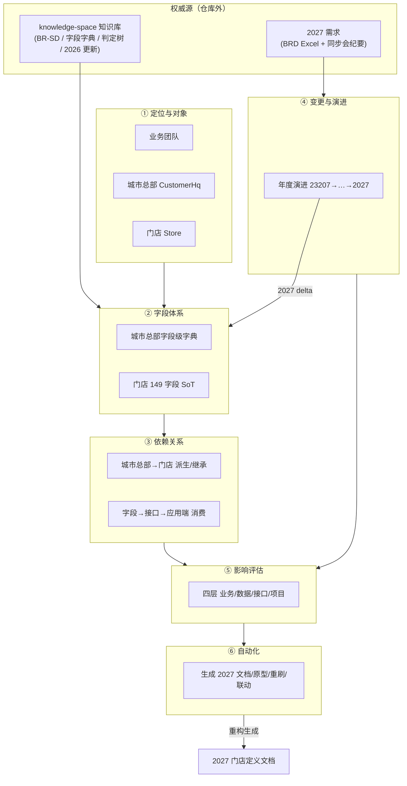

# 门店定义 · 全局纲领（结构性搭建）

> **定位**：门店定义知识的「全局纲领 / 单一骨架」——用一份结构化框架统摄门店定义的所有知识（对象、字段、依赖、变更、影响、工具），作为「2026 基线 + 2027 需求 → 重构生成 2027 门店定义文档」的总纲。
> **用途**：① 知识收敛总入口，每章对应一项或多项「门店定义」行动项；② 2027 文档生成模板，每章同时标注 **2026 基线** 与 **2027 变更 delta**，据此落成 2027 文档。
> **维护约定**：结构稳定、内容逐步补充（状态「待补充 → 进行中 → 已完成」）；口径单源化 + 只追加；改动后同步更新 `CLAUDE.md`「检索地图」节。
> **性质**：个人产出物 · 暂时非公共资产（评审后按 `CLAUDE.md`「检索地图」入库映射进 knowledge-space）。

---

## 0. 纲领总览

### 0.1 定位与用途

（待补充——一句话说清本纲领与「2026 门店定义文档」「2027 需求」三者关系，以及「谁、在什么阶段、怎么用」。）

### 0.2 门店定义知识全景图

### 0.3 章节 ↔ 行动项 ↔ 产出 映射表

| 章节 | 对应行动项 | 主要产出（工作区） | 优先级 |
|---|---|---|---|
| 1 定位、对象与边界 | 全局（纲领性） | 本文件 | — |
| 2 业务团队划分 | 门店定义-1 | `门店定义\业务团队划分.md` | P1 |
| 3 主数据对象与字段体系 | 门店定义-2、3 | `数据资产\城市总部主数据-字段清单.md`、`数据资产\门店主数据-字段清单.md` | P0 |
| 4 依赖关系 | 门店定义-4、5 | `门店定义\城市总部门店依赖关系.md`、`门店定义\数据应用端依赖关系.md` | P0 / P1 |
| 5 变更与演进规律 | 门店定义-6 | `门店定义\门店定义变更规律.md` | P0 |
| 6 下游影响评估 | 门店定义-7 | `门店定义\主数据变更影响评估指南.md` | P0 |
| 7 自动化工具与可持续化 | 门店定义-8、9 | `自动化工具\`（设计 + POC） | P2 |
| 8 落成 2027 门店定义文档 | 全局 | 2027 门店定义文档 | — |

### 0.4 2026 基线 → 2027 重构路径

（待补充——三步法：① 以本纲领为骨架；② 填入 2026 基线（knowledge-space + `数据资产\`）；③ 叠加 2027 变更 delta（BRD Excel + 同步会纪要）→ 生成 2027 文档。）

---

## 1. 定位、对象与边界

### 1.1 门店定义是什么 / 为什么重要

（待补充——门店定义 = 决定门店「怎么分类 / 被谁覆盖 / 供什么货 / 怎么被考核」的规则体系；它是主数据与下游渠道策略的枢纽。）

### 1.2 三大主数据对象与层级

（待补充——业务团队 / 城市总部（三级：客户系列→全国总部→城市总部）/ 门店，及其引用方向。）

### 1.3 范围与边界

（待补充——覆盖哪些一级渠道 / 店型 / 标签，不覆盖什么；2027 店型 80→64 的边界。）

---

## 2. 业务团队划分 ← 门店定义-1

- **要回答**：业务团队「团队 ↔ 品类 ↔ segment(MW/IC) ↔ 覆盖/维护入口」权威对照 + 待确认项。
- **权威来源**：`business/organization/organization.md`、`region.md`、`store-center/ontology/value-types.md` §五/§六、`business/rules/customer_supply_rules.md` BR-CUS-03、`cot/field-ops/{snacking,icecream}-2026-update.md`。
- **2026→2027**：（待补充——BE KIND 是否引入供货治理等。）
- **状态**：待补充

### 2.1 团队 ↔ 品类 ↔ segment ↔ 覆盖/维护入口 对照表

（待补充）

### 2.2 待确认清单

（待补充——Segment 实值、BE KIND 引入等。）

---

## 3. 主数据对象与字段体系 ← 门店定义-2、3

### 3.1 城市总部定义及主数据 ← 门店定义-2

- **要回答**：城市总部**字段级字典**（字段→含义→类型→取值域→继承/计算→来源）+ 逐值明细。
- **权威来源**：`store-center/ontology/object-types/customer-hq.md`、`customer-center/README.md`，融合 `数据资产\城市总部主数据-字段清单.md` + PRD §4.4。
- **状态**：待补充

#### 3.1.1 对象定位

（待补充——层级表达 / backing 表 `city_headquarters` / 主键 / writeback owner / 自链接。）

#### 3.1.2 字段级字典

（待补充——字段→含义→类型→取值域→继承/计算→来源 表。）

#### 3.1.3 逐值明细

（待补充——指定客户类型 10 值 / 非实名 4 值 / 零食系列 3 值 / HqChannel 8 值。）

### 3.2 门店各字段定义与主数据 ← 门店定义-3

- **要回答**：门店 **149 字段 SoT 逐字段权威表**（定义 / 取值域 / 计算函数 / 继承标记 / 生效版本 / 命名漂移）。
- **权威来源**：`data/store_center_data_dictionary.md`、`store-center/ontology/object-types/store.md`(D1–D7)、`ontology/store-synthetic-attrs/attribute-registry.md`(396 属性)，融合 `数据资产\门店主数据-字段清单.md` + PRD §4/附录C。
- **状态**：待补充

#### 3.2.1 149 字段 SoT 逐字段权威表

（待补充）

#### 3.2.2 计算函数

（待补充——`f-store-type-calc` / `f-hq-rtm-calc` / `f-rtm-channel-calc` / `f-rtm-sip-calc` / `f-coverage-mode-calc` / `f-ttf-coeff-calc` / `f-assessment-tag-calc`。）

#### 3.2.3 生效版本与命名漂移

（待补充——同字段跨年取值变化、命名漂移对照。）

---

## 4. 依赖关系 ← 门店定义-4、5

### 4.1 城市总部 → 门店 派生/继承 ← 门店定义-4

- **要回答**：「城市总部属性 → 门店字段」**派生/继承矩阵 + 触发链图**（customer-changed-listen → 门店重算）。
- **权威来源**：`business/entities/actor-model.md` §2.1、`customer_supply_rules.md` BR-CUS-07/12、`store-center/ontology/dynamic-semantics.md` §3、`config-objects/store-type-combination.md`、字段字典 §7.2。
- **状态**：待补充

### 4.2 字段 → 数据集 → 接口 → 应用端 消费 ← 门店定义-5

- **要回答**：「字段 → 数据集 → 接口 → 应用端」**消费矩阵 + 存储引擎分工**。
- **权威来源**：`features/downstream-data-interfaces.md`(18 接口)、`store-center/apis/downstream-store-master-2026.md`(10 下游)、`customer-center/apis/downstream-city-hq-2026.md`(3 API)、`systems/_global/cross-system-scenarios.md`；本地 Postman 接口集合 + SFA 前端 +（按需）`gh` 拉后端。
- **状态**：待补充

---

## 5. 变更与演进规律 ← 门店定义-6

- **要回答**：**年度演进表 + 规律归纳 + 存量重刷方法论**。
- **权威来源**：`projects/proj-store-definition.md`、`business/rules/store_definition_rules.md`(BR-SD + 冲突登记 901~915)、`value-types.md` 版本口径、`config-objects/store-type-combination.md` 三年度判定树、`features/store-definition-*.md`。
- **状态**：待补充

### 5.1 年度演进表（23207 → 24316 → 25178 → 25718 → 2027）

（待补充）

### 5.2 变更类型规律

（待补充——retired / renamed / added / 合并 / 拆分 / 属性下沉为标签。）

### 5.3 存量重刷方法论

（待补充）

---

## 6. 下游影响评估 ← 门店定义-7

- **要回答**：**四层影响评估方法论 + 可复用 checklist + 字段→下游影响追溯模板**。
- **权威来源**：`门店定义知识库探究-避坑指南.md` KB-002 四层框架，结合第 4/5 项矩阵。
- **状态**：待补充

### 6.1 四层影响评估方法论

（待补充——业务 / 数据[逻辑+存量] / 接口[系统 or 微服务] / 项目。）

### 6.2 可复用 checklist

（待补充）

### 6.3 字段 → 下游影响追溯模板

（待补充）

---

## 7. 自动化工具与可持续化 ← 门店定义-8、9

### 7.1 自动化工具实现 ← 门店定义-8

- **要回答**：从「变更对照表 + 字段计算逻辑 + 依赖矩阵」自动生成 2027 各产物。
- **状态**：待补充

#### 7.1.1 自动化生成 PRD 文档

（待补充）

#### 7.1.2 自动化生成各应用端交互原型

（待补充）

#### 7.1.3 历史数据实时按定义变更重刷

（待补充）

#### 7.1.4 城市总部与门店主数据联动

（待补充）

### 7.2 工具可持续化进阶 ← 门店定义-9

（待补充——配置化 / 可扩展 / 版本化 / 数据源治理。）

---

## 8. 落成 2027 门店定义文档

### 8.1 2026 基线 → 2027 变更对照（delta 单源）

> 2027 变更锚点（来源：`2027需求\BRD\门店定义\2027 Channel Segmentation and RTM_260923_(WIP).xlsx` + `2027需求\项目启动\明年门店主数据渠道与店型变更需求同步会_summary.md`；多数待 V3/P11 V4 定稿确认）：

- **店型总量**：80 → 64（简化 / 合并 / 拆分 / 改名 / 属性下沉为标签）。
- **一级渠道**：New Model 并入 Special（NM 一级渠道取消，RTM 随之取消）。
- **MT**：取消连锁/非连锁区分；CVS 高端/大众下沉为标签。
- **TT**：烟酒店 + 平摊店合并（南区有异议，**待确认**）。
- **Special**：新增「无人售卖/新模式」二级店型；改名 4 + 新增 4 三级店型；餐饮店去连锁/非连锁；授权模式拆分为「餐饮品牌店授权 / 预包装食品授权」。
- **Snacking**：二三级店型简化，RTM 保留 NL 区分。
- **Seed**：网吧 + 电竞酒店 →「电竞场所」；药店迁移至 Special；「其他种子渠道单体店」更名。
- **Wholesale**：二三级大幅简化 → 统一「批发渠道」。
- **Online**：平台式前置仓统一（区域/全国连锁/散仓合并）；「即时零售」更名「前置仓」；O2O 即时零售 RTM 拆分。
- **标签新增 4**：火车站安检口内/外、是否考核完美门店（零食白名单）、CVS 高端/大众投资标识、电商仓配标识（店/仓/商）。
- **标签删除 4**：Tier1/Tier2(Hyper/Super)、TT 经营条、供货平台、是否长期关店。
- **其他**：审批流 38 条线上化（独立议题）；完美门店 Scope + CVS POG 独立模块；仓/商分离（分销中心识别）；IR 拓展。

### 8.2 2027 门店定义文档目录（最终输出结构）

（待补充——以本纲领第 1–7 章为骨架，落成 2027 门店定义文档的正式目录。）
