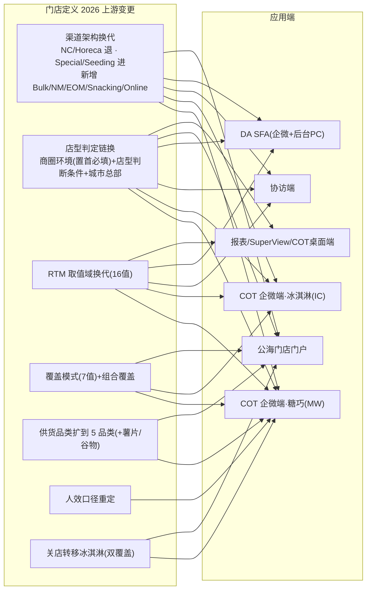

# 门店定义 2026 变更 · 应用端联动改动全景（验证输出）

> 性质：局部小规模知识验证输出（**不是**正式知识图谱，仅验证知识库能否支撑「门店定义变更 → 应用端联动」的溯源）
> 范围：门店定义 2026 换代，传导到所有应用端的联动改动
> 权威出处：`proj-cot-2026-application-refresh.md`（总纲）+ 4 份端侧深读（`snacking-2026-update.md` / `icecream-2026-update.md` / `da-sfa-2026-change.md` / `openstore-2026-change.md`）+ `openstore-page-registry.md`（163 行页面登记）
> 口径基线：**2026 P3**（未注明者以此为准）
> 生成日期：2026-10-15

## 0. 结论先行：能否从知识库拼出全貌？

**能，但要跨 6 份文档拼，知识库里没有单张「变更前/变更后」矩阵。** 分布如下：

| 资产 | 提供什么 |
|---|---|
| `proj-cot-2026-application-refresh.md`（总纲） | §2 各端一句话结论、§3 需求台账、§4 跨端 Ontology 变更总表 |
| `snacking-2026-update.md`（糖巧端） | 门店定义换代 + 线路外模块 + 3 新模块 + 关店转移 + 人效 + 日志 |
| `icecream-2026-update.md`（冰淇淋端） | 覆盖准入、专属人店字段、冰柜字段、供货、报表、分销规则 |
| `da-sfa-2026-change.md`（DA SFA） | 范围换代、完整性开关、重算链路、展示位、校园店 |
| `openstore-2026-change.md`（公海门店门户） | 菜单合并、城市总部维护、线路外绑线路、审批、导入/导出 |
| `openstore-page-registry.md` | 163 行 `page_conf` 页面身份 → 场景/过程 uid 反解 |

**边界（诚实声明）**：知识库能给出「哪些端、哪些菜单、哪些功能点被联动」和「大部分变更前/后取值」，但以下四处**不能从知识库闭环**，只能给出「已知缺口」：

1. **四类修改日志报表未落地**（供货/人店/打标/门店修改日志）——PRD §3.4 提出，程序台账 0 提及、staging 无事实表。
2. **菜单合并只做一半**——6 渠道维护菜单「新增+授权」了「糖巧门店维护」，旧菜单未停用、`page_conf` 6 套身份未收编。
3. **RTM 口径不闭合**——报表/协访端 PRD 列 12/13 值，主数据实际 16 值（差 DCOM/EOM/ERTM）。
4. **三份外链 PRD 未纳管**（冰淇淋表单、DA 表单、完美门店成功图像 PDF）——对应收集项无法逐项核对。

## 1. 上游变更 → 应用端传导总览

门店定义 2026 的 7 个上游变更，向 6 个应用端传导：

## 2. 应用端明细（六列：APP入口 / 菜单入口 / 连带调整功能点 / 变更类型 / 变更前 / 变更后）

### A. COT 企微端 · 糖巧（`user_segment=MW`，PRD 2517802）

| APP入口 | 菜单入口 | 连带调整功能点 | 变更类型 | 变更前 | 变更后 |
|---|---|---|---|---|---|
| COT 企微端 | 门店管理-列表 | 门店过滤口径 | 过滤口径变更 | 按旧渠道/店型过滤 | 覆盖模式含「糖巧固定覆盖」或「糖巧非固定覆盖」，且 `salesman_code` 或 `store_manager_code`=当前用户（可带出门店负责人） |
| COT 企微端 | 门店管理-列表 | 渠道 ICON | 取值域替换 | NC/Horeca 等在 | 取消 NC/Horeca；新增 Special、Seeding、**Bulk**（散装联营） |
| COT 企微端 | 门店管理-列表 | 门店类型筛选 | 过滤口径变更 | 单选/旧店型 | 三级级联多选（一级/二级/三级渠道名称）+ 精确查找 + 无默认值 |
| COT 企微端 | 门店管理-建店/改店 | 店型判定链 | 计算逻辑变更 | 业务员先选一级渠道 | 门店渠道(5组)→商圈环境(必填置首)→店型判断条件→城市总部三级→系统算店型 |
| COT 企微端 | 门店管理-建店/改店 | 【门店特征】字段 | 字段改名 | `门店特征` | `店型判断条件`（`store_feature`） |
| COT 企微端 | 门店管理-建店/改店 | 【商圈环境】 | 计算逻辑变更 | 普通字段 | 升为店型判定首要字段，取消「无」选项、置首 |
| COT 企微端 | 门店管理-供货信息 | 供货品类 | 取值域替换 | 箭牌/巧克力/冰淇淋 3 品类 | 5 品类（箭牌/巧克力/冰淇淋/薯片/谷物）；箭牌&巧克力≤2条、薯片/谷物/冰淇淋仅1条；TT/WS 不可「直供」；主数据实际另有第 6 组 BE KIND |
| COT 企微端 | 门店管理-供货信息 | 供货商过滤 | 过滤口径变更 | 按原口径 | 一级供货商按 `division`+经营范围（Mixed/IceCream Only 等）过滤 |
| COT 企微端 | 门店管理-拜访信息 | 门店负责人可改性 | 计算逻辑变更 | 一律默认当前用户 | 仓储式/大卖场/超级市场默认当前用户**可改**；其他店型默认当前用户不可改 |
| COT 企微端 | 门店管理-审批 | 审批触发规则 | 审批流变更 | 旧审批字段清单(2023) | 免审批白名单新增「商圈环境」；必审情形=MT/Snacking+KA类RTM、WS/Online/Bulk/NM 全审、Special 工厂企事业两店型 |
| COT 企微端 | 门店管理-审批 | 渠道负责人节点 | 审批流变更 | 无 | 新增「渠道负责人」审批节点（仅配了糖巧-工厂企事业 1 条） |
| COT 企微端 | 门店管理-关店 | 关店转移冰淇淋 | 关店转移 | 双覆盖门店关店=彻底关店 | 糖巧+冰淇淋双覆盖门店，糖巧发起关店→最后一级审批通过实时生效：去糖巧覆盖留冰淇淋、清糖巧供货与线店关系、人店关系不变、写标签「关闭转冰品覆盖」 |
| COT 企微端 | 线路外门店管理 | **独立模块（新增）** | 新增模块 | 无此模块 | 首页=覆盖含「糖巧线路外覆盖」；建店仅校验 RTM 白名单(FT-Non KA/FT-TT/FT-Seeding/FT-Special)；数字化标签必填且仅两项；不展示线路；**建/改/关无审批流** |
| COT 企微端 | O2O 分销任务 | **新模块** | 新增模块 | 无 | 2026P3W2 新增（路由 `/o2o-distribution-task`） |
| COT 企微端 | 物料领用扫码 | **新模块** | 新增模块 | 无 | 2026P3W3 新增（`/material-receiving`+`/material-usage-records`，角色=物料领用人员可见） |
| COT 企微端 | 新鲜度采集 | **新模块** | 新增模块 | 无 | 2026P4W1 新增（`/freshness`，导入 4 任务链） |
| COT 企微端 | 首页-人效达成 | 带店折算标准 | 规则参数调整 | MT 670 / 其他 600 | MT **400** / 其他 **360**（代码硬编码，非配置对象） |
| COT 企微端 | 门店拜访-门店详情 | 新增展示字段 | 展示位新增 | 无 | 新增【店型判断条件】【薯片一级供货商】【谷物一级供货商】；调整【商圈环境】顺序 |
| COT 企微端 | 离店页面实时算分 | 报表路由 | 数据源切换 | 有 NC 加油站线下喜铺明细调度 | 新增「特殊渠道明细报表调度」（`zo_special_detail_p`）；取消「NC 加油站线下喜铺明细报表调度」 |
| COT 企微端 | 建店表单数据源 | 表单数据源 | 数据源切换 | `forms_project_instance_2025` | `forms_project_instance_2026`；截P 跨年跨表(P1&P2查2025迁移表、P3后查2026表) |
| COT 企微端 | 验证码查询 | 菜单可见性 | 菜单合并 | 展示 | 2026P6W1 隐藏 |
| COT 企微端 | 门店联系电话 | 店主手机号 | 拦截逻辑 | 编辑态可改 | 编辑态对糖巧用户禁用 `link_tel`（v1.0.7） |

### B. COT 企微端 · 冰淇淋（`user_segment=IC`，PRD 2517804）

| APP入口 | 菜单入口 | 连带调整功能点 | 变更类型 | 变更前 | 变更后 |
|---|---|---|---|---|---|
| COT 企微端 | 门店管理-列表 | 门店过滤口径 | 过滤口径变更 | 按旧渠道/店型 | 覆盖模式含「冰淇淋有拜访要求」，且 `userCode=salesman_code`（**只认业务员，不认门店负责人**，与 MW 不对称） |
| COT 企微端 | 门店管理-列表 | 渠道 ICON | 取值域替换 | NC/Horeca 在 | 取消 NC/Horeca；新增 Special、Seeding、**NM**（新模式）——与糖巧端「新增 Bulk」不一致 |
| COT 企微端 | 门店管理-建店/改店 | 店型判定链 | 计算逻辑变更 | 业务员选一级渠道 | 门店渠道(5组)→商圈环境→店型判断条件→城市总部→系统算店型 |
| COT 企微端 | 门店管理-建店/改店 | 【门店特征】字段 | 字段改名 | `门店特征` | `店型判断条件`（v1.0.2 改名；v1.0.2 增加回【门店渠道】） |
| COT 企微端 | 门店管理-供货信息 | 品类固定 | 计算逻辑变更 | 多品类 | 品类固定「冰淇淋」；供货类型 直供/经销商供货/无；TT/WS 不可选直供；一级供货商经营范围=MIXED 或 IceCream Only |
| COT 企微端 | 门店管理-拜访信息 | 冰淇淋专属人店字段 | 字段新增 | 复用糖巧业务员字段 | 新增 `ic_salesman_code` / `ic_store_manager_code`（实测覆盖 91%）；门店负责人=当前用户不可改 |
| COT 企微端 | 门店管理-审批 | 渠道负责人节点 | 审批流变更 | 无 | 冰淇淋端**不配置**该节点（页面报错找不到审批用户） |
| COT 企微端 | 门店管理-审批 | 工厂企事业拦截 | 拦截逻辑 | 可线上建店 | IC+Special+{工厂企事业内门店,工厂企事业团购} 直接抛「冰淇淋暂未开放该门店类型线上建店，请线下提交」 |
| COT 企微端 | 门店管理-编辑 | 可改性判定 | 拦截逻辑 | 含冰淇淋覆盖即可改 | `canEditStore` 用 `cover_mode === '冰淇淋有拜访要求'` **全等**判断→组合覆盖(糖巧∪冰淇淋)门店不可编辑（与 43% 组合覆盖门店冲突） |
| COT 企微端 | 门店拜访-门店详情 | 新增展示字段 | 展示位新增 | 无 | 新增【店型判断条件】；调整【商圈环境】顺序 |
| COT 企微端 | 门店详情-冰柜 | 冰柜数量字段 | 字段新增 | 无 | 新增 `ice_locker`（4,799 家冰淇淋门店有值） |
| COT 企微端 | 冰淇淋产品介绍 | 模块状态 | 无变更 | — | PRD 显式关闭「已确认，无新品，不更新」 |

### C. 协访端（糖巧 + 冰淇淋，PRD 2517802/2517804）

| APP入口 | 菜单入口 | 连带调整功能点 | 变更类型 | 变更前 | 变更后 |
|---|---|---|---|---|---|
| 协访端 | 未认证门店列表 / 协访列表 | 门店类型筛选项 | 取值域替换 | 旧店型筛选项 | 按 2026 渠道架构更新；新增**筛选/搜索条件记忆**；筛选项由字典提供（糖巧 `mwVisitStoreChannel` L3=59 / 冰淇淋 `icVisitStoreChannel` L3=63） |
| 协访端 | 门店认证报告 | RTM 维度统计 | 计算逻辑变更 | 旧 RTM 口径 | 按 2026 取值汇总后合并 TTL；路由=覆盖∈{糖巧固定/非固定/冰淇淋有拜访要求/糖巧线路外}；`salesman_code/name` 按覆盖模式取糖巧或冰淇淋业务员 |
| 协访端 | 门店认证报告 | 字段增删 | 字段新增/删除 | 旧字段 | 新增 `gaode_name`/`verify_*`/`application_reason`；删除 POI 系列；`first_approved_timestamp` 更名「开店时间」 |
| 协访端 | 门店详情 | 新增展示字段 | 展示位新增 | 无 | 新增【店型判断条件】【薯片一级供货商】【谷物一级供货商】 |
| 协访端 | 执行标准(成功图像) | 图片标准 | 无变更(引用外链) | — | 完美门店成功图像 by 店型更新（PDF 原件未纳管） |
| 协访端 | 陈列/分销/O2O 表单 | 表单数据源 | 数据源切换 | `_2025` | `forms_project_instance_2026`；反馈记录/翻拍反馈不变 |

### D. DA SFA（企微端 + 后台 PC 端，PRD 2517806）

| APP入口 | 菜单入口 | 连带调整功能点 | 变更类型 | 变更前 | 变更后 |
|---|---|---|---|---|---|
| DA SFA 企微端 | 门店管理列表 | 门店范围 | 取值域替换 | MT/TT/WS/Horeca 4 渠道 | MT/TT/WS/Special/Seeding 5 渠道（**Horeca 退出**；实测传统36,460/现代1,346/批发267/特殊84/种子6） |
| DA SFA 企微端 | 门店管理列表 | 一级渠道 ICON | 展示位新增 | 无 ICON | 新增【一级门店渠道】ICON |
| DA SFA 企微端 | 门店管理列表 | 完整性 ICON | 展示位新增 | 无 | 新增【门店信息是否补全】ICON（`is_allow_visit`） |
| DA SFA 企微端 | 门店管理列表 | 三级店型显示 | 展示位新增 | 无三级店型 | 一级渠道后显示三级门店类型（`store_channel_name`） |
| DA SFA 企微端 | 门店信息修改 | 店型可改性 | 计算逻辑变更 | 可改店型 | 仅**首次**维护可改店型信息（门店渠道/商圈环境/店型判断条件/城市总部），非首次锁定置灰 |
| DA SFA 企微端 | 门店信息修改 | 店型判定链 | 计算逻辑变更 | 业务员先选一级渠道 | 填商圈环境+店型判断条件+城市总部→系统算店型（v1.0.3 又回退半步：门店渠道交回业务员选） |
| DA SFA 企微端 | 门店信息修改 | 【门店特征】字段 | 字段改名 | `门店特征` | `店型判断条件`（列名未改，注释已改） |
| DA SFA 企微端 | 门店信息查询页 | 新增展示字段 | 展示位新增 | 无 | 新增【店型判断条件】【收银机个数】【门店营业面积】（v1.0.1） |
| DA SFA 企微端 | 门店信息修改-城市总部 | 城市总部取数 | 过滤口径变更 | 旧取数 | 过滤 LKA 单体店（C00064037/38/39）+ 全国总部指定客户类型∈{校园供应,餐饮供应,自营式前置仓}（糖巧端只滤 LKA 单体店） |
| DA SFA 企微端 | 拜访列表 | 可拜访过滤 | 过滤口径变更 | 旧过滤 | 仅展示**已补全**的指定店型；未补全点击拜访→提示「当前门店未进行信息补全…」并跳门店维护 |
| DA SFA 企微端 | 陈列表单 | 校园店收集项 | 字段新增 | 无校园店 | 新增校园店收集项（校园内标准超市/小型超市/TT店，follow TT 店）；校园店已进主数据并打可拜访标(31家) |
| DA SFA 后台 PC 端 | Excel 导入 | 门店新建入口 | 无变更 | 只能 ERP 导入、不可新建 | 不变（`da_primary_data_batch_creation_*`） |
| DA SFA 后台 PC 端 | 门店重算 | 历史门店重算 | 计算逻辑变更 | 旧映射 | 有效门店按逻辑刷新；无效门店只按映射刷新且**不刷店型判断条件**（Horeca/区域管理餐饮→特殊渠道/非连锁餐饮） |
| DA SFA（跨端） | 城市总部属性变更 | 店型/RTM 重算触发 | 计算逻辑变更 | 无重算触发 | 城市总部「指定客户类型/是否连锁/KA类型」变更→重算该总部覆盖全部有效门店店型与 RTM |

### E. 公海门店门户（PRD 25718）

| APP入口 | 菜单入口 | 连带调整功能点 | 变更类型 | 变更前 | 变更后 |
|---|---|---|---|---|---|
| 公海门店门户 | 门店数据维护 | 菜单合并 | 菜单合并 | 6 个渠道维护菜单(MT/TT/WS、NC/NM、Snacking、Horeca、Online、EOM) | 合并为「糖巧门店维护」1 菜单；**旧菜单未停用仍授权**（合并只做一半） |
| 公海门店门户 | 糖巧门店维护-新建/修改 | 店型判定链 | 计算逻辑变更 | 旧店型逻辑 | 同步 2026 定义：商圈环境取消「无」、店型判断条件、城市总部取数、门店渠道改名「特殊或种子或新模式渠道」 |
| 公海门店门户 | 糖巧门店维护-新建/修改 | 新增字段 | 字段新增 | 无 | `storeFeature`(店型判断条件)/`isFreshDominant`(是否生鲜>70%)/`certificatesFileIds`(合作合同·供货证明·营业执照) |
| 公海门店门户 | 糖巧门店维护-列表/详情/导出 | 供货品类字段 | 字段新增 | 3 品类 | 新增薯片&谷物【供货类型】【供货商编码】【供货商名称】（`chips_customer_*`/`cereal_*` 三处齐备） |
| 公海门店门户 | 糖巧门店维护-导入 | 供货商校验 | 计算逻辑变更 | 无 | 新增薯片&谷物供货商经营范围校验 |
| 公海门店门户 | 糖巧批量关闭/单个关店 | 关店转移冰淇淋 | 关店转移 | 关店=清糖巧 | 双覆盖门店关店触发「糖巧冰淇淋关店」场景→去糖巧覆盖留冰淇淋、清糖巧供货与线店关系（与 COT 同源） |
| 公海门店门户 | 城市总部维护 | 供货品类 | 字段新增 | 箭牌/巧克力/冰淇淋/缤善 | 供货品类下拉新增**薯片、谷物**（`supply_category_code` 实测含 CHIPS/CEREAL/BE_KIND 六类） |
| 公海门店门户 | 城市总部维护 | 店型/RTM 重算 | 计算逻辑变更 | 无触发 | 城市总部属性变更→**触发覆盖门店店型/RTM 重算**（成为 DA 门店定义的事实入口） |
| 公海门店门户 | 访店路线规划-路线门店绑定 | 线路外门店 | 新增能力 | 仅固定覆盖门店可绑线路 | **支持维护线路外门店**（线路外 28,721 家已绑线路 12,883 家=44.9%） |
| 公海门店门户 | 线路外门店转移审批 | 转移审批 | 新增能力 | 无 | 线路外↔固定覆盖互转两级审批（主管→城市经理） |
| 公海门店门户 | 用户管理-组织管理 | 渠道权限初始化 | 权限初始化 | 旧渠道权限 | 组织渠道类型权限按最新渠道初始化（⚠️ 存量取值未清：仍含新兴渠道/电商/二分商等非 2026 取值） |
| 公海门店门户 | 导出 | 导出命名格式 | 无变更(格式规范) | 旧命名 | 文件名规范为 `<业务名>_<用户编码>_<yyyyMMdd_HHmmss>.xlsx` |
| 公海门店门户 | 承包制经销商异常门店清单 | **新页面** | 新增模块 | 无 | 2026 新增（`/abnormal-stores`，虚拟门店人员/主数据缺失清单，异常类型枚举：好德缺失销售人员数据/COT未存在人员信息） |
| 公海门店门户 | 糖巧人店关系维护-导入 | 导入限制 | 拦截逻辑 | 无限制 | 26P6W2 新增导入限制（门店编码+业务员工号+负责人工号+玛氏地理必填） |

### F. 报表 / SuperView / COT 桌面端

| APP入口 | 菜单入口 | 连带调整功能点 | 变更类型 | 变更前 | 变更后 |
|---|---|---|---|---|---|
| 报表 | 冰淇淋国标明细 / 截P | 门店路由 | 计算逻辑变更 | 旧路由 | 扩充：糖巧 Project 下拜访的加油站/线下喜铺/高速服务区售点门店 |
| 报表 | 冰淇淋国标明细 / 截P | 分销字段数据源 | 数据源切换 | 旧数据源 | 分销字段数据源更新 |
| 报表 | 冰淇淋截P | 最后一访店型 | 字段新增 | 无 | 新增【明细最后一访店型】【店型是否更新】（落 `report_ps_p.ic_detail_gb_p`） |
| 报表 | 冰淇淋国标/完美门店明细 | 冻库/家批字段 | 字段新增 | 无 | 新增冻库系列（`is_cold_storage`/`cold_storage_area`/`cold_storage_photos`）+ 家批类型（`hws_type` 大家批/小家批）；另有 `is_freezer_wrap`(冰柜围膜) PRD 未列 |
| 报表 | DA 门店详情报表 | 店型判断条件 | 字段新增 | 无 | 新增【店型判断条件】字段（直连 `yyx_da_master.da_store_inform`，不经报表计算层） |
| 报表 | DA 拜访频率报表 | 陈列字段 | 无变更 | — | 字段不变，不采集的陈列字段**保留不隐藏** |
| SuperView | 分销规则(国标/完美门店) | 目标系数 | 规则参数调整 | 现代/传统/特殊/零食 0.30 | 2026P06 起 **0.85**（批发 0.55 不变） |
| SuperView | 分销规则(完美门店) | SKU 覆盖率 | 规则参数调整 | 旧标准 | 按城市总部×二级渠道 7,153 行/1,431 城市总部（0.07–1.0，均值 0.896，窗口 2026P08–P13） |
| COT 桌面端(`re-sfa-mgtwps`) | 后台建店/校验 | RTM 校验白名单 | 计算逻辑变更 | 旧白名单 | 扩到 {NKA,EOM,ERTM,DCOM,New Model,散装联营}；旧合并渠道映射(MT&TT/Others)注释 |
| COT 桌面端 | 后台建店/校验 | 字段名 | 字段改名 | 「渠道门店类型」 | 「门店渠道类型」；渠道树改懒加载 |
| COT 桌面端 | 访店计划维护/查询 | 计划拜访人 | 展示位新增 | 无 | 新增「计划拜访人 segment」列（支持糖巧/冰淇淋双 segment） |

## 3. 边界与已知缺口

| # | 缺口 | 影响 | 出处 |
|---|---|---|---|
| 1 | 四类修改日志报表（供货/人店/打标/门店修改）未落地 | 变更可追溯无法端到端证明 | 糖巧篇 §2.5/D8 |
| 2 | 菜单合并只做一半（旧菜单未停用、`page_conf` 6 套身份未收编） | 运营仍可从旧入口进入 | 门户篇 D1/D2 |
| 3 | RTM 口径 13≠16 不闭合（差 DCOM/EOM/ERTM） | 认证报告 TTL 与分维不闭合 | 冰淇淋篇 D2/C8 |
| 4 | 组合覆盖（糖巧∪冰淇淋）的「可编辑/归属/考核」语义未裁定 | 43% 冰淇淋门店受影响 | 冰淇淋篇 OQ-COT26-01 / 门户 OQ-OS-08 |
| 5 | 端侧 ICON 双字典（糖巧 Bulk vs 冰淇淋 NM） | 两端筛选项天然不一致 | 糖巧篇 D1 |
| 6 | 三份外链 PRD 未纳管（冰淇淋/DA 表单、成功图像 PDF） | 收集项无法逐项核对 | 各端 OQ |
| 7 | 渠道类型权限资源内容未清洗（含 5 个非 2026 取值） | 数据权限口径含历史残留 | 门户 OQ-OS-07 |
| 8 | DA 可拜访标算法链 2023 年定型、未随门店范围改造 | 拜访范围与店型换代解耦 | DA 篇 D3 |
