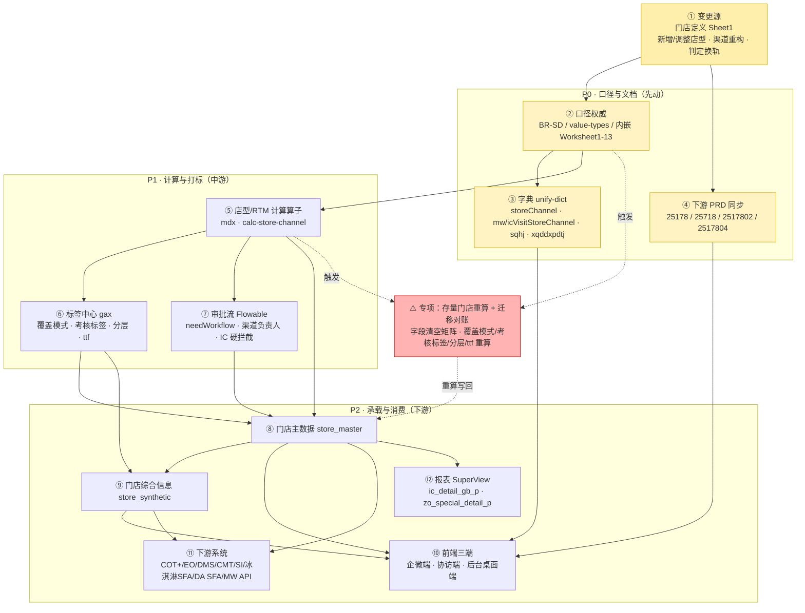
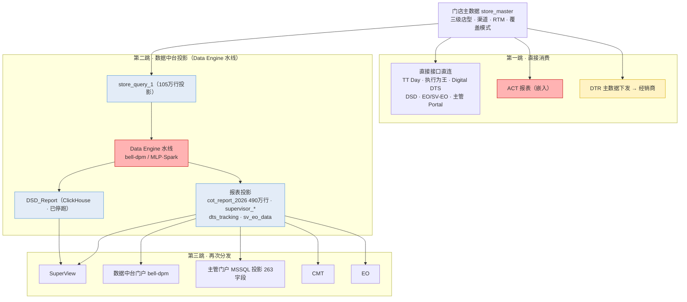

# 门店店型定义变更 · 下游连带影响评估报告（概要版）

> 变更依据：`测试/26 Channel Segmentation and RTM labbling-final.xlsx` **Sheet1「门店定义（1121版本）」** 中标注的 **新增 / 调整** 店型。
> 知识库口径权威：`knowledge-space/clients/mars/business/rules/store_definition_rules.md`（BR-SD）、`.../systems/business-middle-platform/store-center/ontology/value-types.md`（值类型）、`.../business/entities/channel.md`、`.../business/entities/store.md` 等（完整索引见文末附录）。
>
> **信息来源标注约定**：每条评估结果后附「信息来源」列，格式为 `[缩写]`，对应文档与路径统一登记在文末《附录：信息来源索引》。

---

## 0. 变更本质（一句话定性）

这不是一次"增删几个店型"的局部调整，而是一次**一级渠道体系重构**叠加**店型判定机制换轨**：

- **渠道骨架重构**：NC（新兴渠道）拆为 Special + Seeding；Horeca 并入 Special；新模式 NM 缩减（折扣店→MT、集合店潮玩→Special）；**新增一级渠道 Bulk 散装联营**。
- **判定机制换轨**：2026 起店型由「**商圈环境（19 值，必填、首要）＋ 店型判断条件（17 值，统一字段）＋ 城市总部**」组合判定（BR-SD-316/317/318），取代 2025 按渠道分散的 5 个"判断条件"字段。
- **RTM 换轨**：15 值 → 16 值（NC 拆 Special/Seeding、NM 合并为 New Model、新增散装联营）。

因此所有"以店型/渠道/RTM 为输入"的下游业务都会被波及。下表按四个角度展开。

---

## 一、业务逻辑层面

| # | 受影响业务 | 连带影响 | 严重度 | 信息来源 |
|---|---|---|---|---|
| 1 | **店型判定规则** | 新店型（生鲜店/充电站/校园店×4/工厂企事业×2/电竞酒店/运动场馆/桌游店/散装联营等）需**新增判定分支**；A 类商圈（10 值）直接锁定店型、B 类商圈（9 值）必填判断条件；折扣店、集合店潮玩店等"迁移"店型要**改判定归属** | 高 | [Excel-Sheet1]、[BR-SD-202]、[BR-SD-316]、[BR-SD-317]、[BR-SD-318]、[BR-SD-319]、[VT-StoreTypeCondition]、[VT-BusinessDistrict] |
| 2 | **覆盖模式打标** | 覆盖模式由「维护入口 × 店型」系统打标（《店型与覆盖模式对应表》G/H 列）。新店型需补映射，迁移店型的默认覆盖模式会变；手工标后不再自动重判 | 高 | [BR-SD-502]、[BR-SD-503]、[VT-CoverageMode]、[SNK-2026-C1] |
| 3 | **RTM 渠道判定** | NC→Special/Seeding、Horeca→Special、NM 合并，RTM 取值重算为 16 值；SIP 细分随之重排 | 高 | [BR-SD-301]、[BR-SD-302]、[BR-SD-303a]、[BR-SD-305]~[BR-SD-315]、[CH-RTM16]、[VT-RtmChannel] |
| 4 | **考核标签（AssessmentTag 4 值）** | 糖巧线下完美门店/糖巧线上 O2O/糖巧冰淇淋/IC DSR 的判断条件**内嵌店型集合**。店型新增/迁移会直接改变打标结果与考核分母 | 高 | [BR-SD-601]~[BR-SD-606]、[BR-SD-330]、[VT-AssessmentTag] |
| 5 | **人效/ttf 折算** | ttf 系数**按店型分档**（Worksheet9 全表）。新店型若无 ttf 系数，人效分母 `sum(ttf)`、计划固定覆盖会缺失或错值 | 高 | [BR-SD-506]、[BR-SD-507]、[BR-SD-901]、[BR-SD-905]、[SNK-2026-C5] |
| 6 | **门店分层（StoreSeg）** | 铜/银/小微由店型自动产出（TT→铜、Mini→银、WS→小微）。店型迁移会引发分层重算 | 中 | [BR-SD-401]、[BR-SD-402]、[VT-StoreSeg] |
| 7 | **是否连锁** | 按渠道维度 ≥10 家判定，渠道维度 2026 收敛为 8 值（删 NC/Horeca、增 Special/Seeding/Bulk）。渠道重构改变连锁统计口径 | 中 | [BR-SD-106]、[BR-SD-107]、[BR-SD-115]、[BR-SD-329]、[BR-SD-915]、[VT-ChainFlagChannel] |
| 8 | **数字化标签（预售/现售/总仓）** | 按 RTM 分支决定值域与必填。RTM 换轨 → 标签值域与"线路外仅两项"约束变 | 中 | [BR-SD-405]、[BR-SD-327]、[BR-SD-406]、[BR-SD-907]、[VT-DigitalLabel]、[ST-digital] |
| 9 | **建店审批流** | 新店型审批流不同：工厂企事业团购→渠道负责人；校园供应/餐饮供应→channel owner（stone）；散装联营→主管+城市群经理；**冰淇淋对 Special 工厂企事业两类店型硬拦截（仅线下建店）** | 中 | [Excel-Sheet1-审批流列]、[SNK-2026-§2.7]、[IC-2026-C6] |
| 10 | **数据权限** | segment × 覆盖模式 × 玛氏地理。店型/渠道重构影响门店归属，进而影响"交集门店"的跨 segment 开放 | 中 | [BR-SD-703]、[BR-SD-704]、[DM-permission] |

---

## 二、数据层面

| # | 受影响数据资产 | 连带影响 | 严重度 | 信息来源 |
|---|---|---|---|---|
| 1 | **字典取值集合（unify-dict）** | `SalesChannelLevel1/2/3`、`RtmChannel`（16 值）、`BusinessDistrict`（19 值）、`StoreTypeCondition`（17 值）、`DesignatedCustomerType`（10 值）、是否连锁渠道维度（8 值）等全部要同步；现存 `mwVisitStoreChannel`（糖巧，含 Bulk 不含 NM）与 `icVisitStoreChannel`（冰淇淋，含 NM 不含 Bulk）**两套字典**是端侧 ICON 不一致的根因 | 高 | [VT-一]、[VT-二]、[SNK-2026-D1]、[IC-2026-OQ02]、[CH-VALUES] |
| 2 | **存量门店重算** | 历史门店店型需重算：NC 拆 Special/Seeding、Horeca 并入 Special、折扣店/集合店迁出 NM、生鲜店从 Mini 拆出；并按"渠道 × 字段"矩阵清空无关字段 | 高 | [BR-SD-326]、[BR-SD-328]、[BR-SD-213]、[BR-SD-320]、[BR-SD-302] |
| 3 | **门店主数据字段** | 新增 `store_feature`（店型判断条件，复用旧 `nc_analysis_condition` 等列，见命名漂移登记）、生鲜面积>70%、折扣店客户标记等；`store_master` 149 字段口径变 | 高 | [VT-命名漂移]、[ST-字段映射]、[IC-2026-C5] |
| 4 | **报表层** | 冰淇淋国标/完美门店明细（`ic_detail_gb_p/ic_detail_ps_p`）新增"明细最后一访店型/店型是否更新/冻库/家批类型"；新增 `zo_special_detail_p` 特殊渠道明细，取消 NC 加油站线下喜铺明细 | 中 | [IC-2026-C9]、[IC-2026-Q11]、[SNK-2026-§2.2] |
| 5 | **截 P 数据集（ps2026/\*.jiep）** | 全店型/分渠道截 P 报表按店型、RTM 分组，需随新渠道架构刷新分组与字段 | 中 | [DS-ps2026]、[SM-dataset] |
| 6 | **门店综合信息（store_synthetic）** | 151.6 万文档/240 字段，五路整合，店型类字段经标签中心 `tag_data.store_tag` 汇入；变更需回到正本链路 | 中 | [BR-SI-01]、[BR-SI-02]、[BR-SI-11]、[ST-标签段] |
| 7 | **数据质量监控** | 监控 8 类项含三级店型/一级渠道/RTM/是否连锁，监控规则需随渠道重构更新，取数表由 `store_query_1` 改 `store_query_2` | 低 | [BR-SD-801]~[BR-SD-804] |

---

## 三、技术层面

| # | 受影响技术组件 | 连带影响 | 严重度 | 信息来源 |
|---|---|---|---|---|
| 1 | **店型/RTM 计算算子（mdx）** | `POST /store/channel/calc`、`/store/channel/rtm/calc`（calc-store-channel）判定逻辑需重写；A/B 锁定逻辑（follow 商圈/特征）与"无效组合判定失败"路径 | 高 | [CSC-action]、[SNK-2026-§3.5]、[BR-SD-316] |
| 2 | **标签中心 gax 算子** | 覆盖模式/考核标签/分层/ttf 打标算子需改（新店型、迁移店型）；`tag_data.store_tag` 151.6 万文档/71 字段 → `ex_store_tag` MQ | 高 | [ST-标签段]、[BR-SI-11]、[SNK-2026-§4]、[VT-标签生成侧] |
| 3 | **COT 三端前端** | 建店表单五段、渠道 ICON、店型判断条件依赖商圈字典接口（`/dict/bd_env/mapping/store_feature`）、`user_segment`（糖巧/IC）分流；`StoreUpsertHandler.needWorkflow` 免审批白名单与必审情形按新店型判定 | 高 | [SNK-2026-§2.2/§5.3]、[IC-2026-§3.3]、[SNK-2026-§2.7] |
| 4 | **审批流（Flowable）** | `store_create_process_a` 新增"渠道负责人"节点；冰淇淋工厂企事业店型硬拦截；线路外门店无审批流 | 中 | [SNK-2026-§2.7]、[IC-2026-C6]、[IC-2026-§3.3] |
| 5 | **关店转移冰淇淋场景** | `open-ic-mw-store-close` 算子依赖"糖巧+冰淇淋双覆盖"门店判定，双覆盖是主要形态（28,675 家、占冰淇淋门店 43%） | 中 | [SNK-2026-C8]、[IC-2026-C2]、[BR-SD-711] |
| 6 | **线路外门店管理模块** | RTM 白名单（FT-NonKA/FT-TT/FT-Seeding/FT-Special）、数字化标签仅两项，均以新 RTM/店型为准 | 中 | [SNK-2026-C3]、[SNK-2026-C4]、[BR-SD-505]、[BR-SD-509]~[BR-SD-511] |
| 7 | **枚举权威风险** | 端侧各写"新增值"、BE KIND 第 6 品类、供货经营范围大小写等收口缺失——店型变更会放大这类"枚举与存量"漂移 | 中 | [SNK-2026-D1/D3/D4]、[IC-2026-D1/D2/D4] |

---

## 四、系统层面

| # | 受影响系统/中心 | 连带影响 | 严重度 | 信息来源 |
|---|---|---|---|---|
| 1 | **门店中心（store-center）** | 门店定义虚拟 Service，SoT 在 mdx 算子；店型/RTM/覆盖模式计算、门店主数据承载 | 高 | [ST-系统实现]、[BR-SD-frontmatter]、[CSC-action] |
| 2 | **标签中心（tag-center）** | gax-maxwell 场景 + Newton gax 算子，产出门店标签族（62 属性） | 高 | [ST-标签段]、[BR-SI-11]、[VT-标签生成侧] |
| 3 | **COT 企微端/协访端/后台桌面端** | `re-sfa-wxwps-2024` / `re-sfa-wxsavwps` / `re-sfa-mgtwps` + `re-yyx-cot-master`（审批/校验） | 高 | [SNK-2026-§5]、[IC-2026-§5] |
| 4 | **公海门店门户（openstore）** | 门店与城市总部维护入口（与 COT 同源规则，含关店转移） | 中 | [BR-SD-701]、[BR-SD-711] |
| 5 | **通用服务中心（unify-dict）** | 字典域 `storeChannel 116 / cotStoreChannel 138 / mwVisitStoreChannel 102 / icVisitStoreChannel 114 / sqhj 20 / xqddxpdtj 23` 等 | 高 | [VT-运行时来源] |
| 6 | **综合信息中心** | store_synthetic 正本 + SQ1/SQ2/DA 投影 + Solr 查询通道 | 中 | [BR-SI-01]~[BR-SI-09] |
| 7 | **供销/客户中心** | 城市总部 `city_headquarters`（12,249）、供货关系、指定客户类型（10 值） | 中 | [CH-系统实现]、[BR-SD-105]、[BR-SD-110]、[BR-SD-111] |
| 8 | **下游消费系统（COT+/EO/DMS/CMT/SI/冰淇淋SFA/DA SFA/MW 通用 API）** | 门店消费准入门槛按"审批状态 + 完整性 + 覆盖模式"分发；覆盖模式变 → 各下游门店集合变 | 高 | [BR-SD-716] |
| 9 | **报表/SuperView** | 冰淇淋国标/完美门店/拜访频率、`report_ps_p` 表族 | 中 | [IC-2026-§2.4]、[SM-数据来源] |

---

## 五、现有业务知识（PRD 文档）层面

| # | 受影响文档 / 知识资产 | 连带影响 | 严重度 | 信息来源 |
|---|---|---|---|---|
| 1 | **权威口径文档 BR-SD 更新** | 按既定"口径变更流程"执行：**先改本表 → 标注生效版本与 breaking 级别 → 再同步系统文档与下游消费方清单**；未注明版本以 2026 P3 基线为准，检索旧值会直接导致口径错误 | 高 | [BR-SD-变更流程]、[BR-SD-生效版本] |
| 2 | **内嵌工作表（Worksheet1–13）转录更新** | 商圈环境（W1）、店型判断条件（W2）、判据矩阵（W3）、111 行有效组合（W4）、商圈/特征→店型映射（W5）、ttf 系数全表（W9）、覆盖模式对照（W10）、完美门店打标（W11）、字段生效/清空（W12）、监控输出（W13）均需随变更重录 | 高 | [BR-SD-内嵌表索引] |
| 3 | **渠道权威表与值类型清单同步** | 三级渠道（store-channel-taxonomy）、渠道概念（channel.md）、值类型清单（value-types.md）的三级店型/RTM/商圈/判断条件取值集合需同步 | 高 | [CH-VALUES]、[VT-一]、[VT-二] |
| 4 | **下游 PRD 联动同步** | 定义侧 `25178`、公海侧 `25718`、糖巧端 `2517802`、冰淇淋端 `2517804` 的店型清单 / RTM 口径 / 审批规则需对齐（否则继续出现"端侧各写新增值"） | 高 | [PRD-25178]、[PRD-25718]、[PRD-2517802]、[PRD-2517804]、[SNK-2026-D1] |
| 5 | **文档滞后与口径漂移（现存已知缺陷）** | 是否连锁 8 值 vs 10 值（25718 未同步）；商圈命名"带内/短名"两套；EOM 判断条件取值不一致；源文档错字；A/B 标注冲突；端侧 Bulk vs NM 各说各话——**变更会继续放大此类漂移** | 高 | [BR-SD-915]、[BR-SD-913]、[BR-SD-908]、[BR-SD-911]、[BR-SD-914]、[SNK-2026-D1] |
| 6 | **命名漂移登记维护** | 业务名 vs 库内字段名漂移（店型判断条件→`store_feature`、城市总部前缀 vs 业务层级等），变更需同步登记，避免"改名后拼写漂移静默失配" | 中 | [VT-命名漂移]、[VT-治理] |
| 7 | **数据字典同步** | 门店中心数据字典（定义侧 Worksheet1，145 字段）需随新字段/新取值刷新 | 中 | [DD-dict] |

---

## 六、交互设计层面

| # | 受影响交互点 | 连带影响 | 严重度 | 信息来源 |
|---|---|---|---|---|
| 1 | **建店表单结构** | 五段式（基本信息/店型信息/供货信息/拜访信息/状态信息）；店型信息段顺序固定为 门店渠道 → 商圈环境（必填、置首）→ 店型判断条件 → 城市总部 | 高 | [SNK-2026-§2.2]、[IC-2026-§2.2] |
| 2 | **商圈环境 ↔ 店型判断条件联动** | 判断条件下拉依赖商圈字典接口 `/dict/bd_env/mapping/store_feature`；A 类商圈（10 值）不显示判断条件、B 类（9 值）必填 | 高 | [IC-2026-§3.3]、[BR-SD-317]、[BR-SD-318] |
| 3 | **店型判断条件终端可选性** | 企微端糖巧可选前 13 项 + 无人售卖终端；授权模式/新兴渠道/小镇青年仅后台可选；无人售卖终端企微糖巧不可选 | 中 | [BR-SD-321]、[VT-StoreTypeCondition] |
| 4 | **渠道 ICON 与门店类型筛选** | 取消 NC/Horeca、新增 Special/Seeding/（糖巧 Bulk｜冰淇淋 NM）；三级级联多选 + 精确查找 + 无默认值 | 中 | [SNK-2026-C2]、[IC-2026-C4]、[SNK-2026-D1] |
| 5 | **拜访信息默认值** | 门店负责人：仓储式卖场/大卖场/超级市场默认当前用户且可改、其他店型默认当前用户不可改；冰淇淋独立字段 `ic_salesman_code` | 中 | [SNK-2026-§2.2]、[IC-2026-§2.2] |
| 6 | **线路外门店管理独立模块** | 数字化标签仅两项（预售/现售）、不展示"线路"字段、建改关无审批流 | 中 | [SNK-2026-§2.2]、[SNK-2026-C4] |
| 7 | **组合覆盖门店的可编辑 / 标识** | 糖巧+冰淇淋双覆盖门店橙色标记；IC 端 `canEditStore` 用 `cover_mode === '冰淇淋有拜访要求'` 全等判断（与 43% 组合值冲突） | 高 | [IC-2026-C2]、[IC-2026-C10] |
| 8 | **完美门店成功图像** | by 店型显示与条件更新（业务提供 PDF），店型新增/迁移需同步换图 | 中 | [SNK-2026-§2.2]、[SNK-2026-OQ02] |
| 9 | **审批详情页 / 人效卡片** | 审批详情供货关系增加薯片/谷物回显；首页人效达成卡片带店折算标准（MT 400 / 其他 360） | 中 | [SNK-2026-§2.2]、[SNK-2026-C5] |
| 10 | **数据源与表单切换** | 表单数据源 `forms_project_instance_2025` → `_2026`；协访列表筛选/搜索记忆 | 中 | [SNK-2026-§2.2]、[IC-2026-§2.4] |

---

## 七、风险收敛与建议（概要）

1. **先收口枚举权威**：一级渠道、RTM、店型判断条件、供货品类四张清单一次性收口，消除端侧"各写各的新增值"（糖巧 Bulk vs 冰淇淋 NM 的字典双轨）。— 依据 [SNK-2026-D1]、[SNK-2026-§8 2027 建议]
2. **店型迁移是最大风险点**：折扣店、集合店潮玩店、生鲜店、散装联营的"迁出/迁入"会**连锁触发**覆盖模式、考核标签、分层、ttf 的重算，需逐店型做迁移→重算→对账的闭环验证。— 依据 [BR-SD-326]、[BR-SD-328]
3. **新店型的"下游配置"必须补齐**：覆盖模式映射、ttf 系数、考核标签规则、审批流节点、字段生效/清空矩阵，否则新店型会"算得出来但考核/人效/权限落不下去"。— 依据 [BR-SD-502]、[BR-SD-506]、[BR-SD-320]
4. **双覆盖门店（糖巧∪冰淇淋，43%）优先定义**：店型变更会改变双覆盖门店的归属/可编辑/考核规则，建议与关店转移、数据权限一并治理。— 依据 [IC-2026-C2]、[SNK-2026-C8]

---

## 八、跨角度依赖与优先级

### 8.1 高严重度项 × 依赖关系（评审清单）

| 优先级 | 角度 | 关键项（高严重度） | 依赖的上游 | 被谁依赖 |
|---|---|---|---|---|
| **P0 先动** | PRD 文档 | 权威口径 BR-SD / value-types / 内嵌 Worksheet1–13 更新 | 变更源 Sheet1 | 字典、计算算子、下游 PRD、前端 |
| **P0 先动** | 数据 | 字典取值集合（unify-dict） | 口径文档 | 前端三端（ICON/筛选/下拉） |
| **P0 先动** | 业务逻辑 | 店型判定规则（A/B 锁定 + 商圈/特征/城市总部） | 口径文档 | 计算算子、覆盖模式、RTM、考核标签、审批流 |
| **P1 中游** | 技术 | 店型/RTM 计算算子（mdx） | 判定规则 + 字典 | 主数据、标签中心、审批流 |
| **P1 中游** | 技术 | 标签中心 gax 算子（覆盖模式/考核标签/分层/ttf） | 计算算子 | 主数据、综合信息、下游系统 |
| **P1 中游** | 技术 | 审批流（needWorkflow / 渠道负责人 / IC 硬拦截） | 计算算子 + 店型集合 | 主数据、建店入口 |
| **P2 下游** | 数据 | 门店主数据字段（store_feature 等） | 计算 + 标签 | 综合信息、前端、下游系统、报表 |
| **P2 下游** | 系统 | 下游消费系统分发（BR-SD-716 覆盖模式准入门槛） | 主数据 + 覆盖模式 | —（终点） |
| **P2 下游** | 交互 | 前端三端（建店表单 / ICON / 可编辑性） | 字典 + 主数据 | —（终点） |
| **P2 下游** | 系统 | 报表（ic_detail_gb_p / zo_special_detail_p） | 主数据 | —（终点） |
| **贯穿专项** | 数据 | 存量门店重算 + 迁移对账 | 判定规则变更 | 主数据（重算写回） |

### 8.2 依赖关系图（Mermaid）

> 读法：**自上而下 = 谁先动 → 谁后动**；实线 = 主数据/口径流转，虚线 = 存量重算的回写与触发。节点编号 ①→⑫ 与 §8.1 优先级对应。

**图例**：黄色 = 口径/文档层（P0 先动）｜红色 = 存量重算（贯穿专项，最高风险）｜其余 = 计算打标层（P1）与承载消费层（P2）。

---

## 九、门店主数据店型信息变更 → 对其他项目的连带影响

> 与前八节「定义变更」不同，本节评估的是**运行时数据变更**：某一家/一批门店的**店型（三级店型 / RTM / 覆盖模式）字段值发生变化**后，会对哪些**项目（proj-\*）**产生连带影响。
> 知识库在项目层已有一份**权威的「下游消费方」清单**，且明确标注其**闭环状态**——这是本节的结论入口。

### 9.1 店型变更的三条传播路径

| # | 触发源 | 传导机制 | 信息来源 |
|---|---|---|---|
| 1 | 主动变更 | 建店 / 改店 / **批量店型转换**；批量修改为**全量覆盖**，未填字段被清空 → 触发店型重算 | [BR-SD-706]、[BR-SD-715]、[proj-cot-2026-application-refresh] |
| 2 | 联动重算 | **城市总部变更 → 触发店型/RTM 重算**（DA 门店）；TT→MT 触发重算并自动补全 | [proj-cot-2026-application-refresh]、[BR-SD-709] |
| 3 | 年度存量重算 | 定义换代时一次性重算（2026 已做，留 20 条残留 R1–R20 未清） | [PT-cleanup]、[PT-candidates] |

### 9.2 项目级影响清单（17 个项目档案逐一核对）

| 项目 | 消费店型的方式 | 店型字段值变更时的具体影响 | 严重度 | 信息来源 |
|---|---|---|---|---|
| proj-store-definition | 源头，定义店型本身 | 变更即其职责（渠道重构 / 判定换轨） | 源头 | [proj-store-definition] |
| proj-cot-2026-application-refresh | 四端建店/改店/审批/ICON/筛选/**批量店型转换** | 建店表单、审批流、可编辑性、门店筛选直接失效；城市总部变更触发重算 | 高 | [proj-cot-2026-application-refresh] |
| proj-tt-day | 参赛门店**五层过滤**（名单 ∩ 有效 ∩ 数字化 ∩ 覆盖模式 ∩ RTM）；先锋王按 RTM/店型/特殊渠道/O2O | 门店进出参赛名单与榜单；先锋王分桶变化 | 高 | [proj-tt-day] |
| proj-supervisor-portal | 只读 BI；门店范围由 `cover_mode` 决定；销量 KPI 四大渠道、激活 KPI 过滤 RTM + 一级门店类型 | KPI 分子/分母变化 | 高 | [proj-supervisor-portal] |
| proj-execution-king | 新品 R6P 按现代/传统渠道 + RTM∈{FT-NonKA, FT-TT}；分渠道打灯 | 达标/打灯结果变化 | 高 | [proj-execution-king] |
| proj-digital-dts | 考核渠道 RTM∈{FT-TT, WS, FT-NonKA, O2O 前置仓}；FT-NonKA 只算一级=MT | 日报考核口径变化 | 高 | [proj-digital-dts] |
| proj-25088-dtr-integration | 门店主数据下发；`channel_code` 取一级渠道（**初始化仅 7 个渠道：MT/TT/WS/NC/Snacking/Horeca/Online**） | 下发数据变化；且 7 渠道枚举是 2025 老集合，与 2026 的 10 渠道不匹配 | 高 | [proj-25088-dtr-integration] |
| proj-eo-order-reporting | 覆盖模式字段 + 筛选项 + 门店主数据关联 | 订单报表门店归属变化 | 中 | [proj-eo-order-reporting] |
| proj-dsd-report | 消费 `Coverage_Mode`(PS/VS) + 渠道三级 + `Store_layer` + 玛氏地理（纯数据产物） | 报表分组/分层变化 | 中 | [proj-dsd-report] |
| proj-store-expansion | 渠道/门店范围与线路规则 | 拓店候选与可见性变化 | 中 | [proj-store-expansion] |
| proj-cot-visit-planning | 访店计划按店型/覆盖模式 | 拜访计划门店集合变化 | 中 | [proj-cot-visit-planning] |
| proj-posm | 门店主数据（re-sops/store-locust）+ 渠道范围 | 物料投放门店范围变化 | 中 | [proj-posm] |
| proj-qas-liuzhen | 主管 Portal QAS 异常 | 同主管 Portal | 中 | [proj-qas-liuzhen] |
| proj-bc-lian-dong（含 phase2） | 范围按 RTM FT-TT / FT-NonKA | 活动范围变化 | 低 | [proj-bc-lian-dong-phase2] |
| proj-pricing-chain | 行级/列级权限按渠道/客户 | 价格权限边界变化 | 低 | [proj-pricing-chain] |
| proj-fmos | 工厂制造运营（TRS） | 与门店无关 | 无 | [proj-fmos] |

### 9.3 关键风险点

1. **消费方清单未闭环**：七类下游消费方（DTS / DSD / 执行为王 / 主管 Portal / SV-EO / ACT / Data Engine）在 2026 门店定义换代时**仍"未开始/待提供"**——其中 **ACT、Data Engine 在 17 个项目档案中没有对应档案**，店型变更的"最终验收面"缺失。— 依据 [PT-tracker:173]、[PT-tracker:70]

2. **DTR 集成的渠道枚举滞后**：`proj-25088-dtr-integration` 下发 `channel_code` 仍按 2025 的 7 渠道初始化（含已废弃的 NC/Horeca，缺 Special/Seeding/Bulk）——店型一旦落到新渠道，DTR 下发的 `channel_code` 会出现空值/旧值，`store_name` 的 `dmy_` 前缀拼接也随之失效。— 依据 [proj-25088-dtr-integration:356-357]

3. **口径漂移会污染一切按定义取数**：店型判断条件「其他」233 家、线路外 RTM 例外、渠道权限资源历史值等存量残留，会随店型变更继续污染 DTS/DSD/执行为王/主管 Portal 的报表与考核分母。— 依据 [PT-candidates:23]、[PT-cleanup]

### 9.4 消费方关系图（Mermaid）

> 三跳链路：店型字段除被「七类下游」直接消费外，还经 **store_query_1 投影 → Data Engine 水线 → 报表投影** 二次加工后再次分发。依据 [DMP-投影链]：门店定义的"下游投影"都落在数据中台，分析门店定义影响面时**数据中台是必查的一层**。

**图例**：红色 = **未闭环**（ACT 报表、Data Engine 现有水线调整，快照日仍"未开始/待提供"）；黄色 = 渠道枚举滞后（DTR）；蓝色 = 数据中台投影层（第二跳 · 间接下游）。

---

## 附录：信息来源索引

> 以下路径均相对于知识库根目录 `knowledge-space/`（即 `D:\CMJWORK\业务知识库\knowledge-space\`），或直接给出文件全名。

| 缩写 | 来源文档 / 规则 | 路径 |
|---|---|---|
| [Excel-Sheet1] | `26 Channel Segmentation and RTM labbling-final.xlsx` Sheet1「门店定义（1121版本）」新增/调整列 | `D:\CMJWORK\业务知识库\测试\26 Channel Segmentation and RTM labbling-final.xlsx` |
| [Excel-Sheet1-审批流列] | 同上 Sheet1「建店审批流」「建店方式」列 | 同上 |
| [BR-SD-\*] | 门店定义业务规则目录（各 Rule ID） | `clients/mars/business/rules/store_definition_rules.md` |
| [BR-SI-\*] | 门店综合信息业务规则目录（各 Rule ID） | `clients/mars/business/rules/store_synthetic_rules.md` |
| [VT-\*] | 门店中心值类型清单（各值类型/段落） | `clients/mars/systems/business-middle-platform/store-center/ontology/value-types.md` |
| [VT-命名漂移] | 同上「命名漂移登记」表 | 同上 |
| [VT-运行时来源] | 同上开头「取值集合的运行时来源（unify-dict）」段 | 同上 |
| [VT-标签生成侧] | 同上「标签类取值集合的生成侧（标签中心）」段 | 同上 |
| [CH-VALUES] / [CH-RTM16] / [CH-系统实现] | 渠道概念（三级渠道取值 / RTM 16 值 / 系统实现段） | `clients/mars/business/entities/channel.md` |
| [ST-\*] | 门店概念（字段映射 / 标签段 / 系统实现） | `clients/mars/business/entities/store.md` |
| [CSC-action] | 渠道计算动作 | `clients/mars/systems/cot/ontology/actions/calc-store-channel.md` |
| [SNK-2026-\*] | 糖巧端 2026 更新深度分析（各结论/章节） | `clients/mars/systems/cot/field-ops/snacking-2026-update.md` |
| [IC-2026-\*] | 冰淇淋端 2026 更新深度分析（各结论/章节） | `clients/mars/systems/cot/field-ops/icecream-2026-update.md` |
| [SM-dataset] / [SM-数据来源] | 门店主数据数据集 | `clients/mars/data/datasets/store_master.md` |
| [DS-ps2026] | 2026 截 P 数据集族（\*.jiep） | `clients/mars/data/datasets/ps2026/` |
| [DM-permission] | 门店中心数据权限模型（权威） | `clients/mars/systems/business-middle-platform/store-center/concepts/data-permission-model.md` |
| [BR-SD-变更流程] | 门店定义业务规则目录「口径变更流程」 | `clients/mars/business/rules/store_definition_rules.md`（frontmatter / 通用约定） |
| [BR-SD-生效版本] | 同上「生效版本规则（必读）」 | `clients/mars/business/rules/store_definition_rules.md`（frontmatter） |
| [BR-SD-内嵌表索引] | 同上「§〇 参数表来源索引」（内嵌 Worksheet1–13） | `clients/mars/business/rules/store_definition_rules.md` |
| [VT-治理] | 门店中心值类型清单「治理规则」 | `clients/mars/systems/business-middle-platform/store-center/ontology/value-types.md` |
| [PRD-25178] / [PRD-24316] / [PRD-25718] / [PRD-23207] | 门店定义 / 公海门店 PRD 源文档（`25178`=2026 门店定义、`24316`=2025 门店定义、`25718`=2026 公海、`23207`=2024 公海门户） | 引用见 `store_definition_rules.md` frontmatter「来源缩写」 |
| [PRD-2517802] / [PRD-2517804] | 糖巧端 / 冰淇淋端 2026 更新 PRD | `clients/mars/systems/cot/field-ops/snacking-2026-update.md` §0 / `icecream-2026-update.md` §0 |
| [DD-dict] | 门店中心数据字典（定义侧 Worksheet1，145 字段） | `clients/mars/data/store_center_data_dictionary.md` |
| [proj-\*] | 项目档案（17 个 `proj-*.md`，各项目对门店主数据的消费方式） | `clients/mars/projects/proj-*.md` |
| [PT-tracker] | 2026 门店定义换代项目追踪（七类下游消费方清单 · 追踪其闭环状态，快照日=未闭环） | `clients/mars/projects/cot-2026-program-tracker.md` |
| [PT-cleanup] | 2026 门店定义残留清洗 backlog（R1–R20） | `clients/mars/projects/cot-2026-residual-cleanup-backlog.md` |
| [PT-candidates] | 2027 候选包（店型判断条件「其他」233 家等残留） | `clients/mars/projects/cot-2027-candidate-packages.md` |
| [DMP-投影链] | 数据中台深度分析「门店定义下游投影」段（store_query_1 → cot_report_2026 → supervisor_*/dts_tracking/sv_eo_data） | `clients/mars/systems/data-middle-platform/guides/data-middle-platform-deep-dive.md` |

> **补充说明**：
> - 所有 BR-SD / BR-SI / VT 条目均可在对应文档内按 Rule ID 或值类型名直接检索定位。
> - 上表「严重度」为主观评估分级（高/中/低），依据"受影响门店规模 + 是否触发存量重算 + 是否阻断考核/人效/权限落库"综合判定，非知识库既有字段。
> - 涉及 2026 渠道重构的存量子项（如 NC/Horeca 历史数据迁移路径）在知识库中仅登记为"已裁定口径"，**实际系统存量迁移结果仍以门店中心/标签中心上线数据为准**。
